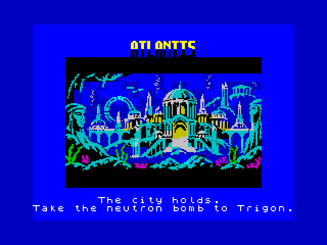
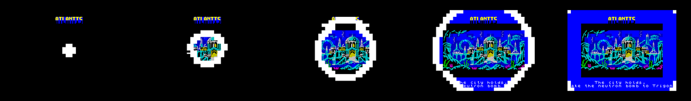

# The city interlude

Finishing the last level of Atlantis stops the game for a picture of
the city, drawn by **Erin**: the city holds, and the diver is sent on
to Trigon. The screen goes black but for ATLANTIS, and the picture's
colours come on in a circle that grows from the middle, led by a bright
white ring, until it fills the screen:

Then a chime plays (C, E, G, then a held C), the border turns the
blue of the water round the picture, and the menu's tall ATLANTIS sits
above it. A fresh key carries on at once; otherwise it stays about five
seconds. Then the next level starts as usual, with its banner and its
jingle.

## How it fits

- **The picture** is Erin's 192 x 128 city (one ink and one paper a
  cell), placed by `tools/mkcity.py` in the middle of a whole screen
  (cell rows 4 to 19, columns 4 to 27) with the game's water colour
  round it: `gfx/city.scr`. ZX0 packs it in two, the pixels (1,839
  bytes, `gfx/city_pix.zx0`) and the colours (180, `gfx/city_atr.zx0`),
  at the end of the data block. The game's own copy of the ZX0 unpacker
  puts the pixels straight onto the screen under black cells, so they
  don't show, and the colours in the free room above the data block.
- **The circle** (`il_circle`) works in half cells, so the middle of
  the screen is a whole number: a cell's distance is |2x - 31| across
  and |2y - 23| down, and it gets its own colours once the sum of their
  squares is under the circle's, or the ring's colour
  (`CFG_INTERLUDE_RIM`) just outside it. Each ring looks at all 768
  cells, about two television frames, so the whole circle takes about
  a second and a half. The ATLANTIS letters are drawn first and stay. Both files are committed, so the
  game builds without Python or `zx0`.
- **Room.** The 2-pixel diver (0.9.4) freed the data block's room the
  packed picture lives in while the game runs, and loading the tape's
  second block high (0.9.5) made the room for it on the tape.
- **Back to the game.** The screen is cleared to water, the sand's and
  the ground's rows get their colours again, and row 1 is redrawn in
  full: the score, the level, the hearts, a held special bomb or the
  double shot's bubble. The seabed's pixels come back from the scroll
  buffers over the next two steps, as every step copies them. The
  sprites keep their places and their photographs (water or seabed),
  and the bomb repaints its colours. Nothing that was going on is
  lost: the double shot's clock and the banner's are pushed on by the
  time the picture was up.
- **Settings** (`config.asm`): `CFG_INTERLUDE_LEVEL`, the level that
  ends Atlantis; `CFG_INTERLUDE_TIME`, how long it waits (1/50
  seconds); `CFG_INTERLUDE_BORDER`.
- **Code:** `src/atlantis/interlude.asm`, called by `level_up`. It runs
  once a game, but sits in the hot code, which has the room.
