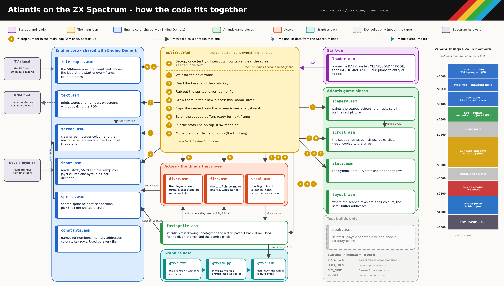

# zx-engine / Atlantis — Engine Deep Dive, V1

24 October 2026

**Matches git tag doc-v1 = commit 0066882 on main**

Source: github.com/dalixinc/zx-engine, commit `0066882b855662795ec7ca1fe3a22525ddd8e285`. Every code block is copied unchanged from that commit; the line above each block gives the file and lines.

## Contents

- [Before the stops: how to read this document](#before-the-stops-how-to-read-this-document)
- [The starting point: main.asm](#the-starting-point-main-asm)
- [Stop 1: interrupts (interrupts.asm)](#stop-1-interrupts-interrupts-asm)
- [Stop 2: the screen (screen.asm)](#stop-2-the-screen-screen-asm)
- [Stop 3: text (text.asm)](#stop-3-text-text-asm)
- [Stop 4: input (input.asm)](#stop-4-input-input-asm)
- [Stop 5: sprites](#stop-5-sprites)
- [Stop 6: scrolling (scroll.asm)](#stop-6-scrolling-scroll-asm)
- [Stop 7: the wheel bomb (wheel.asm)](#stop-7-the-wheel-bomb-wheel-asm)
- [Stop 8: measuring the time](#stop-8-measuring-the-time)
- [Tricks box](#tricks-box)
- [Appendix A: sjasmplus directives used in the repo](#appendix-a-sjasmplus-directives-used-in-the-repo)
- [Appendix B: T-state cheat sheet](#appendix-b-t-state-cheat-sheet)

# Before the stops: how to read this document

This is a guided walk through the Atlantis engine, in the order we took it in the walkthrough: first the top of `src/atlantis/main.asm`, then eight stops, one for each part of the engine. Every code block is copied straight out of the repository at commit `0066882` on `main` (the commit the `doc-v1` tag points at). The comments inside the code blocks are the repository's own comments, not added ones. The explanations are in the text around them.

A few words are used all the way through, so here they are once:

* **T-state.** One tick of the Spectrum's 3.5 MHz clock. Every instruction takes a fixed number of them, which is how we measure cost. The table in Appendix B lists the ones used most.
* **Scanline.** One line of the television picture. On a 48K Spectrum one scanline takes 224 T-states.
* **Frame.** One whole picture: 312 scanlines, which is 312 × 224 = 69,888 T-states. There are 50 frames a second. The game has to finish all its work for a picture inside one frame, or the picture is late.
* **The beam.** The television draws the picture from top to bottom, one scanline at a time. Anything we change on screen after the beam has passed that line is not seen until the next frame. Much of the engine is about staying ahead of the beam.
* **Hex.** Numbers written with a `$` in front, such as `$4000`, are in hexadecimal. `%` in front, such as `%00011000`, means binary.

The module diagram below shows how the files fit together. Each stop covers one or two of the boxes.

<figure><figcaption>Module diagram V1</figcaption></figure>

## The memory map

Everything the engine owns lives somewhere in this map. It is worth keeping in your head, because several tricks depend on where things are.

```text
  $0000 +--------------------------+
        | ROM (16K)                |  only the font at $3D00 is ever read
  $4000 +--------------------------+
        | screen pictures  6144    |  the bitmap, in its odd line order (stop 2)
  $5800 +--------------------------+
        | screen colours    768    |  one byte per 8 x 8 cell
  $5B00 +--------------------------+
        | system variables, BASIC  |  the loader lives here while loading
  $8000 +--------------------------+  CODE_START: RANDOMIZE USR 32768 lands here
        | engine code and data     |  tape build ends at $BF93, must stay
        |                          |  at or below $C000 (an ASSERT checks)
  $C000 +--------------------------+
        | free                     |
  $F000 +--------------------------+  SCROLL_BASE
        | slow seabed buffer  512  |  weed and sand, 16 rows of 32 bytes
  $F200 +--------------------------+
        | ground buffer       256  |  8 rows of 32 bytes
  $F300 +--------------------------+  free (the soak test keeps photos here)
        :                          :
  $FA00 +--------------------------+  ROW_TABLE
        | screen address of every  |  192 rows x 2 bytes = 384 bytes
        | pixel row                |
  $FB80 +--------------------------+
        :  the stack grows down    :
        :  from $FDFD towards here :
  $FDFD +--------------------------+  IM2_JP: "JP isr", 3 bytes
  $FE00 +--------------------------+  IM2_TABLE
        | 257 bytes, all $FD       |  the interrupt table (stop 1)
  $FF01 +--------------------------+
```

The memory between `$4000` and `$7FFF` is shared with the display chip, which slows the processor down whenever both want it at once. The engine code starts at `$8000` so that it always runs at full speed. The constants that name these addresses are all in one file:

<p class="src">src/constants.asm, lines 5–14</p>

```asm
; --- Memory map (see the plan Page) -----------------------------------------
SCREEN          equ $4000       ; bitmap, 6144 bytes, interleaved rows
SCREEN_SIZE     equ 6144
ATTRS           equ $5800       ; attributes, 32x24 = 768 bytes
ATTRS_SIZE      equ 768
CODE_START      equ $8000       ; engine code lives in uncontended RAM
STACK_TOP       equ $FDFD       ; first PUSH writes $FDFC/$FDFB, grows down
IM2_JP          equ $FDFD       ; JP <isr> lives here (3 bytes)
IM2_TABLE       equ $FE00       ; 257-byte vector table, all $FD
IM2_VECTOR_BYTE equ $FD         ; -> every vector reads as $FDFD
```


# The starting point: main.asm

`src/atlantis/main.asm` is the file the assembler is pointed at. Everything else comes in through it. It does four jobs: it tells the assembler what kind of machine we are building for, it sets the machine up, it runs the frame loop forever, and at the very end it writes the tape and snapshot files.

## Telling the assembler what it is building

<p class="src">src/atlantis/main.asm, lines 31–40</p>

```asm
        DEVICE ZXSPECTRUM48

        ; fish.asm reads this. See the FISH_SWIM_Y note in that file.
        DEFINE ATLANTIS

        INCLUDE "../constants.asm"
        INCLUDE "layout.asm"

        ORG CODE_START
code_start:
```

* `DEVICE ZXSPECTRUM48` tells sjasmplus to keep a picture of a 48K Spectrum's memory while it assembles. That memory picture is what `SAVETAP` and `SAVESNA` write out at the end.
* `DEFINE ATLANTIS` sets a name that other files can test. The shared files `fish.asm` and `sprite.asm` check for it, so that Atlantis gets the extra clipping code and Engine Demo 1 (which does not define it) gets exactly the bytes it always had.
* The two `INCLUDE` lines bring in the constants and the Atlantis seabed layout before any code. They only define names; they produce no bytes.
* `ORG CODE_START` says "the next byte goes at `$8000`". The label `code_start` marks that spot, so the tape writer later knows where the code block begins.

## The entry: setting the machine up

<p class="src">src/atlantis/main.asm, lines 42–74</p>

```asm
;------------------------------------------------------------------------------
; entry - RANDOMIZE USR 32768
;------------------------------------------------------------------------------
entry:
        di
        ld sp,STACK_TOP
        call im2_init
        call build_row_table

        ld a,BLACK
        call set_border
        ld a,WATER_ATTR         ; the whole screen starts as open water
        call cls

        call draw_scenery       ; seabed colours and the first copy of the strips

        ; The title is painted after the water, so its cells keep the
        ; colours print_char writes. Row 0 is left as water: that is
        ; where the stat overlay goes, and it is blank until asked for.
        ld a,TITLE_ATTR
        ld (text_attr),a
        ld hl,str_title
        ld bc,(2 << 8) | 12
        call print_string

        ld a,WATER_ATTR
        ld (text_attr),a
        ld hl,str_help
        ld bc,(4 << 8) | 6
        call print_string
        ld hl,str_stats
        ld bc,(5 << 8) | 4
        call print_string
```

In order:

1. `di` turns interrupts off. We are about to move the stack and change the interrupt system, and an interrupt arriving halfway through would crash.
2. `ld sp,STACK_TOP` puts the stack at `$FDFD`, just under our interrupt table (stop 1 explains why there).
3. `im2_init` builds the interrupt table and switches interrupts back on in mode 2 (stop 1).
4. `build_row_table` works out the screen address of all 192 pixel rows once, so that drawing code can look them up instead of calculating them (stop 2).
5. Black border, then clear the screen to the water colour, then draw the seabed.
6. Print the title and the two help lines. The pair `ld bc,(2 << 8) | 12` is just a neat way to load B = 2 (the row) and C = 12 (the column) in one instruction: `2 << 8` moves the 2 into the high byte.

After that the code falls straight into the main loop. There is no return: the game never goes back to BASIC.

## The main loop, in outline

The whole loop is one pass per television frame. Stripped of the measuring switches (stop 8), it reads like this:

```text
  main_loop:
     wait for the frame interrupt            (stop 1)
     read the stats key, read the controls   (stop 4)
     put back the background under the diver, the wheel, the fish
     wipe the stats digits if a sprite is about to photograph row 0
     draw the fish, then the wheel and its colours
     draw the diver now if he is up in the water
     put the stats digits back on top, if a sprite is on row 0
     copy the seabed onto the screen         (stop 6)
     draw the diver now if his feet are on the seabed
     rotate the ground buffer one pixel      (stop 6)
     every other frame, rotate the slow buffer one pixel
     border heartbeat, stats digits if row 0 is clear
     move the diver, the fish and the wheel  (stop 7)
     jump back to main_loop
```

The order matters a great deal, and most of the later stops explain one piece of why. The short version: everything that writes to the top of the screen happens first, while the beam is still up in the top border; the seabed copy happens before the beam reaches the bottom rows; and the thinking (moving things) comes last, because it does not touch the screen at all.

Here is the restore and draw part as it is in the file:

<p class="src">src/atlantis/main.asm, lines 161–207</p>

```asm
        ; Restore first, while the screen still matches the photographs.
        ; Draw order is fish, wheel, diver (back to front), so restore is
        ; the reverse: diver, wheel, fish. The wheel is drawn after the
        ; fish, so where they overlap its photograph contains the fish
        ; and has to be put back before the fish's is.
        ; The fish and the diver go through the tight walker. The shared
        ; routines are what Engine Demo 1 still calls.
        ; NO_WHEEL is a measurement switch, the same kind of thing as
        ; SLACK_LINES. The tape does not define it. It leaves the bomb
        ; out so the spare-scanline count can be taken with no bomb
        ; on screen.
        call diver_restore_fast
    IFNDEF NO_WHEEL
        call wheel_restore
    ENDIF
        call fish_restore_fast
        call stats_prepare      ; drop the digits if a sprite is about to
                                ; photograph row 0. Otherwise leave them:
                                ; the beam is about to read that row.
    IFDEF SOAK
        call soak_after_restore
    ENDIF

        call fish_draw_fast
    IFNDEF NO_WHEEL
        call wheel_draw         ; always above the seaweed, so always here
        ; Ink while the beam is still in the top border, so the attribute
        ; writes are not slowed by the display. The strip is only the cells
        ; that changed, which is small enough to stay ahead of the copy.
        call wheel_colours
    ENDIF
        ld a,(diver_y)
        add a,DIVER_HEIGHT - 1  ; his lowest pixel
        cp BACK_ROW * 8         ; seabed starts at row 21
        jr nc,.low
        call diver_draw_fast    ; still in open water: the copy will not touch him
.low:
        ; If a sprite is on row 0, the digits go back on top now,
        ; after the photograph and before we spend the frame on the seabed.
        ; The wheel is included: it can bob up to y = 0.
        call stats_overlay_if_row0

    IFDEF TIMING_BARS
        ld a,CYAN
        out (ULA_PORT),a
    ENDIF
        call scroll_blit        ; also paints the weed, on the full-copy frame
```

Notice the reverse order. Sprites are drawn fish, then wheel, then diver (back to front), so they are put back diver, then wheel, then fish. Stop 5 explains why that matters when two sprites overlap.

The slow layer moves every other frame. The loop flips a single bit to decide:

<p class="src">src/atlantis/main.asm, lines 229–241</p>

```asm
        ; Slow layer: every other frame. The phase flips here, not inside
        ; the shift, so the green border can be turned on only when the
        ; rotate actually runs.
        ld a,(slow_phase)
        xor 1
        ld (slow_phase),a
        jr z,.slow_done
    IFDEF TIMING_BARS
        ld a,GREEN
        out (ULA_PORT),a
    ENDIF
        call scroll_shift_slow
.slow_done:
```

`xor 1` turns 0 into 1 and 1 into 0. The zero flag tells us which way it went, so the same instruction both flips the phase and decides whether to rotate.

## The heartbeat

When the stats digits are off there is nothing on screen that changes every frame, so the border slowly cycles through colours to show the loop is alive:

<p class="src">src/atlantis/main.asm, lines 247–257</p>

```asm
    IFNDEF SOAK
        ; Heartbeat. The digits are hidden by default, so the border is
        ; what shows the frame loop is alive. rrca x3 is / BORDER_FRAMES.
        ld hl,(frame_count)
        ld a,l
        rrca
        rrca
        rrca
        call set_border
    ENDIF
    ENDIF
```

Three `rrca` instructions shift the frame counter right by three bits, which is the same as dividing by 8 (`BORDER_FRAMES`). An `ASSERT` at the bottom of the file checks that `BORDER_FRAMES` really is 8, so that nobody changes one and forgets the other.

## The end of the file: checks and output

After all the `INCLUDE` lines, the file marks the end of the code and checks a long list of facts that the code relies on:

<p class="src">src/atlantis/main.asm, lines 344–347</p>

```asm
code_end:
CODE_LENGTH     equ code_end - code_start

        DISPLAY "atlantis code_end ", code_end
```

`DISPLAY` prints a message while assembling. Here it prints the address where the code ends, so every build tells you how much room is left. At `0066882` it prints `0xBF93`: 109 bytes below the `$C000` limit.

<p class="src">src/atlantis/main.asm, lines 370–374</p>

```asm
        ASSERT code_end <= ROW_TABLE, "code has run into the row table"
        ASSERT SCROLL_BUF_END <= ROW_TABLE, "scroll buffers run into the row table"
        ASSERT (SCROLL_BASE & 255) == 0, "shift_one_row uses DEC L, so a row must not cross a page"
        ASSERT (BACK_BUF & 31) == 0, "each slow row must be 32-byte aligned"
        ASSERT (GROUND_BUF & 31) == 0, "each ground row must be 32-byte aligned"
```

Each `ASSERT` stops the build with a message if its condition is false. These are the engine's promises written down: the code must not run into the row table, and each scroll buffer row must start on a 32-byte boundary, because the rotate in stop 6 relies on it.

Finally the tape and snapshot are written, but only for the real game build. Each measuring build writes its own snapshot instead:

<p class="src">src/atlantis/main.asm, lines 404–419</p>

```asm
    IFNDEF TIMING_BARS
    IFNDEF SOAK
    IFNDEF SLACK_LINES
    IFNDEF SHOT_FRAME
        EMPTYTAP "build/atlantis.tap"
        SAVETAP  "build/atlantis.tap", BASIC, "atlantis", basic_start, BASIC_LENGTH, 10
        SAVETAP  "build/atlantis.tap", CODE, "atlantc", code_start, CODE_LENGTH
        SAVESNA  "build/atlantis.sna", entry
    ENDIF
    ENDIF
    ENDIF
    ENDIF

    IFDEF TIMING_BARS
        SAVESNA "build/atlantis-timing.sna", entry
    ENDIF
```

`EMPTYTAP` starts a fresh tape file. The first `SAVETAP` writes the BASIC loader (line 10, which runs automatically). The second writes the code block from `code_start`, `CODE_LENGTH` bytes long. `SAVESNA` writes a snapshot that starts running at `entry`. Appendix A goes through each of these directives in detail.


# Stop 1: interrupts (interrupts.asm)

## What an interrupt is for here

Fifty times a second, just as the television starts a new picture, the Spectrum's display chip taps the processor on the shoulder. The processor stops what it is doing, runs a short routine, and goes back. That tap is the only clock the game has that is locked to the picture, so the engine uses it for one thing: knowing when a new frame has started.

The Spectrum's own ROM has an interrupt routine that scans the keyboard and updates its clock. We do not want it: it takes time, and it writes to memory we may be using. So the engine switches to **interrupt mode 2**, where the processor jumps to a routine of our choosing.

## The awkward part: where mode 2 jumps

In mode 2, the processor builds a 16-bit address from two halves:

* the high half is whatever is in the `I` register, which we set;
* the low half is a byte that the hardware is supposed to put on the data bus when the interrupt happens.

The processor then reads a 2-byte address from that spot in memory and jumps to it. The problem is that a standard Spectrum puts nothing on the bus. The byte that turns up is whatever happens to be floating there, and it can be any value from 0 to 255.

The classic answer is to make the answer the same whatever byte turns up. Fill a whole 256-byte page with the same value, `$FD`. Then whichever two neighbouring bytes the processor reads, it gets `$FD` and `$FD`, which is the address `$FDFD`. Put a jump to our real routine at `$FDFD` and every interrupt ends up in the same place.

```text
   I register = $FE           floating bus byte = anything, say $37
            \                       /
             +----> $FE37 <--------+
                      |
          read 2 bytes at $FE37, $FE38:  $FD $FD
                      |
                      v
                jump to $FDFD
                      |
     $FDFD:   $C3  low(isr)  high(isr)     that is "JP isr"
                      |
                      v
                    isr
```

Why 257 bytes and not 256? If the floating byte is `$FF`, the processor reads `$FEFF` and `$FF00`. The second byte is one past the end of the page, so it has to be `$FD` too.

## im2_init

<p class="src">src/interrupts.asm, lines 9–30</p>

```asm
;------------------------------------------------------------------------------
; im2_init - build the vector table and switch to interrupt mode 2
; Corrupts: AF, BC, DE, HL
;------------------------------------------------------------------------------
im2_init:
        di
        ld hl,IM2_TABLE
        ld de,IM2_TABLE+1
        ld bc,256               ; 257 bytes total
        ld (hl),IM2_VECTOR_BYTE
        ldir

        ld a,$C3                ; JP nn opcode
        ld (IM2_JP),a
        ld hl,isr
        ld (IM2_JP+1),hl

        ld a,high IM2_TABLE
        ld i,a
        im 2
        ei
        ret
```

The filling of the table uses a well-known `ldir` trick. `ldir` copies BC bytes from where HL points to where DE points, one at a time, moving both forward. Here DE is always one byte ahead of HL. So:

```text
   before:   $FE00=$FD  $FE01=?    $FE02=?    ...
   copy 1:   $FE00 -> $FE01         now $FE01=$FD
   copy 2:   $FE01 -> $FE02         now $FE02=$FD
   ...       each copy picks up the byte the last one just wrote
```

One byte written by hand plus 256 copies is the 257 bytes. It is slow (21 T-states a byte), but it runs once at start-up, so size matters more than speed and this is about the smallest way to fill memory.

The jump is then written by hand: `$C3` is the machine code for `JP`, followed by the address of `isr`, low byte first. `ld a,high IM2_TABLE` takes the top byte of `$FE00`, which is `$FE`, and that goes into `I`. Then `im 2` switches mode and `ei` lets interrupts in.

### Why the stack starts at $FDFD

The stack is set to `STACK_TOP`, which is `$FDFD`. That looks dangerous, as the jump lives at `$FDFD`. It is safe because the Z80 stack moves down before it writes. The first `push` lowers the stack pointer to `$FDFC` and writes the high byte there, then lowers it again to `$FDFB` and writes the low byte. Nothing is ever written at `$FDFD` or above, so the three bytes of the jump and the table above them are left alone. The stack has the space below, down towards the row table at `$FB80`.

## isr: the interrupt routine

<p class="src">src/interrupts.asm, lines 32–51</p>

```asm
;------------------------------------------------------------------------------
; isr - runs once per frame (50 Hz), at the start of the top border.
; Keep it short: bump the frame counter and raise the vsync flag. Music,
; keyboard scanning, etc. can hook in here later.
;------------------------------------------------------------------------------
isr:
        push af
        push hl

        ld hl,(frame_count)
        inc hl
        ld (frame_count),hl

        ld a,1
        ld (vsync_flag),a

        pop hl
        pop af
        ei
        reti
```

It does as little as possible:

* save the two registers it uses, A (with the flags) and HL;
* add one to `frame_count`, a 16-bit counter of frames since start-up;
* set `vsync_flag` to 1, meaning "a new frame has started";
* put the registers back, turn interrupts back on, and return.

When the processor takes an interrupt it switches further interrupts off by itself, so the routine has to switch them back on with `ei`. The Z80 waits one more instruction before `ei` takes effect, so `reti` always finishes first and an interrupt can never land inside the return.

Keeping it to A and HL is a promise the rest of the engine relies on. The fast sprite code in stop 5 keeps important values in C, DE and the spare accumulator, safe in the knowledge that the interrupt routine never touches them.

`frame_count` is 16 bits, so it wraps round after 65,536 frames, which at 50 a second is about 22 minutes. Nothing depends on it not wrapping.

## wait_frame: lining the loop up with the picture

<p class="src">src/interrupts.asm, lines 53–67</p>

```asm
;------------------------------------------------------------------------------
; wait_frame - block until the next interrupt has happened
;------------------------------------------------------------------------------
wait_frame:
        xor a
        ld (vsync_flag),a
.wait:  halt
        ld a,(vsync_flag)
        or a
        jr z,.wait
        ret

; --- Interrupt state ---------------------------------------------------------
frame_count:    dw 0            ; 16-bit, wraps every ~22 minutes
vsync_flag:     db 0
```

This is the first thing the main loop calls. It clears the flag, then `halt` puts the processor to sleep until the next interrupt arrives. When it wakes, it checks that the flag really was set, and loops if not.

This is where a slow frame costs dearly. If one pass of the main loop takes longer than a frame, the interrupt for the next frame has already happened by the time `wait_frame` is called. `wait_frame` clears the flag and sleeps until the *following* interrupt. That frame is simply lost: the game drops from 50 pictures a second to 25 for that moment, and anything moving on screen stutters or flickers. Most of the later stops are about avoiding exactly that.


# Stop 2: the screen (screen.asm)

## Two separate pieces of screen memory

The Spectrum screen is 256 pixels across and 192 down. It is stored in two parts:

* **The pictures** (`$4000` to `$57FF`, 6,144 bytes). One bit per pixel: 1 means "ink", 0 means "paper". Each byte covers 8 pixels side by side, so a row of 256 pixels is 32 bytes.
* **The colours** (`$5800` to `$5AFF`, 768 bytes). One byte for each 8 × 8 cell: 32 cells across, 24 down. Each byte says which ink colour and which paper colour that whole cell uses, plus a "bright" bit and a "flash" bit.

```text
   one colour byte:   bit  7      6       5 4 3      2 1 0
                           flash  bright  paper      ink
```

This is why Spectrum games "clash": one 8 × 8 cell can only show two colours at a time. When the wheel bomb (stop 7) moves through the water it has to repaint the colour bytes of the cells it covers.

## The odd order of the pixel rows

The colours are stored in the obvious order: row 0 first, then row 1, and so on, 32 bytes each. The pictures are not. If you go down one pixel from the top-left corner, you do not move 32 bytes forward, you move 256. The screen is split into three thirds of 64 rows each, and inside a third the rows are shuffled.

The repo's comment puts it exactly:

<p class="src">src/screen.asm, lines 72–88</p>

```asm
;==============================================================================
; Pixel-row addressing
;
; The bitmap is NOT stored top-to-bottom. For a pixel row y (0-191) split into
; bits  y7 y6 | y5 y4 y3 | y2 y1 y0  the address of its leftmost byte is
;
;     H = 0 1 0 y7 y6 y2 y1 y0       L = y5 y4 y3 0 0 0 0 0
;
;   y7 y6 = which third of the screen (top, middle, bottom: 2048 bytes each)
;   y5 y4 y3 = which character row inside that third (0-7)
;   y2 y1 y0 = which pixel line inside the character cell (0-7)
;
; So moving down one pixel inside a cell is "INC H" (+256), but crossing into
; the next cell or third needs more work. Rather than handle that in every
; drawing routine, we work it out once for all 192 rows and keep a table.
; See docs/SPRITES.md for a worked example.
;==============================================================================
```

Here is what that means on the screen:

```text
   pixel row y     address        why
   -----------     -------        ---
   0               $4000          third 0, character row 0, line 0
   1               $4100          line 1 of the same cell: +256
   2               $4200
   ...
   7               $4700          last line of the first cell row
   8               $4020          next character row: back to $40, +32
   9               $4120
   ...
   63              $47E0          last row of the top third
   64              $4800          middle third starts: +2048 from $4000
   128             $5000          bottom third starts
   191             $57E0          last row
```

So "go down one pixel" is very cheap (`inc h`, add 256) as long as you stay inside one character cell, but every 8 rows you have to step back and add 32 instead, and every 64 rows the third changes. The fast code in stop 5 deals with this by hand. Everything else uses a table.

## Clearing the screen and the border

<p class="src">src/screen.asm, lines 5–30</p>

```asm
;------------------------------------------------------------------------------
; cls - clear bitmap to 0 and fill attributes with A
; In:  A = attribute byte
; Corrupts: AF, BC, DE, HL
;------------------------------------------------------------------------------
cls:
        ld hl,ATTRS
        ld de,ATTRS+1
        ld bc,ATTRS_SIZE-1
        ld (hl),a
        ldir

        ld hl,SCREEN
        ld de,SCREEN+1
        ld bc,SCREEN_SIZE-1
        ld (hl),0
        ldir
        ret

;------------------------------------------------------------------------------
; set_border - In: A = colour 0-7. Corrupts: AF
;------------------------------------------------------------------------------
set_border:
        and 7
        out (ULA_PORT),a
        ret
```

`cls` uses the same "copy a byte onto its neighbour" `ldir` trick as the interrupt table in stop 1, once for the colours and once for the pictures.

The border is just the bottom three bits of port `$FE`. `out (ULA_PORT),a` changes it immediately, part way along the scanline the beam is on, which is exactly what makes the timing bars in stop 8 possible.

## Finding a character cell

<p class="src">src/screen.asm, lines 32–70</p>

```asm
;------------------------------------------------------------------------------
; char_addr - bitmap address of the top pixel row of a character cell
; In:  B = row (0-23), C = column (0-31)
; Out: HL = screen address
; Layout: H = 010 RR 000 (RR = row/8 third), L = rrr CCCCC (rrr = row & 7)
; Corrupts: AF
;------------------------------------------------------------------------------
char_addr:
        ld a,b
        and %00011000
        or high SCREEN
        ld h,a
        ld a,b
        and %00000111
        rrca
        rrca
        rrca                    ; rrr into bits 7-5
        or c
        ld l,a
        ret

;------------------------------------------------------------------------------
; attr_addr - attribute address of a character cell
; In:  B = row, C = column.  Out: HL = $5800 + row*32 + col.  Corrupts: AF
;------------------------------------------------------------------------------
attr_addr:
        ld a,b
        rrca
        rrca
        rrca                    ; row*32: low 3 bits -> bits 7-5, high 2 -> 1-0
        ld l,a
        and %00000011
        or high ATTRS
        ld h,a
        ld a,l
        and %11100000
        or c
        ld l,a
        ret
```

Both routines take B = row (0 to 23) and C = column (0 to 31).

For the picture address, the row number splits into two parts: the top two bits say which third, and the bottom three say which character row inside it. `char_addr` puts the third into H and the character row into the top of L. Three `rrca` instructions move bits 2, 1, 0 up to bits 7, 6, 5 (rotating right three times is rotating left five).

For the colour address we need `$5800 + row × 32`. Multiplying by 32 is shifting left 5 places, and the trick is the same three `rrca`:

```text
   row (0-23)                  0  0  0  r4 r3 r2 r1 r0
   after rrca x3               r2 r1 r0 0  0  0  r4 r3
                               \______/          \___/
                               goes in L         goes in H
                               bits 7-5          bits 1-0
```

`row × 32` has r4 r3 in the high byte and r2 r1 r0 at the top of the low byte, so one rotate gives both halves; `and` picks them apart.

## Finding any pixel row

`screen_row_addr` follows the comment block above, building H from two pieces of y and L from a third:

<p class="src">src/screen.asm, lines 90–119</p>

```asm
;------------------------------------------------------------------------------
; screen_row_addr - address of the leftmost byte of pixel row y
; In:  A = y (0-191)
; Out: HL = screen address
; Corrupts: AF, C
;------------------------------------------------------------------------------
screen_row_addr:
        ld c,a                  ; keep y; we need three different slices of it

        ; H, part 1: y2 y1 y0 (line within the cell) go in H bits 2-0
        and %00000111
        ld h,a

        ; H, part 2: y7 y6 (which third) go in H bits 4-3
        ld a,c
        and %11000000           ; y7 y6 in bits 7-6
        rrca
        rrca
        rrca                    ; now in bits 4-3
        or h
        or high SCREEN          ; + $40 -> 010 in bits 7-5
        ld h,a

        ; L: y5 y4 y3 (character row within the third) go in L bits 7-5
        ld a,c
        and %00111000           ; y5 y4 y3 in bits 5-3
        rlca
        rlca                    ; now in bits 7-5; bits 4-0 (column) are 0
        ld l,a
        ret
```

It is about 100 T-states. That is fine once, but a sprite 16 rows tall would pay it 16 times, so the engine works it out once for every row and keeps the answers.

## The row table

<p class="src">src/screen.asm, lines 121–144</p>

```asm
;------------------------------------------------------------------------------
; build_row_table - fill ROW_TABLE with the address of every pixel row
; Run once at start-up. Afterwards, the address of row y is the word at
; ROW_TABLE + y*2, and the byte at column c (0-31) is that address + c.
; Corrupts: AF, BC, DE, HL
;------------------------------------------------------------------------------
build_row_table:
        ld de,ROW_TABLE
        ld b,0                  ; B = y, counting 0..191
.next:  ld a,b
        push bc
        call screen_row_addr    ; HL = address of row y
        pop bc
        ex de,hl                ; HL -> table entry, DE = address
        ld (hl),e               ; store little-endian (low byte first)
        inc hl
        ld (hl),d
        inc hl
        ex de,hl                ; DE -> next table entry again
        inc b
        ld a,b
        cp 192
        jr nz,.next
        ret
```

After start-up, `ROW_TABLE` (at `$FA00`) holds 192 two-byte addresses, the low byte first as the Z80 always stores them. The address of row y is the word at `$FA00 + y × 2`. To reach column c, add c to the low byte; a row never crosses a 256-byte boundary, so the high byte never changes.

<p class="src">src/screen.asm, lines 146–161</p>

```asm
;------------------------------------------------------------------------------
; row_table_entry - point IX at the table entry for pixel row y
; In:  A = y.  Out: IX -> ROW_TABLE + y*2.  Corrupts: AF, DE, HL
; IX is used so that (ix+0)/(ix+1) read the two address bytes and the caller
; can step to the next row with two INC IX, leaving HL and DE free for the
; actual drawing. (IX is slower than HL, but there aren't enough registers.)
;------------------------------------------------------------------------------
row_table_entry:
        ld l,a                  ; HL = y
        ld h,0
        add hl,hl               ; * 2, because each entry is a 16-bit word
        ld de,ROW_TABLE
        add hl,de
        push hl                 ; there is no "LD IX,HL", so go via the stack
        pop ix
        ret
```

`row_table_entry` points IX at a table entry. There is no instruction that copies HL into IX, so it goes through the stack: `push hl` then `pop ix`, 25 T-states for the pair. IX is slower to use than HL, but its `(ix+0)` and `(ix+1)` forms read both address bytes without disturbing HL or DE, which the drawing loop needs for the sprite and the screen.


# Stop 3: text (text.asm)

The engine prints the title, the help lines and the stats digits without calling anything in the ROM. It only reads the ROM's font, which is a block of 96 characters, 8 bytes each, one byte for each pixel row of the letter.

## Where the font is

<p class="src">src/constants.asm, lines 16–20</p>

```asm
; --- Font --------------------------------------------------------------------
; The 48K ROM font lives at $3D00 (char 32 = space). We only READ the glyph
; bytes; no ROM routines are called. Point FONT_BASE at your own 96-char,
; 8-bytes-per-glyph font later and nothing else needs to change.
FONT_BASE       equ $3D00 - 32*8
```

The ROM keeps its font at `$3D00`, but the first character in it is the space, character 32. Rather than subtract 32 every time we print, `FONT_BASE` is set 32 × 8 = 256 bytes earlier, at `$3C00`. Then "character code × 8 + `FONT_BASE`" lands on the right letter straight away. (Nothing ever reads the bytes between `$3C00` and `$3D00` through this, as we never print a code below 32.)

## print_char

<p class="src">src/text.asm, lines 5–38</p>

```asm
;------------------------------------------------------------------------------
; print_char - draw one character
; In:  A = ASCII code (32-127), B = row, C = column, (text_attr) = colour
; Out: C advanced by one column
; Corrupts: AF, DE, HL
;------------------------------------------------------------------------------
print_char:
        push bc
        ; DE = FONT_BASE + A*8
        ld l,a
        ld h,0
        add hl,hl
        add hl,hl
        add hl,hl
        ld de,FONT_BASE
        add hl,de
        ex de,hl                ; DE -> glyph

        call char_addr          ; HL -> screen
        ld b,8
.row:   ld a,(de)
        ld (hl),a
        inc de
        inc h                   ; next pixel row inside a cell is +256
        djnz .row
        pop bc

        push bc
        call attr_addr
        ld a,(text_attr)
        ld (hl),a
        pop bc
        inc c
        ret
```

1. Multiply the character code by 8 with three `add hl,hl` (each doubles HL), add `FONT_BASE`, and move the result into DE.
2. `char_addr` (stop 2) gives the screen address of the top row of the cell.
3. Copy 8 bytes. Between each, `inc de` steps to the next font byte and `inc h` steps down one pixel row. All 8 rows of one cell are exactly 256 bytes apart, so `inc h` is all it takes; we never cross into the next cell.
4. Write the colour byte for the cell from `text_attr`, and move C one column right, ready for the next character.

## print_string

<p class="src">src/text.asm, lines 40–53</p>

```asm
;------------------------------------------------------------------------------
; print_string - draw a zero-terminated string
; In:  HL -> string, B = row, C = column
; Corrupts: AF, DE, HL, C
;------------------------------------------------------------------------------
print_string:
.next:  ld a,(hl)
        or a
        ret z
        inc hl
        push hl
        call print_char
        pop hl
        jr .next
```

Strings end with a 0 byte. `or a` sets the zero flag only when A is 0, which is the cheapest way to test for the end. `print_char` moves C along, so the column advances for free.

## print_hex8 and print_hex16

These print the stats digits, which change every frame, so they are written to be fast:

<p class="src">src/text.asm, lines 55–110</p>

```asm
;------------------------------------------------------------------------------
; print_hex8 / print_hex16 - print A or HL as hex at B,C
; Corrupts: AF, DE, HL. C advances by 2 (or 4 for print_hex16).
;
; This does not go through print_char. print_char also writes the attribute
; byte, and the debug line prints 16 digits every frame. That extra work,
; on top of the sprites and the scrolling ground, ran past the next
; interrupt, so the game dropped to 25 frames a second (see
; docs/SCROLLING.md). The digit cells are already the right colour: cls
; paints the screen white-on-black, which is the same pen these digits use.
; Writing the picture is enough. The copy is unrolled for the same reason
; the ground copy is: DJNZ was costing more than the byte it copied.
;------------------------------------------------------------------------------
print_hex16:
        push hl
        ld a,h
        call print_hex8
        pop hl
        ld a,l
        ; fall through
print_hex8:
        push af
        rrca
        rrca
        rrca
        rrca
        call .nibble
        pop af
.nibble:
        and $0F
        add a,'0'
        cp '9'+1
        jr c,.glyph
        add a,'A'-'9'-1
.glyph:
        push bc
        ld l,a
        ld h,0
        add hl,hl
        add hl,hl
        add hl,hl               ; *8, bytes per glyph
        ld de,FONT_BASE
        add hl,de
        ex de,hl                ; DE -> glyph
        call char_addr          ; HL -> top pixel row of the cell
        dup 8
        ld a,(de)
        ld (hl),a
        inc de
        inc h                   ; next pixel row inside this cell
        edup
        pop bc
        inc c
        ret

text_attr:      db WHITE | (BLACK << 3)
```

* **One routine for 16 bits.** `print_hex16` prints the high byte with a call, then simply carries on into `print_hex8` for the low byte. "Fall through" saves a call and a return.
* **Two digits from one byte.** Four `rrca` move the top four bits down to the bottom. `call .nibble` prints that digit; when it returns, `pop af` brings the original back and execution runs into `.nibble` again for the low four bits. The final `ret` of `.nibble` is the return from `print_hex8` itself.
* **Turning 0 to 15 into a character.** Add the code for `'0'`. If the result is past `'9'`, add 7 more, because in the character set `'A'` is 7 places after the character that follows `'9'`:

```text
   value   '0' + value   past '9'?   add 7   printed
   3       '3'           no                  3
   9       '9'           no                  9
   10      ':'           yes         'A'     A
   15      '?'           yes         'F'     F
```

* **No colour write, and no loop.** The comment explains why. `dup 8` ... `edup` makes the assembler write the four instructions inside it 8 times in a row, so there is no `djnz` (13 T-states each time round) to pay. Appendix A covers `dup`.

`text_attr` is the colour used by `print_char`: white ink on black paper, `WHITE | (BLACK << 3)`. Paper sits three bits up in the colour byte, hence the `<< 3`.


# Stop 4: input (input.asm)

## One byte for all the controls

Whatever the player uses, the rest of the engine only ever looks at one byte, `input_state`. It is laid out exactly like the Kempston joystick's own byte, so the joystick can be added in with a single `or`:

<p class="src">src/constants.asm, lines 45–61</p>

```asm
; --- Input -------------------------------------------------------------------
; One byte of flags, laid out like the Kempston joystick so a joystick read
; can be OR-ed straight in. A set bit means "pressed".
IN_RIGHT_BIT    equ 0
IN_LEFT_BIT     equ 1
IN_DOWN_BIT     equ 2
IN_UP_BIT       equ 3
IN_FIRE_BIT     equ 4
IN_RIGHT        equ 1 << IN_RIGHT_BIT
IN_LEFT         equ 1 << IN_LEFT_BIT
IN_DOWN         equ 1 << IN_DOWN_BIT
IN_UP           equ 1 << IN_UP_BIT
IN_FIRE         equ 1 << IN_FIRE_BIT
IN_MASK         equ %00011111

KEMPSTON_PORT   equ $1F         ; 000FUDLR, active high
KEMPSTON_FLOAT  equ %11100000   ; any of these set -> no interface fitted
```

```text
   bit       7  6  5   4      3    2      1      0
   meaning   0  0  0   fire   up   down   left   right       1 = pressed
```

## How the keyboard is read

The 40 keys are wired as 8 groups of 5, called half-rows. To read one group you read port `$FE` with that group's selector in the high byte of the address. Each selector has one bit at 0, which picks the group:

<p class="src">src/constants.asm, lines 63–72</p>

```asm
; Keyboard half-rows: the high byte put on the address bus when reading $FE.
; A key reads as 0 in bits 0-4 (bit 0 = key nearest the outside edge).
ROW_CAPS_V      equ $FE         ; CAPS Z X C V
ROW_A_G         equ $FD         ; A S D F G
ROW_Q_T         equ $FB         ; Q W E R T
ROW_1_5         equ $F7         ; 1 2 3 4 5
ROW_0_6         equ $EF         ; 0 9 8 7 6
ROW_P_Y         equ $DF         ; P O I U Y
ROW_ENT_H       equ $BF         ; ENTER L K J H
ROW_SPC_B       equ $7F         ; SPACE SYM M N B
```

The five keys of the group come back in bits 0 to 4, with **0 meaning pressed**. Bit 0 is the key nearest the edge of the keyboard (for example, in the `P O I U Y` group, P is bit 0 and O is bit 1).

The Z80 instruction `in a,(c)` puts all of BC on the address bus, so B carries the selector and C carries the port, `$FE`.

## The key tables

<p class="src">src/input.asm, lines 78–96</p>

```asm
; --- Key tables (order: FIRE, UP, DOWN, LEFT, RIGHT) ------------------------
keys_primary:                   ; defaults: SPACE, Q, A, O, P
        db ROW_SPC_B, %00001    ; SPACE
        db ROW_Q_T,   %00001    ; Q
        db ROW_A_G,   %00001    ; A
        db ROW_P_Y,   %00010    ; O
        db ROW_P_Y,   %00001    ; P
keys_alt:                       ; cursor keys / Sinclair-ish: 0, 7, 6, 5, 8
        db ROW_0_6,   %00001    ; 0
        db ROW_0_6,   %01000    ; 7
        db ROW_0_6,   %10000    ; 6
        db ROW_1_5,   %10000    ; 5
        db ROW_0_6,   %00100    ; 8

; --- Input state -------------------------------------------------------------
input_state:    db 0            ; combined flags this frame
input_prev:     db 0            ; combined flags last frame
input_keys:     db 0            ; keyboard only (debug)
input_joy:      db 0            ; Kempston only (debug)
```

Each control has two bytes: which half-row, and which bit inside it. They are always in the order fire, up, down, left, right. There are two sets: Q, A, O, P and Space, and the number keys 0, 7, 6, 5, 8 (the Sinclair cursor key layout: 5 is left, 6 down, 7 up, 8 right, 0 fire). They are stored in ordinary memory, so a "define keys" screen could later just write new values over `keys_primary`.

## read_key_table: turning five keys into five bits

<p class="src">src/input.asm, lines 39–57</p>

```asm
;------------------------------------------------------------------------------
; read_key_table - In: HL -> 5-entry key table. Out: E = flags. Corrupts: AF,BC,HL
;------------------------------------------------------------------------------
read_key_table:
        ld e,0
        ld b,5
.key:   push bc
        ld b,(hl)               ; half-row select on A8-A15
        inc hl
        ld c,ULA_PORT
        in a,(c)                ; 0 = pressed
        cpl
        and (hl)                ; isolate this key -> non-zero if pressed
        inc hl
        add a,$FF               ; carry = (a != 0)
        rl e
        pop bc
        djnz .key
        ret
```

For each of the five entries:

1. `in a,(c)` reads the half-row. `cpl` flips every bit, so now 1 means pressed.
2. `and (hl)` keeps only this key's bit. A is now 0 if the key is up and not 0 if it is down.
3. `add a,$FF` is the neat part. Adding 255 to anything except 0 overflows past 255 and sets the carry flag; adding it to 0 does not. So carry now means "this key is pressed".
4. `rl e` shifts E left one place and drops the carry into bit 0.

After five rounds the first key read (fire) has been pushed up to bit 4 and the last (right) is in bit 0, which is exactly the Kempston layout:

```text
   after fire     E = 0 0 0 0 0 0 0 F
   after up       E = 0 0 0 0 0 0 F U
   after down     E = 0 0 0 0 0 F U D
   after left     E = 0 0 0 0 F U D L
   after right    E = 0 0 0 F U D L R
```

## read_input and the joystick

<p class="src">src/input.asm, lines 13–37</p>

```asm
;------------------------------------------------------------------------------
; read_input - sample everything once; call once per frame
; Out: A = (input_state) = combined flags, also input_keys / input_joy set
;      (input_prev) = last frame's flags, for edge detection
; Corrupts: AF, BC, DE, HL
;------------------------------------------------------------------------------
read_input:
        ld a,(input_state)
        ld (input_prev),a

        ld hl,keys_primary
        call read_key_table
        ld d,e                  ; D = primary keys
        ld hl,keys_alt
        call read_key_table     ; E = alternative keys (D untouched)
        ld a,d
        or e
        ld (input_keys),a

        call read_kempston
        ld (input_joy),a
        ld hl,input_keys
        or (hl)
        ld (input_state),a
        ret
```

<p class="src">src/input.asm, lines 59–76</p>

```asm
;------------------------------------------------------------------------------
; read_kempston - Out: A = joystick flags, or 0 if no interface.
; With nothing on port $1F the bus floats (often $FF); a real Kempston
; always returns bits 5-7 clear, so any of them set means "not fitted".
; Corrupts: AF
;------------------------------------------------------------------------------
read_kempston:
        in a,(KEMPSTON_PORT)
        bit 7,a
        jr nz,.none
        bit 6,a
        jr nz,.none
        bit 5,a
        jr nz,.none
        and IN_MASK
        ret
.none:  xor a
        ret
```

The two key tables are read and combined with `or`, so either set works, or both at once. Then the joystick.

Reading a Kempston port that is not there is a problem: with nothing plugged in, the value read is whatever happens to be floating on the bus, often `$FF`, which would look like every direction pressed at once. A real Kempston always returns 0 in its top three bits. So if any of bits 5, 6 or 7 are set, the routine decides there is no joystick and returns 0.

Before anything is read, last frame's value is copied into `input_prev`. Comparing the two tells you whether a button has just gone down this frame, rather than being held. The stats key (Symbol Shift with S, stop 8) uses the same idea with its own remembered value, `stats_chord_prev` in `stats.asm`, so that one press turns the stats on and holding the keys does not flick them on and off 50 times a second.


# Stop 5: sprites

A sprite is anything that moves over the background: the diver, the fish, the wheel bomb. The Spectrum has no hardware for this. Every frame the engine has to rub the sprite out, put back whatever was under it, and draw it again somewhere new, all by copying bytes. This stop has three parts: the ideas, in the shared file `src/sprite.asm`; how a sprite slides off the edge of the screen; and the faster copy Atlantis uses, in `src/atlantis/fastsprite.asm`.

## Part 1: the ideas (sprite.asm)

The file opens with the whole technique in one comment, which is worth reading in full:

<p class="src">src/sprite.asm, lines 1–69</p>

```asm
;==============================================================================
; sprite.asm - masked, pre-shifted software sprites of any width
;
; TECHNIQUE (full walk-through in docs/SPRITES.md)
;
; 1. Pre-shifted images. A sprite at pixel x starts in screen column x/8 and
;    is offset x AND 7 pixels into that byte. tools/gfx2asm.py stores 8 copies
;    of every frame, already shifted by 0..7. Drawing is then a plain byte
;    copy: no bit-shifting at run time.
;
;    Width: a sprite W pixels wide is W/8 + 1 bytes wide in every copy.
;    The extra byte is there because shifting right by 1..7 pushes the
;    rightmost pixels into the next byte along. (At shift 0 that byte is
;    empty, but every copy is kept the same size so the loops below don't
;    care which shift they are drawing.) The fish: 16 px -> 3 bytes. The
;    diver: 24 px -> 4 bytes. The routines here take that byte count as a
;    parameter ("bytes per row"), so one set of routines serves both.
;
; 2. Masking. Each image byte comes as a pair (mask, data):
;        screen = (screen AND mask) OR data
;    Mask bits are 1 where the background must survive, 0 where the sprite
;    is solid.
;
; 3. Save / restore background. Before drawing we copy the screen bytes the
;    sprite is about to cover into that sprite's own "background record"
;    (see below). Next frame we copy them back, which erases the sprite and
;    repairs the scenery in one go.
;
; PER FRAME, for one sprite, straight after HALT:
;        sprite_restore_bg  -> sprite_set_pos -> sprite_save_bg -> sprite_draw
; With several sprites: restore ALL of them first, in the REVERSE order they
; were drawn, then save+draw each in turn (see main_loop). Reverse order
; matters when they overlap: the one drawn last saved a background that
; contained the earlier sprites, so it must be put back first.
;
; The scrolling strips are copied onto the screen after every restore
; (main_loop). A sprite that overlaps a strip is saved and drawn AFTER the
; copy, so the record holds this frame's ground and not the sprite itself
; (saving while it is still drawn would put its own pixels back next frame).
; A sprite that stays in the water is drawn BEFORE the copy: the copy does
; not touch those rows, and drawing it earlier keeps the beam from catching
; it. The demo skips the far strip's copy on a prepare frame, because that
; buffer was not rotated after the previous copy and the screen already
; matches it. Atlantis copies its (shorter) strips every frame. Either way
; the save is after the copy when the sprite overlaps a strip.
; docs/SCROLLING.md has both orders.
;
; BACKGROUND RECORD - one per sprite, pointed to by IY:
;        IY+BG_VALID   0 until the first save (so the first restore is skipped)
;        IY+BG_Y       pixel row it was saved from
;        IY+BG_COL     screen column (0-31)
;        IY+BG_HEIGHT  rows saved
;        IY+BG_BYTES   bytes per row saved
;        IY+BG_DATA... the saved screen bytes, BG_BYTES x BG_HEIGHT of them
; Declare one with   my_bg: ds BG_DATA + bytes * height   (ds fills with 0,
; so BG_VALID starts at 0). IY is used because (iy+n) lets us reach each
; field by name without disturbing HL/DE, which do the copying.
;
; LIMITS: sprite_set_pos / sprite_draw still require the sprite fully on
; screen. x no more than 256 - bytes*8 + 7, so every byte of a shifted row
; stays on that screen line, and y within 0..192-height. The diver and the
; fish use that path, and it is the path Engine Demo 1 ships.
;
; Horizontal clipping (a sprite sliding off the left or the right edge) is
; sprite_set_pos_x / sprite_draw_clip, further down. Those two are assembled
; for Atlantis only. The demo never places a sprite past the edge, and its
; tape is frozen, so the bytes above this comment are the demo's bytes.
; Vertical clipping is not done: callers keep y on screen.
;==============================================================================
```

### Pre-shifted images

A byte on screen covers 8 pixels. If a sprite sits at x = 13, it starts in column 1 (13 ÷ 8) and 5 pixels into that byte (the low three bits of 13 are 5). Shifting the picture 5 pixels at draw time would mean rotating every byte, which is slow. So the tool that converts the drawings, `tools/gfx2asm.py`, stores eight copies of every frame, already shifted by 0 to 7 pixels. Drawing becomes a plain copy.

```text
   a 16-pixel-wide picture, shifted by 5:

   screen column      1          2          3
                  +--------+--------+--------+
   shift 0        |XXXXXXXX|XXXXXXXX|........|     needs 2 bytes
   shift 5        |.....XXX|XXXXXXXX|XXXXX...|     needs 3 bytes
                  +--------+--------+--------+
                   pixels pushed right spill into a third byte
```

That spill is why a sprite W pixels wide is stored W ÷ 8 + 1 bytes wide in the shared code.

### Masks

If the sprite were simply copied over the screen, its square outline would wipe out the background. Each image byte comes with a mask byte, and drawing one byte is:

```text
   new screen byte  =  (old screen byte  AND  mask)  OR  data

   old screen   1 0 1 1 0 1 1 0        (seaweed)
   mask         1 1 0 0 0 0 1 1        1 = let the background show
   AND gives    1 0 0 0 0 0 1 0
   data         0 0 1 1 1 1 0 0        1 = sprite ink
   OR gives     1 0 1 1 1 1 1 0        weed at the edges, sprite in the middle
```

The mask can also make a pixel solid paper (mask 0, data 0), which keeps a sprite readable over busy scenery.

### The background record

Before the sprite is drawn, the bytes it is about to cover are copied into its own record. Next frame they are copied back, which rubs out the sprite and repairs the scenery in one go. The record also remembers where it came from:

<p class="src">src/sprite.asm, lines 71–76</p>

```asm
BG_VALID        equ 0
BG_Y            equ 1
BG_COL          equ 2
BG_HEIGHT       equ 3
BG_BYTES        equ 4
BG_DATA         equ 5           ; size of the header; saved bytes follow
```

```text
   record:  +0 valid   +1 row   +2 column   +3 height   +4 bytes   +5 the saved bytes...
```

IY points at the record, so each field can be reached by name, as `(iy+BG_COL)` and so on, without using HL or DE, which are busy copying.

A record is declared with `ds`, which fills with zeros, so "valid" starts at 0 and the first restore is skipped. The wheel's record, in `wheel.asm`, is exactly the pattern the comment gives:

<p class="src">src/atlantis/wheel.asm, line 1056</p>

```asm
wheel_bg:       ds BG_DATA + WHEEL_BYTES * WHEEL_HEIGHT
```

### Why restores go in reverse order

```text
   draw order:     fish, then wheel, then diver
   diver's photo:  taken after the fish and the wheel were drawn, so it
                   may contain bits of them
   restore order:  diver first (puts back the fish and wheel bits it hid),
                   then wheel, then fish (back to the true background)
```

Doing it the other way round would paint pieces of an old fish back onto the screen after the fish had already been rubbed out.

### Setting the position

<p class="src">src/sprite.asm, lines 78–103</p>

```asm
;------------------------------------------------------------------------------
; sprite_set_pos - work out where the next sprite goes
; In:  B = y (top pixel row), C = x, D = bytes per row (e.g. FISH_BYTES),
;      E = height in pixel rows
; Out: spr_y, spr_col (x / 8), spr_shift (x AND 7), spr_bytes, spr_height
; Corrupts: AF
;------------------------------------------------------------------------------
sprite_set_pos:
        ld a,b
        ld (spr_y),a
        ld a,d
        ld (spr_bytes),a
        ld a,e
        ld (spr_height),a

        ld a,c
        and %00000111           ; pixel offset inside the byte -> which copy
        ld (spr_shift),a

        ld a,c
        rrca                    ; x / 8 = screen column. RRCA x3 then mask
        rrca                    ; off the 3 bits that rotated round to the
        rrca                    ; top (Z80 has no single "shift by 3").
        and %00011111
        ld (spr_col),a
        ret
```

`x and 7` picks which of the eight shifted copies to draw. `x ÷ 8` is the column. The Z80 cannot shift by three places in one go, so it rotates three times and then throws away the three bits that came round to the top with `and %00011111`.

### The save, the restore and the draw

<p class="src">src/sprite.asm, lines 105–157</p>

```asm
;------------------------------------------------------------------------------
; sprite_save_bg - copy the screen bytes under the sprite into a record
; In:  IY -> this sprite's background record; position from sprite_set_pos
; Corrupts: AF, BC, DE, HL, IX
;
; Loop shape (also used by restore and draw):
;   outer loop: one pass per pixel row, B counts rows, C = column
;   inner loop: one pass per byte across, B counts bytes
; Both loops want B for DJNZ, so the outer B/C are PUSHed at the start of
; each row and POPped at the end. That is the standard Z80 way to nest two
; DJNZ loops; it costs 21 T-states per row.
;------------------------------------------------------------------------------
sprite_save_bg:
        ; note where this background came from, for the restore
        ld a,(spr_y)
        ld (iy+BG_Y),a
        call row_table_entry    ; IX -> address of the top row
        ld a,(spr_col)
        ld (iy+BG_COL),a
        ld c,a                  ; C = column, added to every row address
        ld a,(spr_bytes)
        ld (iy+BG_BYTES),a
        ld a,(spr_height)
        ld (iy+BG_HEIGHT),a
        ld b,a                  ; B = rows to do

        push iy                 ; DE = IY + BG_DATA, where the bytes go.
        pop de                  ; (no "LD DE,IY": go via the stack)
        ld hl,BG_DATA
        add hl,de
        ex de,hl

.row:   ld a,(ix+0)             ; HL = row address + column
        add a,c                 ; (can't carry: low 5 bits of a row address
        ld l,a                  ;  are 0 and the column fits in them)
        ld h,(ix+1)

        push bc                 ; keep row count + column
        ld a,(iy+BG_BYTES)
        ld b,a
.byte:  ld a,(hl)               ; screen -> buffer
        ld (de),a
        inc de
        inc l                   ; next byte along (same row: L never wraps
        djnz .byte              ;  because the sprite stays on screen)
        pop bc

        inc ix                  ; next table entry = next pixel row
        inc ix
        djnz .row

        ld (iy+BG_VALID),1
        ret
```

Every routine has the same shape: an outer loop for each pixel row, an inner loop for each byte across. Both want B for `djnz`, so the outer count is pushed at the start of each row and popped at the end. For each row the screen address comes from the row table (stop 2) through IX, plus the column.

<p class="src">src/sprite.asm, lines 217–272</p>

```asm
;------------------------------------------------------------------------------
; sprite_draw - draw a masked sprite at the position from sprite_set_pos
; In:  HL -> table of 8 image pointers (one per shift), from sprite_image
; Corrupts: AF, BC, DE, HL, IX
;
; Register plan inside the loop:
;   HL -> image bytes (mask, data, mask, data, ...)
;   DE -> screen byte being drawn
;   IX -> row table entry,  B = rows left (outer) / bytes left (inner),
;   C = column
; The screen pointer is in DE (not HL) because the Z80 can only do
; AND (HL) / OR (HL), not AND (DE): the image is what we AND and OR with.
;------------------------------------------------------------------------------
sprite_draw:
        ; pick the copy for this shift: HL = word at HL + shift*2
        ld a,(spr_shift)
        add a,a
        ld e,a
        ld d,0
        add hl,de
        ld e,(hl)
        inc hl
        ld d,(hl)
        ex de,hl                ; HL -> image for this shift

        ld a,(spr_y)
        push hl
        call row_table_entry    ; (corrupts HL and DE, so keep HL safe)
        pop hl
        ld a,(spr_col)
        ld c,a
        ld a,(spr_height)
        ld b,a

.row:   ld a,(ix+0)             ; DE = row address + column
        add a,c
        ld e,a
        ld d,(ix+1)

        push bc
        ld a,(spr_bytes)
        ld b,a
.byte:  ld a,(de)               ; background
        and (hl)                ; mask: clear where the sprite is solid
        inc hl
        or (hl)                 ; data: set the ink pixels
        inc hl
        ld (de),a
        inc e
        djnz .byte
        pop bc

        inc ix
        inc ix
        djnz .row
        ret
```

The screen is in DE and the image in HL, because the Z80 has `and (hl)` and `or (hl)` but no `and (de)`. Whatever we are combining with must be in HL.

The cost of one masked byte in that inner loop is:

```text
   ld a,(de)    7
   and (hl)     7
   inc hl       6
   or (hl)      7
   inc hl       6
   ld (de),a    7
   inc e        4
   djnz        13
               --
               57 T-states
```

Plus, for every row, the table lookup through IX and the push and pop. This is clear and works for any size, and the diver and the fish in Engine Demo 1 still use it. Part 3 explains why it was too slow for Atlantis.

## Part 2: sliding off the edge (clipping)

The wheel bomb enters from the right and leaves on the left, so it has to be drawn half on and half off the screen. The shared routines above refuse to do that. `sprite.asm` has a second pair, assembled only when `ATLANTIS` is defined:

<p class="src">src/sprite.asm, lines 281–336</p>

```asm
;------------------------------------------------------------------------------
; Horizontal edge clipping. Atlantis only.
;
; Engine Demo 1 does not DEFINE ATLANTIS, so none of this is in diver.tap.
; The routines above are untouched, which is what keeps that tape identical.
;
; A sprite's x may now be negative (hanging off the left) or 256 and above
; (hanging off the right). The pre-shifted copies are unchanged. The same
; rule as a positive x still picks the copy:
;
;   shift  = the low 3 bits of x          (x AND 7, which is right for a
;                                          negative x too: -1 has low bits 7)
;   column = floor(x / 8), signed         (so -1 is column -1, shift 7)
;
; Bytes that would land in column -1 or column 32 are not written. The
; background record then holds only the columns that were actually on
; screen, because sprite_save_bg stores spr_col and spr_bytes and those
; two are set to the VISIBLE column and the VISIBLE count. Restore is the
; ordinary sprite_restore_bg: it puts back exactly what was saved, so a
; half-off-screen sprite does not smear into the line above or below, and
; it does not leave a copy of itself in the margin.
;
; When nothing at all is on screen, spr_hidden is 1. The caller must not
; save or draw, and must clear BG_VALID. The restore at the start of the
; frame has already erased the previous position. Leaving VALID set would
; paint that old photograph a second time, on top of whatever is there now.
;
; Drawing. If the sprite is fully on screen, sprite_draw_clip jumps to
; sprite_draw. The test costs about 70 T-states (a third of a scanline)
; and the byte loop is the original one. While it is clipped, each row
; adds the hidden image bytes onto HL so the next row starts in the right
; place. That add is:
;
;   ld a,(spr_gap2)   ; 13
;   add a,l           ;  4
;   ld l,a            ;  4
;   jr nc             ; 12 when it does not cross a page, 7 when it does
;   inc h             ;  4 only on the cross
;
; 33 T-states on the usual row, 32 when HL crosses a 256-byte boundary.
; A 16-row sprite pays 16*33 = 528 T-states, which is 528/224 = 2.4
; scanlines, and the byte loop is shorter by every byte that is off
; screen (the masked byte is about 57 T-states, so two skipped bytes
; over 16 rows is about 8 scanlines saved). An off-screen margin (draw
; the whole sprite into a wider buffer, then copy the visible part) would
; draw the hidden bytes as well, so it costs more than skipping them.
;
; Not handled: a sprite wider than the screen, clipped on the left AND the
; right at once. Nothing here is that wide. The widest is the diver, 4
; stored bytes, and he does not use this path.
;------------------------------------------------------------------------------
        IFDEF ATLANTIS

spr_skip2:      db 0            ; image bytes to skip at the left of row 0
spr_gap2:       db 0            ; image bytes to skip after each visible row
spr_hidden:     db 0            ; 1 = nothing to save or draw
```

### Working out what is visible

`sprite_set_pos_x` takes x as a 16-bit signed number in HL, so x can be negative (hanging off the left) or 256 or more (hanging off the right).

<p class="src">src/sprite.asm, lines 347–431</p>

```asm
sprite_set_pos_x:
        ld a,b
        ld (spr_y),a
        ld a,e
        ld (spr_height),a

        ld a,l
        and %00000111           ; shift, correct for a negative x as well
        ld (spr_shift),a

        ; column = floor(x / 8). SRA brings the sign down with it, so a
        ; negative x stays negative. Three of them is a divide by 8.
        sra h
        rr l
        sra h
        rr l
        sra h
        rr l                    ; L = column, H = $00 or $FF

        bit 7,h
        jr nz,.off_left

        ; column >= 0. Column 32 and beyond is completely off the right.
        ld a,l
        cp 32
        jr nc,.hide
        ld (spr_col),a
        xor a
        ld (spr_skip2),a        ; the left edge of the image is on screen

        ; The last byte sits in column (column + bytes - 1). That is still
        ; column 31 when column + bytes <= 32.
        ld a,d
        add a,l
        cp 33
        jr c,.all_on            ; column + bytes <= 32

        ld a,32
        sub l                   ; visible = how many columns are left
        ld (spr_bytes),a
        ld c,a
        ld a,d
        sub c                   ; hidden on the right = full width - visible
        jr .gap

.all_on:
        ld a,d                  ; every stored byte lands on the screen
        ld (spr_bytes),a
        xor a                   ; nothing hidden on the right
        jr .gap

.off_left:
        ; skip = -column. The bytes that fell off the left are dropped
        ; and drawing starts at column 0.
        ld a,l
        neg
        cp d
        jr nc,.hide             ; the whole row is off the left
        ld c,a                  ; pairs to skip
        ld a,d
        sub c
        ld (spr_bytes),a        ; the rest of the row. A 3 or 4 byte sprite
        xor a                   ; starting at column 0 cannot also hang off
        ld (spr_col),a          ; the right, so the right-hand tail is 0.
        ld a,c
        add a,a                 ; pairs -> image bytes (mask, data)
        ld (spr_skip2),a
        xor a
        ; fall into .gap

.gap:   ; A = pairs hidden on the right. The gap between one visible row
        ; and the next is those pairs plus the pairs hidden on the left.
        ld c,a
        ld a,(spr_skip2)
        srl a                   ; back to pairs; spr_skip2 is always even
        add a,c
        add a,a                 ; and back to image bytes
        ld (spr_gap2),a
        xor a
        ld (spr_hidden),a
        ret

.hide:  ld a,1
        ld (spr_hidden),a
        ret
```

The steps:

1. **Shift** is `x and 7`, as before. This is still right for negative x: in the way the Z80 stores negative numbers, -3 is `$FFFD`, whose low three bits are 5.
2. **Column** is x ÷ 8, rounded down. `sra h` then `rr l`, three times, shifts the 16-bit number right by three. `sra` copies the sign bit back in at the top, so a negative number stays negative.
3. **Off the left** (column negative): the bytes in columns below 0 are dropped. Drawing starts at column 0, with fewer bytes.
4. **Off the right**: only the columns up to 31 are drawn.
5. **The gap**. After drawing one row's visible bytes, HL has to step over the hidden bytes on the right of this row and the hidden bytes on the left of the next row before it reaches the next visible one. That step, in image bytes (two per screen byte: mask and data), is `spr_gap2`.

A worked example, the 12-pixel wheel at x = -3:

```text
   x = -3      shift = 5, so this copy is 3 bytes wide
               column = -1

   column      -1         0          1
            +--------+--------+--------+
            |.....XXX|XXXXXXXX|X.......|
            +--------+--------+--------+
             hidden   visible  visible

   spr_col   = 0        drawing starts at column 0
   spr_bytes = 2        two bytes on screen
   spr_skip2 = 2        step over 1 mask and 1 data byte before row 0
   spr_gap2  = 2        after each row: 0 hidden on the right, plus
                        1 hidden on the left of the next row, = 2 image bytes
```

And on the right edge, x = 250: shift 2, column 31, the copy is 2 bytes wide. Only 1 byte fits, so `spr_bytes` is 1, `spr_skip2` is 0 and `spr_gap2` is 2.

When nothing at all is visible, `spr_hidden` is set to 1 and the caller skips the save and the draw, and clears "valid" in the record. Otherwise the next restore would paint an old photograph back onto the screen.

### Drawing with a gap

<p class="src">src/sprite.asm, lines 440–508</p>

```asm
sprite_draw_clip:
        ld a,(spr_hidden)
        or a
        ret nz
        ; Fully on screen: spr_bytes is the full width and spr_col is the
        ; real column, which is exactly what sprite_draw wants.
        ld a,(spr_skip2)
        or a
        jr nz,.clipped
        ld a,(spr_gap2)
        or a
        jp z,sprite_draw

.clipped:
        ld a,(spr_shift)        ; same copy-picking as sprite_draw
        add a,a
        ld e,a
        ld d,0
        add hl,de
        ld e,(hl)
        inc hl
        ld d,(hl)
        ex de,hl                ; HL -> image for this shift

        ; Row 0: step over the pairs that hang off the left. Later rows
        ; get the same step from spr_gap2, after the previous row.
        ld a,(spr_skip2)
        add a,l
        ld l,a
        jr nc,.skip0
        inc h
.skip0:
        ld a,(spr_y)
        push hl
        call row_table_entry
        pop hl
        ld a,(spr_col)
        ld c,a
        ld a,(spr_height)
        ld b,a

.row:   ld a,(ix+0)             ; DE = first on-screen byte of this row
        add a,c
        ld e,a
        ld d,(ix+1)

        push bc
        ld a,(spr_bytes)        ; visible bytes only. At least one: a count
        ld b,a                  ; of 0 is spr_hidden, and we returned.
.byte:  ld a,(de)
        and (hl)
        inc hl
        or (hl)
        inc hl
        ld (de),a
        inc e                   ; stays on this screen line: the visible
        djnz .byte              ; bytes end at column 31 or before
        pop bc

        ld a,(spr_gap2)         ; skip the hidden pairs, then the left-hand
        add a,l                 ; pairs of the next row. 33 T-states.
        ld l,a
        jr nc,.gap_nc
        inc h
.gap_nc:
        inc ix
        inc ix
        djnz .row
        ret
```

If nothing is clipped, it hands straight over to the ordinary `sprite_draw`. If something is, it draws the visible bytes and adds the gap to HL after each row. The comment above counts that add at 33 T-states a row, much less than the 57 T-states saved for every byte that is not drawn.

## Part 3: the fast sprite walker (fastsprite.asm)

### Why it exists

<p class="src">src/atlantis/fastsprite.asm, lines 1–44</p>

```asm
;==============================================================================
; fastsprite.asm - a tighter sprite walker, Atlantis only
;
; The shared routines in src/sprite.asm are written to be clear. Every
; pixel row they look the row address up in the table, save the row
; counter, and then walk the bytes one at a time with a loop. A masked
; byte in that loop is about 57 T-states, and a 16 by 16 wheel pays it
; three times (put the background back, photograph the new background,
; draw). That came to about 60 scanlines. The seabed frame only had 7
; scanlines to spare, so the picture missed the interrupt, the loop ran
; twice per picture, and the bomb flickered.
;
; This file does the same three jobs with less bookkeeping. The 12 by
; 12 wheel below, and the fish and the diver on this build, are what
; brought the frame back inside one interrupt. One seabed frame was
; still short by less than a scanline after that. The time was in the
; scroll rotate (a call and a saved row count on every row), which is
; fixed in scroll.asm. The measured spare is in docs/SCROLLING.md.
;
;   * The next pixel line down, inside one character cell, is one add
;     to the high byte of the screen address. The row-address table is
;     read once per sprite, not once per line. See NEXT_LINE.
;   * Each width (1, 2, 3 or 4 bytes) is written out in full, so there
;     is no per-byte loop.
;   * The fish and the diver on this build use it too. They are on
;     screen every frame, so the time they give back is what leaves
;     spare scanlines once the wheel is drawn as well.
;
; Engine Demo 1 does not include this file. The fish and the diver
; there still call sprite_save_bg, sprite_restore_bg and sprite_draw,
; and that tape is unchanged.
;
; The background record is the same shape as sprite_save_bg writes:
; valid, y, column, height, bytes, then the visible bytes row by row.
; Restore puts back exactly those bytes. A sprite that is half off the
; screen has already had its column and its byte count reduced to the
; part that is visible, so this walker never writes past column 31.
;
; The interrupt handler only saves the accumulator and HL. These
; routines keep the screen pointer in DE. C holds the low byte of that
; address across a row: the byte copy increments E, and copying E back
; from C puts the column back. A push and a pop would do the same and
; costs more. The handler does not touch C or DE.
;==============================================================================
```

In short: with the wheel bomb drawn by the shared routines the seabed frame overran by a long way. The 16 × 16 wheel cost about 60 scanlines and there were only 7 to spare. The game dropped frames and the bomb flickered. The fix was a smaller wheel (12 × 12) and a faster walker, used for the fish and the diver as well as the wheel.

### Going down a line without the table

<p class="src">src/atlantis/fastsprite.asm, lines 46–81</p>

```asm
;------------------------------------------------------------------------------
; NEXT_LINE - DE = the next pixel row down, same column
;
; The eight pixel lines of a character cell sit 256 bytes apart, so
; adding 1 to D steps to the next line inside the cell. After the
; eighth line that add also bumps the bit that says which third of the
; screen we are in. That bump is only correct when the character row
; wrapped as well (we really have entered the next third).
;
; If the low three bits of D are not zero, we are still inside the
; cell and there is nothing else to do. If they are zero, we wrapped:
; adding 32 to E steps to the next character row. A carry from that add
; means the character row wrapped too, so the bump of D stays. No carry
; means we are still in the same third, and 8 is subtracted from D to
; undo the bump.
;
; E must be the column we started the row on. The caller copies it to
; C before the byte copy and copies it back before this runs.
; Written out at each row, rather than called: a call and a return are
; most of the cost of the common case, which is the seven lines that
; stay inside the cell. Corrupts: AF.
;------------------------------------------------------------------------------
        MACRO NEXT_LINE
        inc d
        ld a,d
        and 7
        jr nz,.cell@
        ld a,e
        add a,32
        ld e,a
        jr c,.cell@
        ld a,d
        sub 8
        ld d,a
.cell@:
        ENDM
```

The table lookup through IX costs about 66 T-states a row. Instead, the walker works out the address of the top row once (with `screen_row_addr`, in `fast_screen_de`), then steps down by hand using the screen layout from stop 2:

```text
   D = 0 1 0 t t l l l      t = third, l = line inside the cell
   E = r r r c c c c c      r = character row, c = column

   inc d, and the line bits are not 000:
       still inside the cell. Done.                          27 T-states
   inc d, and the line bits wrapped to 000:
       we have left the cell. Add 32 to E (next character row).
       if that carried:  the character row wrapped too, so we
                         really are in the next third. Keep D. 49 T-states
       if it did not:    still in the same third. The inc d
                         wrongly moved the third bits on, so
                         take 8 back off D.                     59 T-states
```

Seven lines in every eight take the short path. `NEXT_LINE` is a macro, not a routine: a `call` and `ret` would cost 27 T-states on their own, as much as the whole common case.

The label `.cell@` is the label the macro jumps to. A macro is written out in full every time it is used, so the same label appears many times in one routine. sjasmplus makes a `.` label inside a macro private to that one use of the macro, so each copy gets its own `.cell@` and they never clash. (The `@` at the end is just part of the name. Appendix A has the details.)

<p class="src">src/atlantis/fastsprite.asm, lines 83–102</p>

```asm
; A full-width wheel is 3 bytes by 12 rows. That is the frame that was
; missing the interrupt: the two-byte shifts already fitted. The fish
; is 3 bytes too, but only 9 rows, so it keeps the counted loop below.
;
; The full-width wheel is written out twelve times, further down. A
; line that stays inside its character cell pays for the next-line test
; and nothing else. A jump into a shared block was tried, and the
; arithmetic to find the entry cost more than the test it removed.
;------------------------------------------------------------------------------
; fast_screen_de - DE = screen address of spr_y, spr_col
; Corrupts: AF, HL, C
;------------------------------------------------------------------------------
fast_screen_de:
        ld a,(spr_y)
        call screen_row_addr    ; HL = leftmost byte of this pixel row
        ld a,(spr_col)
        or l                    ; low five bits are 0; the column fits there
        ld l,a
        ex de,hl
        ret
```

`fast_screen_de` uses `screen_row_addr` directly rather than the row table: it is done once per sprite, so the extra cost does not matter.

### No inner loop, and C keeps the column

<p class="src">src/atlantis/fastsprite.asm, lines 307–393</p>

```asm
;------------------------------------------------------------------------------
; fast_draw - draw a masked sprite that is fully stored at spr_bytes
; In:  HL -> first mask byte (shift already chosen). Position from
;      sprite_set_pos. Every stored byte of every row is on screen, so
;      nothing is skipped between rows. The fish and the diver use this.
; Corrupts: AF, BC, DE, HL
;
; A masked byte is: screen = (screen AND mask) OR data. The image has
; to stay in HL because the chip can do AND (HL) and not AND (DE).
;------------------------------------------------------------------------------
fast_draw:
        push hl
        call fast_screen_de
        pop hl
        ld a,(spr_bytes)
        cp 3
        jr nz,.width
        ld a,(spr_height)
        cp 12
        jp z,fast_draw_wheel3
.width: ld a,(spr_height)
        ld b,a
        ld a,(spr_bytes)
        cp 2
        jr z,.two
        cp 3
        jr z,.three
        cp 4
        jr z,.four

.one:   ld c,e
        ld a,(de)
        and (hl)
        inc hl
        or (hl)
        inc hl
        ld (de),a
        inc e
        ld e,c
        NEXT_LINE
        djnz .one
        ret

.two:   ld c,e
        dup 2
        ld a,(de)
        and (hl)
        inc hl
        or (hl)
        inc hl
        ld (de),a
        inc e
        edup
        ld e,c
        NEXT_LINE
        djnz .two
        ret

.three: ld c,e
        dup 3
        ld a,(de)
        and (hl)
        inc hl
        or (hl)
        inc hl
        ld (de),a
        inc e
        edup
        ld e,c
        NEXT_LINE
        djnz .three
        ret

.four:  ld c,e
        dup 4
        ld a,(de)
        and (hl)
        inc hl
        or (hl)
        inc hl
        ld (de),a
        inc e
        edup
        ld e,c
        NEXT_LINE
        djnz .four
        ret
```

Each width (1, 2, 3 and 4 bytes) has its own copy of the row, written out with `dup`, so there is no byte counter and no `djnz` for each byte. A masked byte is 44 T-states instead of 57.

At the start of each row `ld c,e` keeps the column, and `ld e,c` puts it back after the bytes are copied, ready for `NEXT_LINE`. That is 8 T-states, against 21 for a push and pop. It is safe because the interrupt routine (stop 1) only touches A and HL.

### The clipped draw and the spare accumulator

<p class="src">src/atlantis/fastsprite.asm, lines 395–433</p>

```asm
;------------------------------------------------------------------------------
; fast_draw_gap - fast_draw, for a sprite that is clipped at the edge
; In:  HL -> first on-screen mask byte of row 0 (the caller has already
;      stepped over any pairs hanging off the left). spr_bytes is the
;      visible count. spr_gap2 is how many image bytes to skip after
;      each visible row: the pairs off the right of this row, plus the
;      pairs off the left of the next one. sprite_set_pos_x fills both.
; A fully visible wheel does not come through here: adding a gap of
; zero still costs a memory read, and that wheel is the slow one.
; wheel_draw calls fast_draw instead. Corrupts: AF, BC, DE, HL
;------------------------------------------------------------------------------
fast_draw_gap:
        push hl
        call fast_screen_de
        pop hl
        ; The gap is the same on every row. Kept in the alternate
        ; accumulator so the copy can use the ordinary one. The
        ; interrupt handler does not touch the alternate pair.
        ; The last row does not step: nothing follows it.
        ld a,(spr_gap2)
        ex af,af'
        ld a,(spr_height)
        ld b,a
        ld a,(spr_bytes)
        cp 2
        jr z,.two
        cp 3
        jr z,.three

.one:   ld c,e
        ld a,(de)
        and (hl)
        inc hl
        or (hl)
        inc hl
        ld (de),a
        inc e
        ld e,c
        djnz .more1
```

For a clipped sprite the gap has to be added after every row, and it is the same every row. Rather than read it from memory each time, it is parked in the Z80's second accumulator. `ex af,af'` swaps the two (4 T-states), so the gap is swapped in, added to L, and swapped out again, while the normal A carries on doing the drawing.

### The full-size wheel, written out twelve times

<p class="src">src/atlantis/fastsprite.asm, lines 538–611</p>

```asm
;------------------------------------------------------------------------------
; The full-width wheel, 3 bytes by 12 rows.
; Reached only when the byte count is 3 and the height is 12. HL is the
; buffer or the image, DE is the screen, IY is the background record
; (the save uses it to mark the photograph valid).
;
; Twelve copies of the row. The next line inside a character cell is one
; added to the high byte, and NEXT_LINE does that add and then checks
; whether the cell was crossed. Writing the rows out costs less than
; finding an entry point in a shared block: that arithmetic was measured
; and the frame missed the interrupt again.
;------------------------------------------------------------------------------
        MACRO WHEEL_SAVE_ROW
        ld c,e
        dup 3
        ld a,(de)
        ld (hl),a
        inc hl
        inc e
        edup
        ld e,c
        ENDM

        MACRO WHEEL_RESTORE_ROW
        ld c,e
        dup 3
        ld a,(hl)
        ld (de),a
        inc hl
        inc e
        edup
        ld e,c
        ENDM

        MACRO WHEEL_DRAW_ROW
        ld c,e
        dup 3
        ld a,(de)
        and (hl)
        inc hl
        or (hl)
        inc hl
        ld (de),a
        inc e
        edup
        ld e,c
        ENDM

fast_save_wheel3:
        dup 11
        WHEEL_SAVE_ROW
        NEXT_LINE
        edup
        ; The twelfth line is the last. Stepping past it is wasted:
        ; nothing reads the address afterwards.
        WHEEL_SAVE_ROW
        ld (iy+BG_VALID),1
        ret

fast_restore_wheel3:
        dup 11
        WHEEL_RESTORE_ROW
        NEXT_LINE
        edup
        WHEEL_RESTORE_ROW
        ret

fast_draw_wheel3:
        dup 11
        WHEEL_DRAW_ROW
        NEXT_LINE
        edup
        WHEEL_DRAW_ROW
        ret
```

The full-width wheel (3 bytes by 12 rows) was the case that kept missing the interrupt, so it gets its own code with all twelve rows written out: 11 rows followed by `NEXT_LINE`, then the twelfth on its own, because nothing reads the address after the last row. It is reached from `fast_save`, `fast_restore` and `fast_draw` when the byte count is 3 and the height is 12:

<p class="src">src/atlantis/fastsprite.asm, lines 138–147</p>

```asm
        ; A full-width wheel is 3 bytes by 12 rows. That copy is written
        ; out in full, further down, because it was the one missing the
        ; interrupt. Every other size stays in the counted loops here,
        ; which are short enough for a relative jump.
        ld a,(spr_bytes)
        cp 3
        jr nz,.width
        ld a,(spr_height)
        cp 12
        jp z,fast_save_wheel3
```

This is a straight trade of memory for time. From the assembler's symbol file, the three routines are 349 bytes (save), 345 (restore) and 453 (draw), 1,147 bytes together.


# Stop 6: scrolling (scroll.asm)

The seabed at the bottom of the screen moves left all the time, in two layers at two speeds, which gives a feeling of depth. This stop has two parts: how the pictures get onto the screen fast enough, and how they are moved one pixel at a time.

## Part 1: the layout, the buffers, and the copy

### Three bands at the bottom

<p class="src">src/atlantis/layout.asm, lines 26–35</p>

```asm
WATER_TOP_ROW   equ 0           ; open water from the top of the screen
BACK_ROW        equ 21          ; first row of the seabed (the seaweed)
SAND_ROW        equ 22
GROUND_ROW      equ 23

; Slow buffer: 8 weed rows + 8 sand rows. Fast buffer: 8 ground rows.
BACK_PX         equ 16
GROUND_PX       equ 8
SILO_H          equ 16          ; stands 8 pixels up into the sand row
ROCK_H          equ 6           ; a rock stays inside the ground row
```

```text
   character row                                     moves
   0 .. 20     open water: the diver, fish, wheel    (does not scroll)
   21          weed      \  the slow layer,         1 pixel every 2 frames
   22          sand      /  one 16-row buffer
   23          ground       the fast layer,          1 pixel every frame
                            its own 8-row buffer
   (silos: 16 pixels tall. The bottom half travels in the ground buffer;
    the top half is stamped onto the sand row each frame.)
```

### Why the scrolling happens in a buffer, not on the screen

<p class="src">src/atlantis/layout.asm, lines 56–64</p>

```asm
; Pixel buffers. Ordinary RAM, not screen RAM, so the rotate is not slowed
; by the ULA. Built by scroll_init, not stored on the tape.
;   back    16*32 = 512 bytes at $F000
;   ground   8*32 = 256 bytes at $F200
;   $F300 is the first free byte. The row table at $FA00 is well clear.
SCROLL_BASE     equ $F000
BACK_BUF        equ SCROLL_BASE
GROUND_BUF      equ BACK_BUF + BACK_PX * 32
SCROLL_BUF_END  equ GROUND_BUF + GROUND_PX * 32
```

The moving pictures are not shifted on the screen itself. They are shifted in two ordinary blocks of memory, the buffers, and then copied onto the screen. There are two reasons:

* **Speed.** Memory from `$4000` to `$7FFF` is shared with the display chip, which holds the processor up while it is drawing the picture. The buffers at `$F000` are never held up.
* **A simple layout.** In a buffer each row is just 32 bytes after the one before, with none of the screen's shuffled order from stop 2.

```text
   $F000   slow buffer row 0    32 bytes   (weed, top line)
   $F020   slow buffer row 1
   ...
   $F100   slow buffer row 8               (sand starts: SAND_BUF)
   ...
   $F1E0   slow buffer row 15
   $F200   ground buffer row 0             (GROUND_BUF)
   ...
   $F2E0   ground buffer row 7
   $F300   first free byte
```

### What happens each frame

The file's header lists it:

<p class="src">src/atlantis/scroll.asm, lines 28–40</p>

```asm
; PER FRAME (see main_loop):
;   1. restore both sprites
;   2. draw anyone still above row 21
;   3. copy the slow buffer (weed, then sand)
;   4. stamp silo tops onto the sand
;   5. copy the ground
;   6. draw the diver if his feet are on the seabed, so he saves THIS ground
;   7. rotate the ground buffer
;   8. rotate the slow buffer, every other frame
;
; Restore is first for the same reason as the demo. The copy replaces
; the seabed completely, so a photograph taken before the copy is last
; frame's ground.
```

### The race with the beam

Copying the buffers onto the screen has to be finished, for each row, before the television's beam gets there. If the beam arrives while a row is half copied, it shows half the old picture and half the new one, and the seabed tears. On a 48K Spectrum the beam reaches the top of the seabed (pixel row 168) about 52,000 T-states after the interrupt. By then the sprites have been restored and redrawn and the copy must be well under way.

### scroll_blit

<p class="src">src/atlantis/scroll.asm, lines 188–229</p>

```asm
;------------------------------------------------------------------------------
; scroll_blit - put the buffers on screen, then the silo tops.
;
; The slow buffer only changes every other frame (main_loop rotates it
; after this, when slow_phase is 0). On that frame the picture already
; on screen is this buffer: the sprites have been restored, so the weed
; does not need copying again. The sand row does, because last frame's
; silo tops are still drawn on it and the ground has moved. Copying just
; those 8 rows wipes them. The other frame (slow_phase != 0) is the one
; that shows the buffer the rotate just produced, so it copies all 16
; and repaints the weed colours while it is there. The sand-only frame
; does not: the colours already match the pixels still on screen.
; Corrupts: AF, BC, DE, HL, IX
;------------------------------------------------------------------------------
; The sand is the bottom 8 rows of the slow buffer. The weed is the top 8.
SAND_BUF        equ BACK_BUF + 8 * 32

scroll_blit:
        ld a,(slow_phase)
        or a
        jr z,.sand_only
        ld a,BACK_ROW * 8       ; weed, then the sand falls out in row 22
        ld b,BACK_PX
        ld hl,BACK_BUF
        call blit_rows
        ; Colours in the same breath as the pixels. The beam reaches row
        ; 21 while the rest of this frame is still copying sand and ground,
        ; so painting later would let it draw the new pixels with the old
        ; cell colour for one frame.
        call paint_weed_attrs
        jr .tops
.sand_only:
        ld a,SAND_ROW * 8
        ld b,8
        ld hl,SAND_BUF
        call blit_rows
.tops:  call stamp_silos
        ld a,GROUND_ROW * 8
        ld b,GROUND_PX
        ld hl,GROUND_BUF
        call blit_rows
        ret
```

The slow layer only changes every other frame, so on the in-between frame only the sand row is copied (to wipe last frame's silo tops). On the other frame all 16 rows go across, and the weed's colours are painted at the same time, so the beam never shows new pixels in old colours.

### blit_rows: the copy itself

<p class="src">src/atlantis/scroll.asm, lines 327–365</p>

```asm
;------------------------------------------------------------------------------
; blit_rows - copy buffer rows onto screen rows
; In:  A = first pixel y (multiple of 8), B = rows (multiple of 8),
;      HL = buffer (32 bytes a row)
; Corrupts: AF, BC, DE, HL, IX
;
; This is the demo's blit_rows (src/scroll.asm), copied so that file can
; stay the Engine Demo 1 seabed. LDI unrolled, and INC D between the
; lines of one character cell, because that is what made the copy finish
; before the beam. LDIR was still running when the raster arrived.
;------------------------------------------------------------------------------
blit_rows:
.cell:  push bc
        push hl
        push af
        call row_table_entry
        ld e,(ix+0)
        ld d,(ix+1)
        pop af
        pop hl
        ld b,8
.line:  push bc
        push de
        dup 32
        ldi
        edup
        pop de
        inc d
        pop bc
        djnz .line
        pop bc
        add a,8
        ld c,a
        ld a,b
        sub 8
        ld b,a
        ld a,c
        jr nz,.cell
        ret
```

The copy works in blocks of 8 pixel rows, one character row at a time:

* At the start of each character row it looks up the screen address once in the row table (stop 2).
* For the 8 lines inside that row, `inc d` steps down one line (256 bytes), as in stop 2.
* Each line is 32 bytes, copied with 32 `ldi` instructions written out by `dup 32`.

`ldi` copies one byte from where HL points to where DE points and moves both on: 16 T-states. `ldir` does the same but repeats by itself until BC runs out, at 21 T-states for each byte except the last (16). For a 32-byte line:

```text
   ldir       31 x 21 + 16   =  667 T-states
   32 x ldi   32 x 16        =  512 T-states
                                ---
   saving                       155 T-states a line, about 0.7 of a scanline
```

Over the 24 lines copied on a full frame that is 3,720 T-states, more than 16 scanlines. The code comment records the reason in one line: "LDIR was still running when the raster arrived."

## Part 2: moving the pictures one pixel

### shift_rows_left: rotating a buffer

<p class="src">src/atlantis/scroll.asm, lines 367–414</p>

```asm
;------------------------------------------------------------------------------
; shift_rows_left - move a buffer left one pixel; the feed's bit 7 enters
; on the right.
; In:  HL = buffer, DE = feed (one byte per row), B = rows
; Out: HL = just past the buffer, DE = just past the feed
; Corrupts: AF, B
;
; The rotate itself is the demo's: RL (HL) then DEC L is 19 T-states a
; byte, and it is written out 32 times because a loop around one RL
; dropped the demo to 25 Hz. DEC L stays on the page because every row
; is 32 bytes on a 32-byte boundary and SCROLL_BASE is $F000.
;
; The demo calls a one-row block and saves the row count around that
; call. Nothing in the row uses the row count, so the save was only
; there to protect it from the call. Putting the row in line with the
; count removes the call, the return, and that save: 42 T-states a row
; on the common row (one less on the row that steps into the next page).
; The ground is 8 rows, every frame: 336 T-states, a scanline and a
; half. The weed and the sand are 16 more rows, every other frame:
; another 672 T-states. Both are after the screen copy, so the copy
; starts at the same moment as before. The seabed frame that draws the
; bomb while it is two bytes wide and half off the left was the one
; frame with no scanline to spare. This is where that time went.
;------------------------------------------------------------------------------
shift_rows_left:
.row:   push hl
        ld a,l
        add a,31
        ld l,a
        ld a,(de)
        rlca                    ; feed bit 7 -> carry, and into bit 0 of the feed
        ld (de),a
        inc de
        dup 31
        rl (hl)
        dec l
        edup
        rl (hl)
        pop hl
        ld a,l
        add a,32
        ld l,a
        jr c,.page              ; the next row starts on the next page
        djnz .row
        ret
.page:  inc h
        djnz .row
        ret
```

To move a row of 256 pixels left by one, every byte shifts left one bit, and the bit that falls off the left of each byte has to arrive on the right of the byte before it. The Z80's `rl (hl)` does exactly that: it shifts the byte left, puts the carry flag into bit 0, and puts the old bit 7 into the carry. So the routine starts at the right-hand end of the row and works left:

```text
   new pixel from the feed
           |
           v (carry)
   byte 31:  rl (hl)   old bit 7 -> carry
   dec l
   byte 30:  rl (hl)   gets byte 31's bit 7 in bit 0, its own bit 7 -> carry
   dec l
   ...
   byte 0:   rl (hl)   its bit 7 falls off the left edge of the screen
```

Each byte costs `rl (hl)` 15 plus `dec l` 4, 19 T-states, and the 32 of them are written out in full. Two details:

* **The feed.** The new pixel comes from a feed byte, one for each row, which holds the next 8 pixels waiting to enter. `rlca` moves its bit 7 into the carry, ready for the first `rl (hl)`, and also rotates that bit round to bit 0, so after 8 frames the feed byte is back as it started, used up, and a new column is built into it.
* **Staying on the page.** `dec l` only changes the low byte of the address. That is safe because every row is 32 bytes on a 32-byte boundary: a row never crosses a 256-byte boundary. The `ASSERT` lines at the end of `main.asm` check this. Moving to the next row is `add a,32` to L, and only when that carries does H go up (`.page`).

The comment also records the last speed-up: the row used to be a routine called once per row with the row count saved around the call. Writing the row in line removed the call, the return and the save, 42 T-states a row: 336 T-states on the ground every frame and 672 on the slow layer every other frame. That was the time the worst bomb frame needed (stop 8).

### A ring of columns

<p class="src">src/atlantis/scroll.asm, lines 239–283</p>

```asm
scroll_shift_ground:
        ld hl,GROUND_BUF
        ld de,ground_feed
        ld b,GROUND_PX
        call shift_rows_left

        ld a,(front_fine)
        inc a
        cp 8
        jr z,.wrap
        ld (front_fine),a
        ret
.wrap:
        xor a
        ld (front_fine),a
        ld hl,(front_origin)
        inc hl
        ld (front_origin),hl

        ; The slot that just left the screen becomes the new right-hand
        ; column. The pixels are already in the buffer (the shift put
        ; them there). This only files the id and the height.
        ld a,(front_head)
        ld e,a
        ld d,0
        ld hl,front_tiles
        add hl,de
        ld a,(front_pending)
        ld (hl),a
        ld hl,front_h
        add hl,de
        ld a,(front_h_pending)
        ld (hl),a
        ld a,e
        inc a
        and 31
        ld (front_head),a

        ld hl,ground_feed
        ld (pat_dest),hl
        call next_front_tile
        ld (front_pending),a
        ld a,(column_h)
        ld (front_h_pending),a
        jp silo_after_wrap      ; the list, now that the new pending exists
```

The pixels in the buffer just slide. What slides with them is a list of which tile (sand, rock, silo) is in each of the 32 screen columns. Rather than shuffle that list along every 8 pixels, the engine keeps it as a ring of 32 slots and moves the starting point:

```text
   front_tiles:   slot 0  slot 1  slot 2  ...  slot 31
                            ^
                        front_head = the slot under the left edge

   screen column i  is  slot (front_head + i) and 31
```

`and 31` keeps only the bottom five bits, so counting past 31 comes back round to 0. That is the ring. Every 8 frames (`front_fine` reaches 8), the column that has just slid off the left becomes the new right-hand column: its slot gets the new tile, `front_head` moves on one, and a fresh 8-pixel column is built into the feed. The header of `scroll.asm` gives the formulas:

<p class="src">src/atlantis/scroll.asm, lines 42–56</p>

```asm
; SILOS, FOR LATER (missiles are not in this version)
; The fast strip is a ring of 32 tile ids, plus the column still sliding
; in from the right.
;
;   screen x of the left edge of aligned column i  =  i*8 - front_fine
;   tile of aligned column i                        =  front_tiles[(front_head+i) & 31]
;   solid height of that column                     =  front_h[(front_head+i) & 31]
;   world column of screen column i                 =  front_origin + i
;
; front_fine is 0..7. front_head is the slot under the left edge of the
; screen. Aligned column 32 is front_pending / front_h_pending: it is not
; in the ring until front_fine wraps, and its world column is
; front_origin+32. TILE_SILO (2) is a silo. Its height is 16, hatch
; included: the clear bits in the picture are not a gap. The top of that
; column on screen is pixel y = NEAR_BOTTOM - 16 = 176, the top of row 22.
```

### The silo tops

<p class="src">src/atlantis/scroll.asm, lines 416–461</p>

```asm
;------------------------------------------------------------------------------
; stamp_silos - OR every silo's top 8 pixels onto row 22
;
; The ground buffer holds the BOTTOM 8 bytes of pat_silo, and the shift
; has already moved them by front_fine. The top 8 bytes are not in that
; buffer. This draws them at the same fine-scroll so the picture is one
; column, not two.
;
; Aligned column n (the column the silo occupies when front_fine is 0)
; is slot (front_head + n) & 31, or front_pending when n is 32. After k
; pixels of left scroll its screen x is n*8 - k. An 8-pixel column
; shifted left by k lands in column n-1 (the bits that fell off) and
; column n (the rest). k = 0 stays entirely in column n. n = 32 is the
; column still entering: only its spill, in column 31, is on screen.
;
; Worked example, hatch byte %00100100, k = 4:
;   bits that fall off the left  ->  %00000010  in column n-1
;   bits that remain             ->  %01000000  in column n
; The routine builds those two bytes with the same RL the buffer uses,
; so it cannot disagree with the half that is already on row 23.
;
; Walking all 33 columns every frame, and calling front_tile for each,
; did not fit. The closest silos are 8 columns apart, so at most five of
; them (plus the one still off the right) are in this window. silo_at is
; that list. silo_build fills it once at start-up. silo_after_wrap keeps
; it when a column scrolls off: every entry moves one column left, a 0
; falls off, and the new pending column is appended if it is a silo.
;
; Corrupts: AF, BC, DE, HL, IX
;------------------------------------------------------------------------------
stamp_silos:
        ld a,(silo_n)
        or a
        ret z
        ld b,a
        ld hl,silo_at
.one:   push bc
        push hl
        ld a,(hl)
        ld (stamp_n),a
        call stamp_one_silo
        pop hl
        pop bc
        inc hl
        djnz .one
        ret
```

A silo is 16 pixels tall, but the ground buffer is only 8. The bottom half scrolls in the buffer. The top half is drawn onto the sand row each frame, at the same fine offset, so the two halves stay joined. A column moved left by k pixels splits across two screen columns, and the comment gives the worked example:

```text
   hatch byte  0 0 1 0 0 1 0 0    moved left by k = 4

   column n-1  0 0 0 0 0 0 1 0    the bits that fell off the left
   column n    0 1 0 0 0 0 0 0    the bits that remain
```

The routine builds those two bytes with the same `rl` the buffer uses, so the top half cannot disagree with the bottom half. Only the silos actually on screen are visited, from a short list (`silo_at`), because walking all 33 columns every frame did not fit.


# Stop 7: the wheel bomb (wheel.asm)

The wheel bomb is the first enemy. One at a time, it slides in from the right edge a pixel a frame, bobs up and down, spins its legs, leaves through the left edge, and after a short pause the next one appears at a different height. This stop has two parts: how it moves, and how it is drawn and coloured.

## Part 1: how it moves

The file's header describes the whole thing:

<p class="src">src/atlantis/wheel.asm, lines 1–43</p>

```asm
;==============================================================================
; wheel.asm - the first Trigon enemy, the wheel bomb
;
; One at a time. It slides in from the right edge, a pixel a frame, bobs
; up and down, and leaves through the left edge. After a short pause
; another one appears at a different height.
;
; The legs spin. The T does not: that mark is on every Trigon enemy,
; and it stays upright. The art is gfx/wheel.txt, 12 by 12, four frames,
; the wide leg stepping a quarter turn counter-clockwise (the way a
; wheel rolls when it travels left). There is a one-pixel gap of water
; between the T and the rim. The picture is a placeholder.
;
; It is drawn by the walker in fastsprite.asm, not by the shared sprite
; loop. A 16 by 16 wheel on that loop cost about 60 scanlines, and the
; frame only had 7 to spare, so the picture missed the interrupt and
; flickered. Twelve pixels is the size asked for. Shifted by 0 to 4 it
; is two bytes wide; shifted by 5 to 7 it is three. The walker writes
; the row in a straight line, and the fish and the diver on this build
; use the same walker, which is where the spare scanlines come from.
;
; Each bomb has its own ink colour. The paper stays the blue of the
; water. wheel_colour is an index into wheel_palette, so a later level
; can point a bomb at another entry, and a homing bomb can use a
; different index from a drifting one. The default is bright red.
; White is the diver, the fish and the water ink, so a white bomb
; would not read.
;
; Colour clash: an 8 by 8 cell has one ink. Any cell the bomb covers
; (the title, the diver, the fish, the stat digits) is drawn in the
; bomb's ink until the bomb moves on and the old attribute byte is put
; back. The sand and the seaweed are not recoloured. The lowest pixel
; of the lowest bob is pixel 167, the last pixel of character row 20,
; and the attribute walk stops there. Row 21 is the seaweed.
;
; Movement is a type byte and a table of routines, so a later bomb that
; homes in on the diver is another entry in the table and another
; routine. That routine is not written here.
;
; It stays in the open water. The top of the bob is pixel row 0 (the stat
; digits may sit on it). The bottom of the bob is the last pixel of row
; 20, one above the seaweed.
;==============================================================================
```

### The knobs

<p class="src">src/atlantis/wheel.asm, lines 45–83</p>

```asm
; Kind values. wheel_kind picks a row of wheel_kind_tab.
WHEEL_KIND_DRIFT equ 0          ; the only kind so far: straight left

; --- Tuning. Names are the knobs. -------------------------------------------
; One pixel a frame, the same speed as the diver, so this first bomb is
; something he can swim away from and something the eye can follow while
; it clips at the edge. 50 pixels a second.
WHEEL_SPEED     equ 1

; Half the height of the bob, in pixels. The table below is a rounded
; sine of this size, not a triangle: a triangle is a couple of adds and
; no table, but it turns around in one frame at the top and looks like a
; bounce. The sine slows down as it reaches the top. 6 pixels is enough
; to read as a bob and small enough that a spawn near the surface still
; fits under the seaweed.
WHEEL_BOB       equ 6

; How many video frames each rotation frame is held. Four frames make one
; turn, so a turn takes 4*8 = 32 frames. In that time the bomb travels 32
; pixels. The rim sits about 5 pixels from the centre, and a wheel of that
; radius rolls one turn in about 31 pixels, so the spin is about right.
; Lower it to slow the spin; it does not have to match the roll.
WHEEL_SPIN      equ 8

; Frames to wait after one bomb has gone, before the next appears.
; 48 frames is just under a second.
WHEEL_GAP       equ 48

; Legal bases. The bob is added to the base, so the base itself stays this
; far from the top and from the seaweed:
;   top:    base - WHEEL_BOB >= 0
;   bottom: base + WHEEL_BOB + WHEEL_HEIGHT <= row 21
WHEEL_TOP_BASE  equ WHEEL_BOB
WHEEL_LOW_BASE  equ BACK_ROW * 8 - WHEEL_HEIGHT - WHEEL_BOB

; Phase of the one bomb. Not the same thing as the kind: drifting covers
; both the flight and the pause between flights.
WHEEL_FLY       equ 1
WHEEL_WAIT      equ 0
```

All the tuning is in named constants at the top, each with a comment saying what it does and why that value. Some of them are also checked by `ASSERT` lines at the end of `main.asm`, because the soak test counts frames and would give wrong answers if they changed quietly.

The two limits are worked out, not typed in. The bob goes 6 pixels up and 6 down from the base, so the highest base is 6 (the top of the bob is then pixel row 0), and the lowest is row 21's first pixel (168) minus the wheel's 12 rows minus the 6 of bob, which is 150.

### A table of movement routines

<p class="src">src/atlantis/wheel.asm, lines 85–105</p>

```asm
;------------------------------------------------------------------------------
; update_wheel - one frame of movement, via the kind table
; Corrupts: AF, BC, DE, HL
;------------------------------------------------------------------------------
update_wheel:
        ld a,(wheel_kind)
        add a,a                 ; entries are words
        ld e,a
        ld d,0
        ld hl,wheel_kind_tab
        add hl,de
        ld e,(hl)
        inc hl
        ld d,(hl)
        ex de,hl
        jp (hl)

; One entry today. A homing bomb is a second dw, and wheel_kind = 1.
; Nothing here jumps to a routine that has not been written.
wheel_kind_tab:
        dw wheel_drift
```

Each bomb has a "kind". `update_wheel` doubles the kind (table entries are two bytes), finds that entry in `wheel_kind_tab`, loads the address into HL and jumps to it with `jp (hl)`. There is only one kind today, drifting left. A bomb that homes in on the diver later would be one more `dw` line and one more routine, and nothing else changes.

Despite the brackets, `jp (hl)` does not read memory. It jumps to the address that is in HL, and it is only 4 T-states.

### wheel_drift: flying and waiting

<p class="src">src/atlantis/wheel.asm, lines 107–177</p>

```asm
;------------------------------------------------------------------------------
; wheel_drift - the straight-left bomb
; Flying: bob, spin, move left, and when it has gone past the left edge,
; start the pause. Waiting: count down, then spawn the next one.
;------------------------------------------------------------------------------
wheel_drift:
        ld a,(wheel_phase)
        or a
        jr z,.waiting

        ; Bob index steps every frame, round a 32-entry table.
        ld a,(wheel_bob_i)
        inc a
        and 31
        ld (wheel_bob_i),a
        ld hl,wheel_bob
        ld e,a
        ld d,0
        add hl,de
        ld a,(wheel_base)
        add a,(hl)              ; the table entry is a signed offset
        ld (wheel_y),a

        ; Spin. WHEEL_FRAMES is 4, so the frame number is two bits.
        ld hl,wheel_spin_n
        inc (hl)
        ld a,(hl)
        cp WHEEL_SPIN
        jr c,.moved
        ld (hl),0
        ld a,(wheel_frame)
        inc a
        and WHEEL_FRAMES - 1
        ld (wheel_frame),a

.moved: ld hl,(wheel_x)
        ld de,-WHEEL_SPEED
        add hl,de
        ld (wheel_x),hl

        ; Gone once the right-hand pixel is off the screen too:
        ; x + width <= 0.
        ld de,WHEEL_WIDTH
        add hl,de
        bit 7,h
        jr nz,.leave            ; x + width is negative
        ld a,h
        or l
        ret nz                  ; still a pixel on the screen, or more
.leave: xor a
        ld (wheel_phase),a
        ld a,WHEEL_GAP
        ld (wheel_delay),a
        ret

.waiting:
        ld hl,wheel_delay
        dec (hl)
        ret nz
        call wheel_next_height  ; a new base, from the LFSR
        ld hl,256               ; left pixel just past the right edge
        ld (wheel_x),hl
        xor a
        ld (wheel_bob_i),a
        ld (wheel_spin_n),a
        ld (wheel_frame),a
        ld a,(wheel_base)       ; bob[0] is 0, so y starts at the base
        ld (wheel_y),a
        ld a,WHEEL_FLY
        ld (wheel_phase),a
        ret
```

The bomb is in one of two phases.

**Flying**, every frame:

1. **Bob.** Step round a 32-entry table and set y to the base plus the table entry.
2. **Spin.** Count frames; every 8th (`WHEEL_SPIN`), move to the next of the 4 pictures. `and WHEEL_FRAMES - 1` (that is, `and 3`) makes the picture number go 0, 1, 2, 3, 0, ...
3. **Move.** Take 1 off x. x is a 16-bit number, so it can go below 0.
4. **Gone yet?** Add the width (12). If x + 12 is negative or 0, the right-hand pixel has left the screen too. Then switch to waiting, with a 48-frame countdown.

**Waiting**: count down. At 0, choose a new height (Part 2), put x at 256, just past the right-hand edge, reset the bob, the spin and the picture, and start flying.

Starting at x = 256 means the player sees the bomb slide in, rather than pop into existence. The very first bomb starts that way too, because `wheel_x` begins as 256:

<p class="src">src/atlantis/wheel.asm, lines 973–986</p>

```asm
; --- State -------------------------------------------------------------------
wheel_kind:     db WHEEL_KIND_DRIFT
wheel_phase:    db WHEEL_FLY
; Starts just off the right, so the first thing the player sees is it
; sliding in, not popping into existence. The first height is fixed
; (table entry 0). Later heights come from the LFSR.
wheel_x:        dw 256
wheel_y:        db 36           ; matches the base; bob[0] is 0
wheel_base:     db 36
wheel_bob_i:    db 0
wheel_frame:    db 0
wheel_spin_n:   db 0
wheel_delay:    db 0
wheel_seed:     db 42
```

### The bob: a sine, not a triangle

<p class="src">src/atlantis/wheel.asm, lines 1006–1013</p>

```asm
; Rounded sine, amplitude WHEEL_BOB, 32 steps. It holds at the top and
; the bottom for two frames, which is the shape of a sine and not of a
; straight up-and-down. Stored as signed offsets from the base.
wheel_bob:
        db 0, 1, 2, 3, 4, 5, 5, 6
        db 6, 5, 5, 4, 3, 2, 1, 0
        db 0,-1,-2,-3,-4,-5,-5,-6
        db -6,-5,-5,-4,-3,-2,-1, 0
```

The entries are offsets from the base. Negative numbers are stored the Z80's usual way (`-1` is `$FF`), and adding `$FF` to an 8-bit number gives the same answer as taking 1 away, so one `add a,(hl)` handles up and down. Remember that y counts down the screen, so the first half of the table moves the bomb **down**:

```text
   6 up |                                               * *              
   5 up |                                           * *     * *          
   4 up |                                         *             *        
   3 up |                                       *                 *      
   2 up |                                     *                     *    
   1 up |                                   *                         *  
   base | *                             * *                             *
 1 down |   *                         *                                  
 2 down |     *                     *                                    
 3 down |       *                 *                                      
 4 down |         *             *                                        
 5 down |           * *     * *                                          
 6 down |               * *                                              
        +----------------------------------------------------------------
   step  0       4       8       12      16      20      24      28      
```

A triangle (add 1, add 1, then take 1, take 1) would need no table, but it turns round in a single frame and looks like a bounce. The sine slows down and pauses for two frames at each end, which reads as floating.

## Part 2: the height, the drawing, and the colour

### Picking a height: a repeatable random sequence

<p class="src">src/atlantis/wheel.asm, lines 179–218</p>

```asm
;------------------------------------------------------------------------------
; wheel_next_height - step the LFSR and take a base from the table
; The low 3 bits pick one of 8 heights. Every entry is between
; WHEEL_TOP_BASE and WHEEL_LOW_BASE, so the bob cannot leave the water.
; Corrupts: AF, DE, HL
;------------------------------------------------------------------------------
wheel_next_height:
        call wheel_rng
        and 7
        ld e,a
        ld d,0
        ld hl,wheel_heights
        add hl,de
        ld a,(hl)
        ld (wheel_base),a
        ret

;------------------------------------------------------------------------------
; wheel_rng - one step of an 8-bit LFSR. A is the new value.
;
; The other cheap source is the R register. R counts instructions, so it
; changes when a frame runs long, and a soak test could not know which
; height was coming. This sequence is the same every time the game is
; switched on.
;
; Galois form, polynomial x^8 + x^6 + x^5 + x^4 + 1. The shifted-out bit
; selects the xor with $B8. Period 255. Seed 0 would stay 0, so the seed
; below is not 0, and the xor keeps it off 0.
;
; Seed 42. The first step is 21 (index 5, the fish's depth). The second
; is 178 (index 2, the surface). The soak counts on that order.
; Corrupts: AF
;------------------------------------------------------------------------------
wheel_rng:
        ld a,(wheel_seed)
        srl a                   ; bit 0 into carry, a zero into bit 7
        jr nc,.keep
        xor $B8
.keep:  ld (wheel_seed),a
        ret
```

The next height comes from a tiny random number generator, a "linear feedback shift register". Each step shifts the byte right; if the bit that fell out was a 1, the byte is mixed with `$B8` using `xor`. With that particular value it visits all 255 non-zero numbers before repeating. (0 would stay 0 for ever, which is why the seed is not 0.)

```text
   seed      42 = 0 0 1 0 1 0 1 0
   step 1    shift right: bit out = 0, so no mix
             21 = 0 0 0 1 0 1 0 1        low 3 bits = 5
   step 2    shift right: bit out = 1, so mix with $B8
             0 0 0 0 1 0 1 0     (10)
       xor   1 0 1 1 1 0 0 0     ($B8)
             1 0 1 1 0 0 1 0  = 178      low 3 bits = 2
```

The low three bits pick one of eight heights:

<p class="src">src/atlantis/wheel.asm, lines 988–1004</p>

```asm
; Eight bases. Entry 0 is the first bomb (no LFSR yet): deep enough to
; meet the diver as he drops back from the surface, not so high that it
; sits on row 0 while the soak is checking his photograph.
; Entry 5 is the first LFSR height (seed 42 -> 21, low 3 bits = 5): the
; fish swims at pixel 76, and a bomb at 70 overlaps him at every point
; of the bob.
; Entry 2 is the second LFSR height: the surface. The bob reaches y = 0,
; so the stat digits can sit on top of it.
wheel_heights:
        db 36                   ; 0  diver's depth on the way down
        db 100                  ; 1
        db WHEEL_TOP_BASE       ; 2  surface
        db 120                  ; 3
        db 50                   ; 4
        db 70                   ; 5  fish
        db 24                   ; 6
        db WHEEL_LOW_BASE       ; 7  one pixel of bob above the seaweed
```

The comment explains why the generator is not the Z80's R register, the usual cheap random source: R changes with how long each frame takes, so the soak test could not know which height was coming. This sequence is the same every time the machine is switched on, so the test knows the second bomb (entry 5) will cross the fish's path and the third (entry 2) will reach the surface.

### Drawing: using everything from stop 5

<p class="src">src/atlantis/wheel.asm, lines 220–310</p>

```asm
;------------------------------------------------------------------------------
; wheel_restore - put back the pixels and the attribute bytes from last
;                 frame
; wheel_draw    - photograph the new position, draw, and colour the cells,
;                 or do none of that when it is fully off the screen
; Drawn after the fish and before the diver, so the fish is behind it
; and the diver is in front. It never reaches the seaweed, so it is
; always drawn before the seabed copy. Both of these run at the start
; of the frame, while the beam is still up in the border on a frame
; that finishes on time. That is what keeps the erase from flickering.
; Corrupts: AF, BC, DE, HL, IX, IY
;------------------------------------------------------------------------------
wheel_restore:
        ld iy,wheel_bg
        jp fast_restore

wheel_draw:
        ld a,(wheel_phase)
        or a
        jr z,.off               ; the pause: nothing on screen

        ; Stored width depends on the shift. The low 3 bits of x pick
        ; it, including when x is negative: -1 has low bits 7, and that
        ; copy is 3 bytes. sprite_set_pos_x then clips that width.
        ld hl,(wheel_x)
        ld a,l
        and 7
        ld e,a
        ld d,0
        ld hl,wheel_shift_bytes
        add hl,de
        ld d,(hl)               ; stored bytes for this shift
        ld a,(wheel_y)
        ld b,a
        ld e,WHEEL_HEIGHT
        ld hl,(wheel_x)
        call sprite_set_pos_x
        ld a,(spr_hidden)
        or a
        jr nz,.off

        ; Resolve the ink every draw, so a store to wheel_colour shows
        ; up on the next frame without any other setup.
        ld a,(wheel_colour)
        ld e,a
        ld d,0
        ld hl,wheel_palette
        add hl,de
        ld a,(hl)
        ld (wheel_ink),a

        ld iy,wheel_bg
        call fast_save

        ld a,(wheel_frame)      ; one facing, so the index is the frame
        ld hl,wheel_images
        call sprite_image
        call fast_pick          ; HL -> image for this shift

        ; Fully on screen: every stored byte is drawn, and the gap
        ; between rows is zero. That is the slow case (a shift of 5, 6
        ; or 7 is three bytes, and all three are on the screen). Skip
        ; the "add the gap" step, which would be adding zero.
        ; Clipped: step over the pairs hanging off the left, then
        ; fast_draw_gap skips the hidden pairs after each row.
        ld a,(spr_skip2)
        or a
        jr nz,.clipped
        ld a,(spr_gap2)
        or a
        jr nz,.clipped
        call fast_draw
        ret
.clipped:
        ld a,(spr_skip2)
        add a,l
        ld l,a
        jr nc,.noskip
        inc h
.noskip:
        call fast_draw_gap
        ret

.off:   ; Fully off, or waiting. wheel_colours, which runs next and
        ; still before the seabed copy, puts the water colour back on
        ; the rectangle. Drop the pixel record so the next restore
        ; does not paint the old photograph.

        ld iy,wheel_bg
        ld (iy+BG_VALID),0
        ret
```

Step by step:

1. If waiting, there is nothing to draw: go to `.off`.
2. The picture's width depends on the shift: 2 bytes at shifts 0 to 4, 3 bytes at 5 to 7. `wheel_shift_bytes` (in the generated `gfx/wheel.asm`) gives it. This works for negative x too, because the low three bits of x are always the shift.
3. `sprite_set_pos_x` works out what is visible (stop 5, part 2). If nothing is, go to `.off`.
4. Look up the ink colour, so a change to `wheel_colour` shows on the very next frame.
5. Photograph the background with `fast_save`.
6. Pick the picture for this spin frame and shift.
7. If nothing is clipped, use `fast_draw`. That is the slow case (3 bytes, all on screen) and adding a gap of zero would waste time. If something is clipped, step over the bytes hanging off the left of the first row and use `fast_draw_gap`.

`.off` clears "valid" in the background record. The restore at the start of this frame has already rubbed the old bomb out; if "valid" stayed set, the next restore would paint that old photograph a second time, on top of whatever is there by then.

```text
   frame   x            what is on screen          path
   1       256          nothing (column 32)        .off, record not valid
   2       255          1 pixel, in column 31      clipped on the right
   3-12    254 to 245   part of the wheel          clipped on the right
   13      244          all of it                  fast_draw, 2 bytes
   13-257  244 to 0     all of it                  fast_draw; at shifts 5-7
                                                   the 3-byte wheel routine
   258     -1           all but 1 pixel            clipped on the left
   268     -11          1 pixel, in column 0       clipped on the left
   then    -12          x + width = 0              waiting, 48 frames
```

### The colour

<p class="src">src/atlantis/wheel.asm, lines 1015–1031</p>

```asm
; Ink for this bomb. An index into the table, not the attribute byte
; itself, so another bomb can use another entry without a second copy
; of the drawing code. 0 is the drifting bomb on screen today.
wheel_colour:   db 0

; Bright red on the blue of the water. White is the diver, the fish and
; the open water, so a white bomb would disappear into them. Paper is
; blue in every entry: the sea does not change colour. To recolour the
; bomb, change the byte below. For a second colour, add another db and
; store 1 in wheel_colour (a homing bomb would do that).
wheel_palette:
        db BRIGHT | RED | (BLUE << 3)

; The attribute byte last chosen from the table. The soak reads this
; when the bomb is on row 0. It matches the palette until a draw
; resolves a new index.
wheel_ink:      db BRIGHT | RED | (BLUE << 3)
```

A Spectrum cell has one ink colour (stop 2), so the bomb carries its own: the colour bytes of every cell it covers are set to its ink, and put back when it moves on. On `main` the ink is **bright red** on the blue water. White would vanish, as white is the diver, the fish and the water's ink. The palette is a table indexed by `wheel_colour`, so a later bomb can use another entry without another copy of the drawing code.

Recolouring the whole rectangle every frame cost too much, so `wheel_colours` only writes what changed. Moving left one pixel a frame, the set of cells changes only on two shifts:

<p class="src">src/atlantis/wheel.asm, lines 360–373</p>

```asm
;------------------------------------------------------------------------------
; wheel_colours_fast - the bomb is wholly on screen and the ink is the
; same as last frame
; A one-pixel slide to the left changes a column only on two shifts.
; Shift 7: the left pixel has entered a new cell, so that column is
; painted. Shift 4: the right pixel has left a cell, so the old column
; is put back to the water colour. Any other shift is the same columns.
; The bob moves one pixel up, one down, or not at all, so at most one
; row edge changes, and only by one cell.
; Working out which edge from the two column numbers, then checking the
; difference was exactly one, was most of the time on the frame that
; also draws the three-byte picture.
; Corrupts: AF, BC, DE, HL
;------------------------------------------------------------------------------
```

```text
   x and 7 = 7   the left pixel has just entered a new cell column:
                 paint that column in the bomb's ink
   x and 7 = 4   the right pixel (x + 11) has just left a cell column:
                 put that column back to the water colour
   any other     the same columns as last frame: nothing to do
```

The bob moves at most one pixel a frame, so at most one row edge changes. And the colours are written while the beam is still up in the top border, so the change is in place before the beam draws those rows.


# Stop 8: measuring the time

Everything in stops 5 to 7 was driven by one question: does the whole loop fit in one frame? This stop is about how the engine answers it. There are two tools, both built from the same `main.asm` with a switch on the assembler's command line, and neither is on the tape.

## The time there is

```text
   one frame on a 48K Spectrum = 312 scanlines x 224 T-states = 69,888 T-states

   scanline   0  +-------------------------------+  <- interrupt: wait_frame returns
                 |  top border (and the unseen   |
                 |  lines above it)              |     64 lines = 14,336 T-states
             64  +-------------------------------+
                 |  pixel rows 0 .. 167          |     the open water
            232  +-------------------------------+
                 |  pixel rows 168 .. 191        |     the seabed: the copy must
                 |                               |     be ahead of the beam here
            256  +-------------------------------+
                 |  bottom border                |
            312  +-------------------------------+  <- next interrupt
```

The loop starts at the interrupt, at the top. It has about 64 scanlines of top border before the beam reaches the first pixel row, and about 230 before it reaches the seabed. Writes to the open water early in the frame, like the sprite restores, are ahead of the beam as long as they are done in that top-border time. The whole loop has to be finished before scanline 312, or the next interrupt is missed (stop 1) and the frame is dropped.

## Tool 1: the border as a clock (make timing)

`make timing` assembles with `-DTIMING_BARS`. That switch turns on a handful of `out` instructions in the loop, each setting the border to a new colour as a new piece of work begins. Because the border changes the moment the `out` runs, part way along the scanline the beam is drawing, the border becomes a bar chart of the frame: each colour band is as tall as the time that piece of work took.

The colours are listed at the top of `main.asm`:

<p class="src">src/atlantis/main.asm, lines 8–23</p>

```asm
; Assemble with -DTIMING_BARS for build/atlantis-timing.sna. The border is
; a clock for that build:
;   white    restore, wipe the overlay if a sprite is on row 0, draw
;            sprites that are still above the seabed (fish, wheel bomb,
;            and the diver while he is up in the water)
;   cyan     copy the seabed. The full-copy frame also repaints the weed
;            colours here, before the beam reaches that row.
;   magenta  the diver, if his feet are on the seabed
;   red      rotate the ground buffer (every frame)
;   green    rotate the slow buffer. Absent on the frames it does not move.
;   yellow   stat overlay, then move the diver, the fish and the wheel bomb
;   black    this frame's work is done
; A frame with no green band is the one that shows a new sand position:
; it copies all 16 slow rows and recolours the weed. The green frame
; only repairs the sand (the silo tops moved) and then rotates the slow
; buffer for next time. See docs/SCROLLING.md.
```

and each one is a small block like this, in the loop:

<p class="src">src/atlantis/main.asm, lines 216–219</p>

```asm
    IFDEF TIMING_BARS
        ld a,MAGENTA
        out (ULA_PORT),a
    ENDIF
```

```text
   the border of a typical frame, top to bottom

   +--------------------------------------------+
   | white     restore, wipe digits, draw fish, |
   |           wheel (and diver if in water)    |
   | cyan      copy the seabed                  |
   | magenta   diver, if his feet are down      |   only on the seabed
   | red       rotate the ground                |
   | green     rotate the slow layer            |   every other frame
   | yellow    stats, move everything           |
   | black     done: this band is the spare time|
   +--------------------------------------------+
```

The black band at the bottom is the slack. If a frame runs long the black band vanishes and the colours roll up into the next frame, which you can see at once. The yellow block has an `ELSE`: when the bars are not built in, that same place sets the heartbeat border colour instead (see the `main.asm` chapter). The two never fight over the border.

## Tool 2: counting spare scanlines (SLACK_LINES)

The bars show the shape of the frame, but you have to judge by eye. For a number, the loop is built with `-DSLACK_LINES=n`. There is no `make` target for this one; the assembler is run directly, for example:

```text
   sjasmplus --nologo -DSLACK_LINES=3 -DSLACK_WARMUP=40 src/atlantis/main.asm
```

That build adds a "nop sled" at the end of the loop: n scanlines of wasted time.

<p class="src">src/atlantis/main.asm, lines 275–284</p>

```asm
    IFDEF SLACK_LINES
        ; One scanline (224 T-states) per repetition, after the real work.
        ; Used to measure how close the frame is to the next interrupt.
        ; Not part of the tape. 56 NOPs = 224 T-states.
        dup SLACK_LINES
        dup 56
        nop
        edup
        edup
    ENDIF
```

`nop` does nothing in 4 T-states, so 56 of them is exactly one scanline (224 T-states). The nested `dup` writes 56 × n of them. The idea: if the loop still fits with n scanlines wasted, the frame had at least n spare.

To know whether it fit, the loop counts its own passes and compares them with the interrupt routine's `frame_count`:

<p class="src">src/atlantis/main.asm, lines 82–146</p>

```asm
    IFDEF SLACK_LINES
        ; Not in the tape. Count loops against interrupts so a nop sled
        ; (below) can say how many spare scanlines the frame has.
        ; -DSLACK_WARMUP=n ignores the first n loops, which is how the
        ; "diver on the bottom" measurement skips the dive down.
        IFNDEF SLACK_WARMUP
SLACK_WARMUP    equ 0
        ENDIF
        ld hl,(slack_loops)
        inc hl
        ld (slack_loops),hl
        ; 16-bit compare against the warmup. A bare "cp low" after the
        ; high bytes match is not enough: once the high byte moves on,
        ; a low byte that happens to be small is still past the warmup.
        ; Those loops used to be left out of the count, and the
        ; interrupts they spent showed up as dropped frames.
        ld a,h
        cp SLACK_WARMUP / 256   ; immediate. Parentheses would be CP (HL).
        jr c,.slack_play        ; high byte still below
        jr nz,.slack_go         ; high byte above: warmup is over
        ld a,l
        cp SLACK_WARMUP & 255
        jr c,.slack_play
.slack_go:
        ld a,(slack_armed)
        or a
        jr nz,.slack_tick
        ld a,1
        ld (slack_armed),a      ; this return is the start of the window
        ld hl,(frame_count)
        ld (slack_base),hl
        jr .slack_play
.slack_tick:
        ld hl,(slack_measured)
        inc hl
        ld (slack_measured),hl
        ld a,h
        cp 2                    ; 512 measured loops
        jr c,.slack_play
        ld hl,(frame_count)
        ld de,(slack_base)
        or a
        sbc hl,de               ; interrupts since the window opened
        ld de,(slack_measured)
        or a
        sbc hl,de               ; 0 = one interrupt each loop, no frame dropped
        push hl
        ld a,h
        or l
        ld a,GREEN
        jr z,.slack_colour
        ld a,RED
.slack_colour:
        out (ULA_PORT),a
        ld a,BRIGHT | WHITE | (BLUE << 3)
        ld (text_attr),a
        pop hl                  ; extra interrupts over the 512 loops
        ld bc,(8 << 8) | 12
        call print_hex16
        di
.slack_halt:
        halt
        jr .slack_halt
.slack_play:
    ENDIF
```

After 512 measured loops, it works out:

```text
   interrupts since the window opened  -  loops in the window
```

If every loop fitted in one frame, those two numbers are equal and the answer is 0: green border, `0000` printed. Every dropped frame adds one more interrupt than loops: red border, and the extra count printed in hex. Then it stops.

Note the `or a` before each `sbc hl,de`. The Z80 has no 16-bit subtract without carry; `sbc` also subtracts the carry flag, so the carry must be cleared first, and `or a` does that (see the Tricks box).

`SLACK_WARMUP` skips the first loops, which is how the "diver on the seabed" measurement skips his dive down: hold Down, wait 200 loops, then start counting. The comment at the warmup compare records a bug found here: comparing only the low byte once the high bytes matched was not enough, and loops were left out of the count, which showed up as dropped frames that never happened. The compare now looks at the high byte first, then the low.

Passing at n and failing at n + 1 means the spare is exactly n scanlines.

## What was measured

From `docs/SCROLLING.md`, with the stats digits off (the normal game):

| situation | spare scanlines |
|---|---|
| before the wheel bomb existed: open water | 9 |
| before the wheel bomb existed: diver on the seabed | 7 |
| first wheel, 16 × 16 on the shared sprite loop | none: 459 of 512 loops dropped in open water, 408 on the seabed |
| 12 × 12 wheel and fast walker, before the rotate fix: open water | 2 |
| same, diver on the seabed | 0 |
| **now, at `0066882`: open water (warmup 40)** | **3** |
| **now, at `0066882`: seabed, Down held (warmup 200)** | **4** |
| now, built without the bomb (`-DNO_WHEEL`): open water | 41 |
| now, built without the bomb (`-DNO_WHEEL`): seabed | 44 |

So the bomb as it stands costs about 38 to 40 scanlines, of the 312 in a frame, and the game has 3 or 4 scanlines in hand on its worst frames. That is thin. Anything added to the loop later should be measured with both tools before it goes in.

## The stats digits

The third way to look inside a running frame is the row of hex digits at the top of the screen: frame count, keys, joystick, diver x and y, and the picture number. They are off by default. Symbol Shift + S turns them on or off:

<p class="src">src/atlantis/stats.asm, lines 50–78</p>

```asm
STATS_ROW       equ 0
STATS_LAST      equ 22          ; last column the overlay writes

stats_on:       db 0            ; 1 = draw the digits this frame
stats_dirty:    db 0            ; 1 = digit pixels are on the screen now
stats_chord_prev: db 0          ; last frame's chord, for the edge

;------------------------------------------------------------------------------
; stats_poll - Symbol Shift + S, rising edge, toggles stats_on
; Call once per frame, before the overlay is drawn.
; Corrupts: AF, BC, DE, HL
;------------------------------------------------------------------------------
stats_poll:
        call stats_key_sym      ; A nonzero if Symbol Shift is down
        ld e,a
        call stats_key_s        ; A nonzero if S is down
        and e                   ; both, or neither
        ld hl,stats_chord_prev
        ld b,(hl)
        ld (hl),a               ; remember this frame either way
        or a
        ret z                   ; chord is up: not an edge
        ld a,b
        or a
        ret nz                  ; it was already down: holding does not flip
        ld a,(stats_on)
        xor 1
        ld (stats_on),a
        ret
```

Both key reads keep only bit 1 (`and %00000010`), so `and e` is non-zero only when both keys are down. The chord is acted on only on the frame it goes down (`stats_chord_prev` remembers last frame), so holding it does not make the digits flicker on and off. The header explains the harder part, which is the order of work when a sprite is on row 0, so the digits never get into a sprite's photograph:

<p class="src">src/atlantis/stats.asm, lines 17–47</p>

```asm
; ORDER, and why a sprite on row 0 does not eat the digits
; The sprite's background record is a photograph of the screen at the
; moment of the save. If the digits are in that photograph, the next
; restore paints them back wherever the sprite has moved, as debris, and
; the water under the overlay is never the water again.
;
; So the photograph is taken with the digits OFF the screen, and the
; digits are put back afterwards, on top of the sprite:
;
;   no sprite on row 0
;       The digits stay up for the whole frame. The beam reads row 0 near
;       the start, long before this loop reaches its end, so wiping them
;       at the start would wipe them before the beam saw them. They are
;       erased and redrawn at the END, after the beam has passed row 0.
;       Nothing saved a background on row 0, so the digits cannot get
;       into a record.
;   a sprite is on row 0 (the diver at the surface, the fish if its
;       depth is ever up there, or the wheel bomb bobbing up to y = 0)
;       The digits are wiped AFTER the old sprite is restored and BEFORE
;       the new one is saved. The photograph is water. The digits are
;       drawn again as soon as that sprite is on screen, so they sit on
;       top of it. Restoring the sprite later puts the water back, which
;       also removes the digits that were on top of it; the wipe then
;       clears the digits the sprite did not cover.
;
; The beam can still catch row 0 while a sprite is up there, between the
; wipe and the redraw. The digits may shimmer on the sprite for that
; frame. They do not get left behind, and turning the overlay off leaves
; row 0 as water. Waiting for the beam would mean holding the sprite
; back until row 0 had been scanned, and the restore already wrote
; that row at the start of the frame, which is when the beam is there.
```

The measured numbers above are with the digits off, which is how the game is played.

## The soak test (make soak)

One more measuring build is worth knowing about: `make soak` (`-DSOAK`). It plays a scripted 1,024-frame game and, after every restore, checks that the screen is exactly what it should be: open water blank, the seabed matching the last copy, sprites on row 0 having photographed water, and so on. It also insists that the bomb was seen clipped on both edges, overlapping the fish and the diver, and on row 0 with the digits on. Green border and `OK` means everything happened and nothing was left behind. The checker does not fit under `$C000` (that build's code ends at `$C4EF`), which is why the `$C000` `ASSERT` is skipped for the soak and the sled builds; the tape build is still checked.


# Tricks box

<div class="tricks" markdown="1">

### Trick 1: `xor a` instead of `ld a,0`

Both put 0 in A. `xor a` mixes A with itself, and any number mixed with itself using `xor` is 0.

| | `xor a` | `ld a,0` |
|---|---|---|
| time | 4 T-states | 7 T-states |
| size | 1 byte | 2 bytes |
| flags | changed | left alone |

What `xor a` does to the flags: zero is set (the answer is 0), carry is cleared, sign is cleared, parity is set (0 has an even number of 1 bits, none), and half-carry and subtract are cleared.

That flag change is the one catch. When the carry flag still matters, `ld a,0` is the right choice, and the engine uses it on purpose in `diver.asm` (line 193): the comment there says "LD does not clear the carry", because the next instruction, `adc a,0`, needs it. Everywhere else, for example at the top of `wait_frame` (`interrupts.asm`, line 57), it is `xor a`.

History: on the Intel 8080, the Z80's ancestor, the same instruction was written `XRA A` ("exclusive-or register A"). The Z80 kept the machine code and changed the spelling.

### Trick 2: `or a` before `sbc`

The Z80 has `add hl,de` but no plain 16-bit subtract. It only has `sbc hl,de`, "subtract with carry", which also takes away 1 if the carry flag happens to be set. To get a plain subtract, clear the carry first. `or a` does that in 4 T-states and 1 byte, and leaves A unchanged (A or A is A).

```text
   or a          carry = 0, A unchanged
   sbc hl,de     HL = HL - DE - 0
```

The spare-scanline count in stop 8 does this twice in a row, and the `SHOT_FRAME` compare in `main.asm` does it once.

</div>


# Appendix A: sjasmplus directives used in the repo

A directive is an instruction to the assembler, not to the Z80. It produces no machine code of its own (apart from `db`, `dw` and `ds`, which place data). Each entry below says what it does in plain words and shows a real use from the repo.

### DEVICE

Tells the assembler which machine to pretend to be, so it keeps a full 64 KB memory image of a 48K Spectrum. Without it, `SAVESNA` and `SAVETAP` have nothing to save.

<p class="src">src/atlantis/main.asm, line 31</p>

```asm
        DEVICE ZXSPECTRUM48
```

### ORG

"Origin": the address the next byte will be placed at. Everything after it is laid out from there, and labels get addresses counted from there.

<p class="src">src/atlantis/main.asm, lines 39–40</p>

```asm
        ORG CODE_START
code_start:
```

The loader uses a second `ORG` to build the BASIC program somewhere out of the way (`$E000`), because it is only there to be saved to tape:

<p class="src">src/loader.asm, lines 17–18</p>

```asm
        ORG $E000               ; scratch; never loaded at runtime
basic_start:
```

### equ

Gives a name to a number. No memory is used; the assembler just swaps the name for the number wherever it appears.

<p class="src">src/constants.asm, lines 10–12</p>

```asm
CODE_START      equ $8000       ; engine code lives in uncontended RAM
STACK_TOP       equ $FDFD       ; first PUSH writes $FDFC/$FDFB, grows down
IM2_JP          equ $FDFD       ; JP <isr> lives here (3 bytes)
```

### Labels and local labels

A name at the start of a line is a label: it means "the address of this line". A name starting with a dot is local. Its full name is the last ordinary label plus the dot name, so every routine can have its own `.loop` or `.done` without clashing.

<p class="src">src/interrupts.asm, lines 53–59</p>

```asm
;------------------------------------------------------------------------------
; wait_frame - block until the next interrupt has happened
;------------------------------------------------------------------------------
wait_frame:
        xor a
        ld (vsync_flag),a
.wait:  halt
```

Here `.wait` is really `wait_frame.wait`.

Inside a `MACRO`, a dot label is local to each copy of the macro. `NEXT_LINE` is used several times in the same routine, and each copy gets its own `.cell@`. The `@` at the end is just part of the name. (Putting `@` at the **front**, as in `@.label`, does the opposite: it stops the macro making the label private.)

<p class="src">src/atlantis/fastsprite.asm, lines 68–81</p>

```asm
        MACRO NEXT_LINE
        inc d
        ld a,d
        and 7
        jr nz,.cell@
        ld a,e
        add a,32
        ld e,a
        jr c,.cell@
        ld a,d
        sub 8
        ld d,a
.cell@:
        ENDM
```

### db, dw, ds

Place data. `db` is "define byte" (one byte per value; text in quotes gives one byte per letter). `dw` is "define word": two bytes, low byte first, which is the order the Z80 reads them. `ds` is "define space": that many bytes, filled with 0.

<p class="src">src/loader.asm, lines 19–26</p>

```asm
        db 0, 10                ; line number 10 (big-endian)
        dw .line_end - .line    ; line length (little-endian)
.line:
        db T_CLEAR, T_VAL, '"32767"', ':'
        db T_LOAD, '""', T_CODE, ':'
        db T_RANDOMIZE, T_USR, T_VAL, '"', "32768", '"'
        db $0D
.line_end:
```

<p class="src">src/atlantis/wheel.asm, lines 104–105</p>

```asm
wheel_kind_tab:
        dw wheel_drift
```

<p class="src">src/diver.asm, line 255</p>

```asm
diver_bg:       ds BG_DATA + DIVER_BYTES * DIVER_HEIGHT  ; background record
```

### INCLUDE

Reads another file in at this point, as if it had been typed here. The path is relative to the file doing the including.

<p class="src">src/atlantis/main.asm, lines 36–37</p>

```asm
        INCLUDE "../constants.asm"
        INCLUDE "layout.asm"
```

### DEFINE

Defines a name for the `IFDEF` tests. It is not the same as `equ`: `IFDEF` and `IFNDEF` see names made with `DEFINE` (or with `-D` on the command line), not names made with `equ` (checked with sjasmplus 1.24.0). Atlantis's `main.asm` defines one:

<p class="src">src/atlantis/main.asm, lines 33–34</p>

```asm
        ; fish.asm reads this. See the FISH_SWIM_Y note in that file.
        DEFINE ATLANTIS
```

and `fish.asm`, included later, tests it and points out the difference:

<p class="src">src/fish.asm, lines 18–24</p>

```asm
; Atlantis (DEFINE ATLANTIS, before this file) sets FISH_SWIM_Y itself.
; Its water starts at row 0, and WATER_TOP_ROW * 8 + 20 would park the
; fish on the title. The number is still 76, so he crosses the diver
; in open water either way. IFNDEF only sees DEFINE, not an EQU.
        IFNDEF ATLANTIS
FISH_SWIM_Y     equ WATER_TOP_ROW * 8 + 20
        ENDIF
```

### IFDEF, IFNDEF, ELSE, ENDIF

Assemble a block only if a name is defined (`IFDEF`) or not defined (`IFNDEF`). `ELSE` starts the other half; `ENDIF` ends the block. This is how one `main.asm` makes the tape, the timing build, the spare-scanline build and the soak build.

<p class="src">src/atlantis/main.asm, lines 243–257</p>

```asm
    IFDEF TIMING_BARS
        ld a,YELLOW
        out (ULA_PORT),a
    ELSE
    IFNDEF SOAK
        ; Heartbeat. The digits are hidden by default, so the border is
        ; what shows the frame loop is alive. rrca x3 is / BORDER_FRAMES.
        ld hl,(frame_count)
        ld a,l
        rrca
        rrca
        rrca
        call set_border
    ENDIF
    ENDIF
```

### MACRO, ENDM

A named block of lines. Using the name pastes a copy of the lines in. Unlike a `call`, a macro costs no time for the call and return, but every use costs the space of a full copy. See `NEXT_LINE` above, under local labels.

### dup, edup

Repeat the lines between them a given number of times, at assembly time. It is a way to unroll a loop without typing it out.

<p class="src">src/scroll.asm, lines 255–257</p>

```asm
        dup 32
        ldi                     ; (HL) -> (DE); HL steps through the buffer
        edup
```

The spare-scanline sled puts one `dup` inside another: 56 `nop`s, repeated `SLACK_LINES` times.

<p class="src">src/atlantis/main.asm, lines 279–283</p>

```asm
        dup SLACK_LINES
        dup 56
        nop
        edup
        edup
```

### ASSERT

Stops the build with a message if something is not true. The engine uses it to make sure numbers that the code depends on have not been changed somewhere else.

<p class="src">src/atlantis/main.asm, line 353</p>

```asm
        ASSERT WHEEL_FRAMES == 4, "wheel_drift masks the frame with 3"
```

### DISPLAY

Prints a message and a value while assembling. This one prints where the code ends, which is how the "109 bytes under `$C000`" figure is known.

<p class="src">src/atlantis/main.asm, line 347</p>

```asm
        DISPLAY "atlantis code_end ", code_end
```

### EMPTYTAP, SAVETAP, SAVESNA

Write the output files. `EMPTYTAP` starts a new, empty tape file. Each `SAVETAP` adds one block to it: here, the BASIC loader, then the code. `SAVESNA` writes a snapshot (memory and registers, ready to run from `entry`).

<p class="src">src/atlantis/main.asm, lines 408–411</p>

```asm
        EMPTYTAP "build/atlantis.tap"
        SAVETAP  "build/atlantis.tap", BASIC, "atlantis", basic_start, BASIC_LENGTH, 10
        SAVETAP  "build/atlantis.tap", CODE, "atlantc", code_start, CODE_LENGTH
        SAVESNA  "build/atlantis.sna", entry
```

### high

Gives the top byte of a 16-bit number. (`low` gives the bottom byte.) The interrupt setup needs the table's page number in the I register:

<p class="src">src/interrupts.asm, lines 26–27</p>

```asm
        ld a,high IM2_TABLE
        ld i,a
```

### $

Means "the address this line is being placed at". Subtracting a label from `$` gives the size of what lies between them:

<p class="src">src/loader.asm, line 27</p>

```asm
BASIC_LENGTH equ $ - basic_start
```


# Appendix B: T-state cheat sheet

The times of the instructions this document talks about, from the standard Z80 tables. Where two numbers are given, the first is when the jump or repeat happens and the second is when it does not.

| instruction | T-states | bytes | where it comes up |
|---|---|---|---|
| `nop` | 4 | 1 | the spare-scanline sled: 56 of them = 1 scanline |
| `xor a`, `or a`, `and r`, `or r` | 4 | 1 | clearing A, clearing carry |
| `inc e`, `dec l`, `rrca` | 4 | 1 | stepping along a row; the address sums |
| `ex af,af'` | 4 | 1 | keeping a second A in the masked loops |
| `jp (hl)` | 4 | 1 | the wheel's kind table |
| `halt` | 4 (repeats until an interrupt) | 1 | `wait_frame` |
| `inc hl` | 6 | 1 | |
| `ld r,n`, `add a,n` | 7 | 2 | |
| `ld a,(de)`, `ld (de),a`, `and (hl)`, `or (hl)` | 7 | 1 | masked sprite bytes |
| `sra r`, `rr r`, `srl r`, `neg` | 8 | 2 | shifting a sprite; `neg` for a negative x |
| `im 2` | 8 | 2 | interrupt setup |
| `ld i,a` | 9 | 2 | interrupt setup |
| `pop bc` | 10 | 1 | |
| `ret` | 10 | 1 | |
| `inc ix` | 10 | 2 | |
| `push bc` | 11 | 1 | |
| `out (n),a` | 11 | 2 | the border, and the timing bars |
| `jr` | 12 / 7 | 2 | |
| `djnz` | 13 / 8 | 2 | row loops |
| `ld a,(nn)` | 13 | 3 | reading a variable |
| `pop ix` | 14 | 2 | the row address lookup |
| `reti` | 14 | 2 | end of the interrupt routine |
| `push ix` | 15 | 2 | |
| `rl (hl)` | 15 | 2 | the scroll rotate (19 with `dec l`) |
| `sbc hl,de` | 15 | 2 | 16-bit subtract (after `or a`) |
| `ldi` | 16 | 2 | the seabed copy, unrolled |
| `ldir` | 21 a byte, 16 for the last | 2 | the slow copy it replaced |
| `call` | 17 | 3 | |
| `ld r,(ix+n)` | 19 | 3 | reading a sprite's record |

**Sums from this document**

| what | T-states |
|---|---|
| one frame | 312 × 224 = 69,888 |
| one scanline | 224 |
| from the interrupt to the beam at pixel row y | 14,336 + y × 224 (row 168 ≈ 52,000) |
| masked byte, shared sprite loop | 57 |
| masked byte, unrolled walker | 44 |
| `NEXT_LINE`, usual case | 27 |
| `NEXT_LINE`, into the next third of the screen | 49 |
| `NEXT_LINE`, into the next cell row, same third | 59 |
| row address from the table (`push hl` / `pop ix` and the lookup) | 66 a row |
| keeping a byte in C (`ld c,e` / `ld e,c`) instead of `push` / `pop` | 8 instead of 21 |
| one 32-byte line with `ldir` | 667 |
| one 32-byte line with 32 `ldi` | 512 (saves 155 a line, 3,720 over 24 lines) |
| one seabed line in `blit_rows`, all in | 571 |
| saving the row count around the rotate call (removed) | 42 a row |

**Contended memory.** All the numbers above assume the code and data are in the top 32 KB (`$8000` and up). On a 48K Spectrum the 16 KB from `$4000` to `$7FFF`, which includes the screen, is shared with the display. While the beam is drawing the picture, the Z80 is held up for a few T-states when it reads or writes there. So writes to the screen during the picture area can take longer than the table says; writes during the border do not. This is one more reason the engine puts its code at `$8000` and does as much screen work as it can early in the frame.

