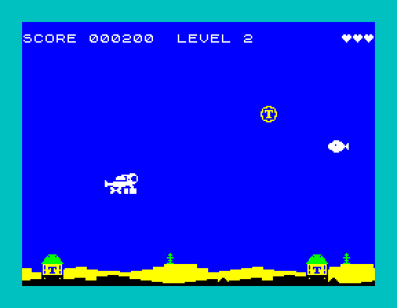

# Level 2

Branch `claudelet/dev`. Quartus's brief: make level 2 a real level,
and set the pattern for the levels after it.



## What changes at level 2

| | Level 1 (unchanged) | Level 2 |
|---|---|---|
| bomb | the black pulsar, small bob | the same pulsar, **yellow**, on a **wave** 16 pixels up and down |
| fish | straight across at row 76 | a **wave** 12 pixels up and down about row 76, about a fifth faster |
| border | the heartbeat (a slow round of colours) | **cyan** |
| points | bomb 2, fish 1 | the same |

Level 2 starts at 200 points and runs to 500, as before. Its bomb was
already a little faster (haste 24).

**The panel.** Reaching level 2 shows the "LEVEL 2" banner, then the
panel: "WELL DONE, YOU REACHED LEVEL 2." / "LEVEL 2 STARTS NOW", the
code, and "PRESS A KEY". The "STAY TUNED, MORE IS COMING" panel has
moved to the end of level 2: it follows the "LEVEL 3" banner, with level
3's code, and level 3 (the spinning wheel) carries on behind it. The
code is no longer under level 3's banner. From level 4 it is under the
banner as before.

## The table

The look is five more columns of `CFG_LEVELS` in `config.asm`:

```
;          ...  bomb    ink            bmove      fmove          fspeed border
LEVEL_ROW  ...  BOMB_P, CFG_WHEEL_INK, MOVE_BOB,  MOVE_STRAIGHT, 0,     BORDER_BEAT   ; 1
LEVEL_ROW  ...  BOMB_P, CFG_L2_INK,    MOVE_WAVE, MOVE_WAVE,     48,    CYAN          ; 2
LEVEL_ROW  ...  BOMB_W, CFG_SPIN_INK,  MOVE_BOB,  MOVE_STRAIGHT, 0,     BORDER_BEAT   ; 3 to 9
```

- **ink**: the bomb's cell colour. `CFG_L2_INK` is bright yellow on blue.
- **bmove**: `MOVE_BOB` (the old bomb) or `MOVE_WAVE`.
- **fmove**: `MOVE_STRAIGHT` (the old fish) or `MOVE_WAVE`.
- **fspeed**: the fish's haste, like the bomb's: 0 is a pixel per 1/50 s,
  48 adds a pixel about one 1/50 s in five. It only applies to
  `MOVE_WAVE`; a straight fish must have 0, and an assert checks that.
- **border**: a colour (`BLACK` to `WHITE`), or `BORDER_BEAT` for the
  heartbeat.

Asserts keep level 1's row exactly the old game. A later level is one
more row; a new kind of movement is one more `MOVE_*` value and one
more routine in `level.asm`.

The waves' sizes and speeds (`config.asm`, with Dalix's tuning in mind):

| Setting | Value | Meaning |
|---|---|---|
| `CFG_BOMB_WAVE_AMP` | 16 | pixels above and below the bomb's middle |
| `CFG_BOMB_WAVE_SPEED` | 2 | one wave every 128/50 s (2.6 s) |
| `CFG_FISH_WAVE_AMP` | 12 | pixels above and below row 76 |
| `CFG_FISH_WAVE_SPEED` | 3 | one wave every 85/50 s (1.7 s) |
| level 2 `fspeed` | 48 | the fish about a fifth faster |
| `CFG_L2_INK` | `BRIGHT \| YELLOW \| (BLUE << 3)` | the bomb's colour |
| level 2 border | `CYAN` | |

A wave climbs at most `AMP * 6.3 * SPEED / 256` pixels a 1/50 s. Above
1, the bomb's colour is repainted whole on those steps, which costs
time; the fish doesn't mind. The asserts keep both waves in open water:
the bomb's middle stays `AMP` clear of the top and the seaweed, and the
fish stays below row 1 and above the seabed.

## How it works

- `level.asm` is new. `level_style` (cold) takes a row's five bytes when
  a level starts, by score or by code. The two movers are hot.
- **The bomb.** `wheel_type` gives each new bomb the level's ink and
  movement. `update_wheel` sends kind 1 to `wheel_wave`, after the kind
  0 test, so level 1's bomb costs exactly what it did. The wave sets the
  height from a 128-entry table, then joins the drift's own spin and
  move code (`wheel_drift.spin1` at 50, `.spin2` at 25). A height more
  than a pixel from the last sets `wheel_odd`, so the colour is painted
  whole, as a wobble does.
- **The fish.** `fish_wave` replaces `update_fish` in the two move calls
  (`fish_mv`, `fish_mv2`), and `fish_unhold` now puts back the level's
  mover (`fish_mover`). The three hit tests that used the fixed depth
  (`fish_touch`, `fish_aside`, `torpedo_fish`) keep `FISH_SWIM_Y` as
  their operand, and `fish_wave` writes the fish's height into it as it
  moves. So level 1 runs the same instructions as before. The shared
  `fish.asm` is untouched.
- **The border.** A fixed colour is written over the heartbeat's first
  four bytes (`LD A,colour : JR .border`). `BORDER_BEAT` puts them back.
- **The tables.** `data.asm` makes both waves from one table of sines
  when the game is assembled, so any amplitude works.
- **Measuring.** `-DMEAS_LEVEL=n` starts a MEASURE build at level n.

## Bytes

| | Before | After | Used |
|---|---|---|---|
| hot code (`code_end`) | `$B1A8` | `$B28C` | 228 |
| data (`data_end`) | `$CB6B` | `$CC98` | 301 (256 of it the two wave tables) |
| cold block (`cold_end`) | `$6FBB` | `$7036` | 123 |
| tape | 12,697 | 13,116 | 419 |

Free afterwards: code 4,468, data 664, cold block 394.

## Checks

- **Level 1 is unchanged.** All ten timing and screenshot builds
  (MEASURE at 50 and 25 with MEAS_DOWN, MEAS_FIRE, MEAS_SPIN, MEAS_BOOM,
  MEAS_MISSILE; SHOT_FRAME 300 and 1200) are pixel-identical to the
  build before this brief. The soak is green at 50 and 25. Engine Demo
  1 is byte-identical.
- **Timing**, minimum spare scanlines and late steps, interrupts right
  throughout (512 at 50, 1024 at 25):

| Build | Level 1 | Level 2 |
|---|---|---|
| 50 MEAS_DOWN | 9, 0 late | 9, 0 late |
| 50 MEAS_DOWN + MEAS_FIRE | 2, 0 | 1, 0 |
| 50 MEAS_DOWN + MEAS_MISSILE | 4, 0 | 5, 0 |
| 50 MEAS_BOOM | 0, 1 late | 0, 2 late |
| 50, diver in open water | – | 10, 0 |
| 25 MEAS_DOWN | 48, 0 | 47, 0 |
| 25 MEAS_DOWN + MEAS_FIRE | 47, 0 | 47, 0 |

  MEAS_BOOM's late steps overrun by a few T-states and catch up; that
  count moves by one or two with schedule alignment alone.
- **Codes.** TLTTDL starts level 2 at 200 with the cyan border, the
  yellow wave bomb and the wave fish. FDCGGR starts level 3 at 500 with
  the red spinning wheel, the straight fish and the heartbeat.
- **Panels**, in a scratch build scoring 50 or 99 a shot: level 2's
  panel says it starts now, and play goes on in level 2. Level 3's says
  more is coming, with FDCGGR, and play goes on in level 3.
- **A death on level 2**: the same freeze, flash, burst and respawn as
  on level 1. The fish keeps its wave and the bomb its colour.
- That scratch build, scoring every step fire was held, ran up to level
  16 and showed level 2's message there as "LEVEL @". A message still
  due from level 2 or 3 is now dropped when a later level arrives. Real
  play can't skip levels like that.
