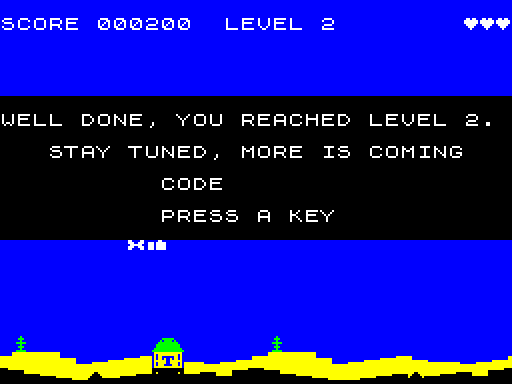
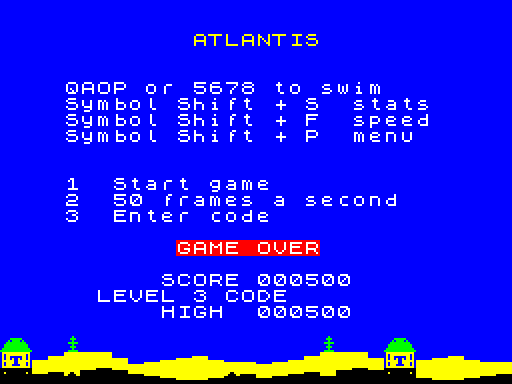
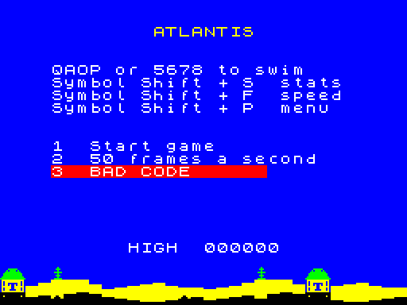

# Level 2 teaser, level codes and the web focus fix

Branch `claudelet/dev`. Quartus's brief, items 1, 2 and 4. The wheel as
a second bomb (item 3) is a separate push.

## 1. Level 2 teaser

When the score first reaches 200, the "LEVEL 2" banner and jingle play
as before. When the banner comes down, a black panel covers rows 6 to 14:

- It stays up until a key is pressed, so there's time for a screenshot.
  Then the panel goes back to water and play carries on.
- The direction or fire key the player is holding has to be let go
  first, so it doesn't end the message at once. The key that ends it
  has to be let go too, so it doesn't fire a torpedo.
- **How it fits the frame.** `banner_tick` patches main_loop's
  `call spare_count` (now labelled `teaser_hook`) to `call teaser` for
  one step. So the message comes at the end of a step, with every sprite
  drawn, and the picture stays still behind it. When it ends, the
  panel's rows are wiped to empty water. Every sprite there photographed
  water this step, so the next restore puts back what is now on screen.
  The step after the message is late, once, and that's all.
- **Builds that run on their own** (soak, MEASURE, timing, slack,
  screenshot) leave the message out, because nobody is there to press a
  key (`TEASER` in score.asm).

## 2. Level codes

Everything is in `src/atlantis/codes.asm`: how the codes are made, the
table, showing one, and checking one that's been typed.

**Where they appear**

| Where | What |
|---|---|
| Level 2 | in the message above |
| Level 3 onwards | a second line of block letters under the "LEVEL n" banner, which then stays up 4 s instead of 2 (`CFG_BANNER_CODE_TIME`) |
| Game over | "LEVEL n CODE xxxxxx" under the score, for the level the game ended on (levels only go up, so that's the highest reached) |

**Entering one.** The menu has a new option, "3 Enter code". The line
turns into `3  Code ......` and fills in as letters are typed. `0`
(or Delete) rubs one out and Space gives up. The sixth letter checks the
code:

- **A good code** starts a game at that level. The score is the level's
  starting total from `CFG_LEVELS` (200, 500, 900, ...), lives are full,
  and the high score works as normal. The levels in between are stepped
  through quietly (`level_advance`), so the missile gap and bomb haste
  are that level's own.
- **A bad code** shows `3  BAD CODE` in red for a second and a half,
  then the option comes back.

**How a code is made.** It's 24 bits, written as six letters of 4 bits
each, from a 16-letter alphabet with no I, O, Q, V, W, X, Y, Z, M or N
(those are the hardest to read, or to tell apart, in the 3x5 banner
letters).

1. The level number (5 bits) sits on top of a 19-bit checksum of itself
   (level × a constant + a key).
2. The 24 bits are stirred: multiplied by an odd number, XORed with
   themselves shifted right, twice, then XORed with a second key. Every
   step can be undone, so no two levels can share a code, but every
   bit of the result depends on every bit of the level.
3. Every 4 bits becomes a letter.

The table is worked out at assembly time by the `LEVEL_CODES` macro,
3 bytes per level, which is smaller than code to reverse the stirring.
A typed code is turned back into 24 bits and looked up in the table.

- **Consecutive levels look nothing alike.** No two of the 19 codes share
  more than 3 letters in the same places, so changing one or two letters
  of a real code can never give another real code.
- **A random guess** has about a one-in-880,000 chance of being a code.
- **All 20 levels are covered** (`CFG_CODE_LEVELS` = 20: Atlantis is
  1-10, Trigon 11-20). Level 1 has no code; it's "Start game". Changing
  `CFG_CODE_LEVELS` adds or drops codes but changes none, since each
  code depends only on its level number.

The list itself isn't published here: it's in `notes/LEVEL-CODES-LIST.md`
in the repository, outside `docs/`, so it isn't served with the game.
(Anyone can still work the codes out from the source or the tape. That's
fine for a challenge among friends.)

`CFG_LEVELS` has 9 rows, and the last row repeats. A code for level 10
or above therefore starts the score at 5,400 plus 1,000 for each level
past 9, and plays level 9's settings until Trigon has rows of its own.

**Banner font.** The banner's block letters were just L, E, V and the
digits. They're now the whole alphabet (130 bytes), so the codes can be
drawn the same way as "LEVEL".

## 4. Web focus

JSSpeccy listens for keys on its own box (a div it gives `tabindex 0`),
and only focuses that box in `start()`, which runs once the snapshot
has been fetched. By then the "Click to play" button that had the focus
has been removed, so the focus sits on the page and the first `1` goes
nowhere. `docs/play/index.html` now focuses the box itself inside the
click, then checks every 0.1 s for 5 s and focuses it again if the
focus has fallen back to the page. A click somewhere else on the page is
left alone.

Console:

- **The error** was the browser asking for `/favicon.ico`, which isn't
  there (a 404). The page now declares an empty icon (`data:,`).
- **The warning** is Chrome's deprecation notice for
  `createScriptProcessor`, which JSSpeccy 3.2 uses for its sound. It's
  in the unmodified GPL emulator, so I've left it; it does no harm.

I couldn't open a browser from this session (no headless browser on the
machine, and the Chrome extension wasn't connected), so both web fixes
come from reading JSSpeccy's source. **They need a check on the live
site.**

The page's key table now lists `3`. `make web` refreshed
`docs/play/atlantis.sna` and `.tap`.

## Checks

- **Engine Demo 1:** `make demo` is byte-identical to the committed tape.
- **Soak at 50:** green border, OK.
- **Timing:** items 1 and 2 add nothing to the per-frame path. The only
  change there is a label on an existing `call`. MEASURE with
  MEAS_DOWN at 50 prints `090000 56 0200` on row 2, exactly what the
  last commit prints (512 interrupts for 512 steps).
- **In Fuse:** reaching level 2 shows the banner, then the message;
  a key ends it and play resumes cleanly. Level 3's banner shows
  its code. On the menu: typing, rub-out, a bad code, level 3's code starting
  level 3 at 500, and the game-over screen showing "LEVEL 3 CODE" and the code.
  (A scratch build scored 50 per torpedo to get there quickly.)

## Memory

| | Before | After | Free after |
|---|---|---|---|
| code (`code_end`, limit `$C000`) | `$BB2D` (1,235 free) | `$BDD7` | 553 |
| data (`data_end`, limit `$F000`) | `$E808` (2,040 free) | `$E97B` | 1,669 |

The code's 682 bytes are mostly code entry and checking (codes.asm)
and the teaser. The data's 371 bytes are the full banner alphabet (130),
the code table (57), the key map (40), and the strings.

## Fixes after review

- **The codes aren't published.** The table of codes has moved out of
  `docs/` (the GitHub Pages site) to `notes/LEVEL-CODES-LIST.md`. The
  codes are painted out of the level 2 and game-over screenshots, and
  the level 3 banner shot is gone. No other file in `docs/` has a code.
  They're still in the git history and can be worked out from the
  source or the tape.
- **A stale level 2 message.** If the diver died in the same step that
  level 2's banner came down, `teaser_hook` was left pointing at
  `teaser`, and the next game opened in level 1 with the "WELL DONE"
  panel. `score_reset` now puts the hook back to `spare_count`.
  A scratch build that scored 50 a torpedo and went to `game_over` at
  that exact moment showed the panel on the next game before the fix,
  and a normal level 1 after it.
- **Level 10's score** was wrong here: a code for level 10 starts at
  5,400 (200 + 300 + ... + 1,000), not 4,500.
- The fix costs 6 bytes of code, in a part only the tape build has: the
  soak and MEASURE builds are byte-identical to before. `code_end` is
  `$BEA4`, 348 bytes free; data is unchanged (`$EBA1`, 1,119 free).
  Engine Demo 1 is byte-identical.
