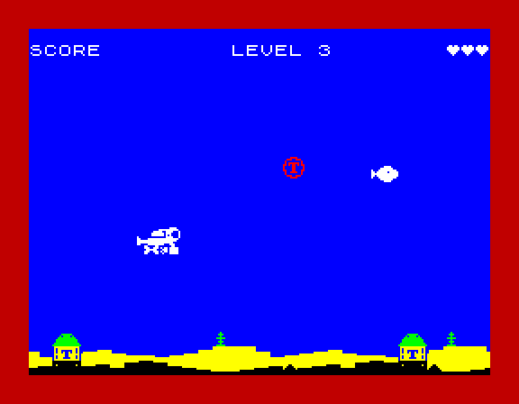
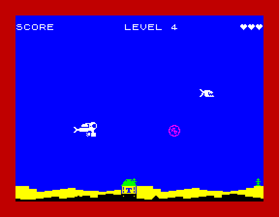

# Levels 3 to 9, and the diver's jet

Branch `claudelet/dev`. Quartus's brief: level 3 gets its own look,
level 4 brings the first bomb that hunts the diver, levels 5 to 9 hunt
harder, and the diver's jet is always alive.

## What changes

| | Level 3 | Level 4 | Levels 5 to 9 |
|---|---|---|---|
| bomb | the red spinning wheel, small bob, **now rolling** | the spinning wheel, **bright magenta**, **hunting** | the same hunter, hunting harder each level |
| fish | straight across | straight across | straight across |
| border | **red** | the heartbeat | the heartbeat |
| points | bomb 2, fish 1, missile 10 | the same | the same |

The targets and the level codes are not published here: the codes are
in `notes/LEVEL-CODES-LIST.md` in the repository, and the targets are
the first column of `CFG_LEVELS`. No target and no code changed.

## The roll (level 3 on)

The spinning wheel's 8 pictures are one whole turn, counter-clockwise,
the way a wheel turns going left. Each was held 8 1/50 seconds, the
pulsar's hold, so a turn took 64 and the wheel turned at about half the
speed it travels: it looked as if it skidded. The rim is 5 to 6 pixels
from the middle, so a rolling turn is about 34 pixels, about 4.3 pixels
a picture. The bomb travels 1 + haste/256 pixels a 1/50 second, so the
hold that rolls is 4.3 / that speed: 3.6 at level 3, 2.5 at level 9.

`wheel_type`, which runs when a bomb appears, now patches the hold into
the spin's three operands: **4** below haste 64 (level 3) and **3**
from it (levels 4 to 9). Every level is then within about a fifth of a
true roll. The pulsar keeps its 8, so levels 1 and 2 are unchanged. It
costs nothing a frame: the hold was already a compare.

## The hunter (level 4 on)

`MOVE_HOME`, kind 2, the slot that was kept for it (`wheel_home`,
`level.asm`). It is the drift with its small bob, as on level 3, and:

- **While the bomb is to the right of the diver**, the level's `hunt`
  is added to a fraction each 1/50 second. Each time it carries, the
  bomb's middle moves a pixel towards the height that puts it level
  with him (his top + 1: the diver is 15 tall, the bomb 12).
- **Once its middle has passed his** (its x below his x + 6), it stops
  hunting for good and carries straight on at the height it reached.
  It never turns back on him, and a dive under or over it is still the
  way to dodge.
- **Its middle stays between the spawn table's own limits**
  (`WHEEL_TOP_BASE`, `WHEEL_LOW_BASE`), so the bob never reaches the
  score row or the weed. A diver on the seabed is hunted down to the
  lowest the bomb may go, one swing above the weed.

### The hunt values

One new column of `CFG_LEVELS`, `hunt`, after `bmove`:

| Level | haste | hunt | pixels a second | in a crossing (about) |
|---|---|---|---|---|
| 4 | 72 | 48 | 9.4 | 39 |
| 5 | 96 | 64 | 12.5 | 49 |
| 6 | 120 | 80 | 15.6 | 57 |
| 7 | 144 | 96 | 18.8 | 64 |
| 8 | 168 | 112 | 21.9 | 71 |
| 9 | 192 | 128 | 25.0 | 77 |

"In a crossing" is how far it can climb or sink while it crosses the
screen (268 pixels at its speed). The diver swims 50 pixels a second, so
even level 9's hunter goes at half his speed.

Asserts in `LEVEL_ROW` (score.asm): `MOVE_HOME` needs a hunt of 1 to
128, and every other movement 0. 128 is the cap for two reasons: it is
half the diver's speed, so he can always swim clear; and a step then
carries at most once, so with the bob's own pixel the bomb moves at most
two pixels up or down. A 12-pixel picture can't cross a cell edge at its
top and at its bottom within two pixels (the edges are 3 and 5 apart),
so the colour's cheap one-cell row step still follows it.

## The diver's jet

The brief: the jet always animated, bubbling even when he is still,
and the legs kicking only while a direction is held.

The legs already did that: the kick only runs while Q, A, O or P (or the
joystick) is held, and he glides with his legs together when you let
go. What was missing was the jet. Its tail is now a 3 by 3 housing (a row
shorter than the art's: rows 11 to 13, where the jet's body keeps its
4), a shaft two pixels long reaching back under him, and the propeller
blade on the shaft's end. The new legs leave that room free. It turns
and throws bubbles in two phases:

- **A**: the blade face on, 3 pixels tall, with two bubbles behind it.
- **B**: the blade edge on (one pixel), the housing down to its 2-wide
  hub, and three bubbles thrown back.

Each bubble is a pixel with no ink beside it in any of the three
frames, so a bubble never joins a leg.

**At start-up, from the existing art.** `gfx/diver.txt` is Engine Demo
1's art too, so it is not changed. `diver_jet_build` (preshift.asm)
patches the raw art before it is shifted: frames 0 and 2 get A, frame 1
gets B. The kick runs 0 1 2 1, so while he swims the jet goes A B A B.
The still pose (frame 2) needs a B as well, so it also copies frame 2
with B, both facings, and shifts it into two more pictures. While he is
still, `diver_image_index` shows the B picture every other 4 1/50
seconds, so the jet turns at the same rate swimming or still.

The soak build has no room for the two extra pictures (its code is
there), so it keeps the still pose without them.

## Bytes

| | Before | After | Used |
|---|---|---|---|
| hot code (`code_end`) | `$B2A4` | `$B351` | 173 (the missile's flicker 10, `wheel_home` 107, the spin hold and the hunt in `wheel_type` 38, the still jet in `diver_image_index` 13, four bytes of state, one longer jump; the kind table went and the dispatch's two tests took its four bytes) |
| the jet's still pictures (`JET_BUF`) | | `$BC80-$C3FF` | 1,920, built at start-up, not on the tape |
| data (`data_end`) | `$CCB3` | `$CDC3` | 272 (the `hunt` column, 9; the jet pictures' pointer tables, 36; the missile's second picture, 227) |
| cold block (`cold_end`) | `$7036` | `$713E` | 264 (`diver_jet_build`, `jet_patch` and the two pixel lists) |

Free afterwards: code 2,351 (up to `JET_BUF`), data 365, cold block
130. The tape is 13,517 bytes (367 more).

The two extra pictures are the "new pre-shifted copies" the brief
allowed if the memory did: one still pose per facing, 960 bytes each.
Without them the still diver's jet could not change: every other
combination is a picture already there.

The soak build's code sits where `JET_BUF` is, and it no longer had
room after the new hot code, so its title photograph (768 bytes) moved
to `$F600-$F8FF`, above the run-time buffers. The soak is a snapshot,
never loaded from tape, and nothing else uses that room in it.

## Timing

Spare scanlines (the lowest of 512 steps) and late steps, `MEASURE`,
before (main) and after. The interrupts are 1 a step at 50 and 2 at 25
in every row, before and after.

| Build | Before | After |
|---|---|---|
| level 1, seabed (`MEAS_DOWN`) | 9 | 9 |
| level 1, + `MEAS_FIRE` | 2 | 2 |
| level 1, + `MEAS_MISSILE` | 4 | 4 |
| level 1, `MEAS_BOOM` | 0, 1 late | 0, 1 late |
| level 1, open water, still | 9 | 9 |
| level 1, `MEAS_SPIN` | 9 | 8 |
| level 1 at 25 (down, fire, spin) | 47 | 47 |
| level 2, seabed | 9 | 9 |
| level 2, + `MEAS_FIRE` | 1 | 1 |
| level 2, + `MEAS_MISSILE` | 5 | 5 |
| level 2, `MEAS_BOOM` | 0, 2 late | 0, 2 late |
| level 2, open water, still | 10 | 9 |
| level 2 at 25 (down, fire) | 47 | 47 |
| level 3, seabed | 2 | 1 |
| level 3, + `MEAS_FIRE` | 0, 1 late | 0, 1 late |
| level 4, seabed, the hunter on him | 7 | 7 |
| level 4, + `MEAS_FIRE` | 0, 1 late | 0, 1 late |
| level 4, + `MEAS_MISSILE` | 3 | 3 |
| level 4, `MEAS_BOOM` | 0, 1 late | 0, 1 late |
| level 4, open water, still | 7 | 7 |
| level 4 at 25 (down / fire) | 49 / 48 | 49 / 48 |
| level 9, seabed | 8 | 7 |
| level 9, + `MEAS_FIRE` | 1 | 0, no late step |

"Before" at level 4 is main's level 4, the red wheel on the bob, so the
hunter costs nothing that shows. In `MEAS_DOWN` the diver sits on the
seabed, and the hunter comes down to the lowest the bomb may go, one
swing above the weed: as close as it can be to him.

Levels 1 and 2 are unchanged in every heavy case. The two that moved by
a line are the spinning wheel's (level 3, and level 1 with
`MEAS_SPIN`): its picture now changes every 4 1/50 seconds, not every
8, and `wheel_next_frame` sometimes lands on the heaviest step. Level
2's open water lost a line with the jet's still picture; level 1's
open water did not. That is within the line or two that schedule
alignment alone moves.

## Checks

- **Levels 1 and 2:** the timing above. On level 1 the only pixels
  that differ from main in the screenshot builds are the jet's tail and bubbles.
- **Soak:** green at 50 and 25.
- **Level codes:** the code table is byte-identical to main's. No code
  or target changed.
- **Engine Demo 1:** byte-identical.
- **Asserts:** `MOVE_HOME` with hunt 0, hunt 129, and `MOVE_BOB` with a
  hunt each stop the build.
- **No leftover colour:** the scratch cell check from the level 2
  follow-up (every cell of rows 2 to 20 must be water or the banner,
  apart from the bomb's own rectangle), with the diver sweeping up and
  down, ran 5 minutes each at levels 3 and 4, at 50 and at 25. It found
  no cell left in the bomb's ink.
- **In Fuse:** level 3's red border and rolling wheel, level 4's
  magenta hunter sinking to the diver's depth and hitting him, the jet
  turning while he is still.

## Graphics polish

Four more changes to the art. Every one keeps its sprite's size, so
the draws read the same number of bytes. Only the missile's flicker
adds a picture (below). With the missile's flicker and the longer jet tail in, the full timing
set was run again: level 1 seabed 9, + fire 2, + missile 4, boom 0 with
1 late step, open water 9; level 2 seabed 9, + fire 1, + missile 5, open
water 10; level 3 seabed 1; level 4 seabed 7, + fire 0 with 1 late step,
+ missile 3; level 9 seabed 6, + fire 0; 47 to 49 at 25. The missile
cases, where the flicker's 32 T-states land, did not move. The
interrupts are 1 a step at 50 and 2 at 25 in every build. The soak is
green at 50 and 25, and Engine Demo 1 is byte-identical.

- **The diver's legs.** Atlantis has its own copy of the diver,
  `gfx/diver-atlantis.txt`; Engine Demo 1 keeps `gfx/diver.txt`. The
  body, tank, helmet, arms and jet are pixel for pixel the same. The
  legs are new: a scissor kick from the hip, wide apart (one leg up and
  back, one down and back, each with a flat flipper), half way, then
  together and straight back with the flippers flared in a V. The last
  is also the glide pose, which used to cross the shins under his belly
  in an X just behind the jet's bubbles. That X is gone.
- **The missile's flame.** `gfx/missile.txt`: the body is four rows,
  then the fins with the nozzle between them, then the flame. Still 6
  by 8, one byte a row in flight. The flame flickers: two pictures,
  long and short, swapped every 2 1/50 seconds by `missile_draw`. That
  one costs 227 bytes of data (the second picture at all 8 shifts) and
  32 T-states on a frame with a missile up.
- **The pulsar's pulse.** `gfx/wheel.txt`: its two pictures used to
  differ by a few edge pixels. Now one is the burst (the wide shape with
  four rays out at the corners and the caps joined) and the other is the
  ring (drawn in from the box's edge, no caps). The order is burst,
  burst, ring, ring, twice: two pulses a cycle where there was one.
- **The fish.** Atlantis has its own copy, `gfx/fish-atlantis.txt`: a
  piranha. Its two frames flip every 8 1/50 seconds, and on each flip
  the jaws snap (wide open with teeth on both, the lower jaw dropped and
  thrust forward; then shut with a tooth over the lip), the gill opens
  and shuts, and the tail swings from spread to down. The box is still
  16 by 9, so the hit tests and its colour are unchanged.

The loading screen (`tools/mkloadscreen.py`) reads the Atlantis copies
too, so its fish are piranhas and its bombs the new burst and ring.

## Two fish

The piranha and the old round fish take turns: when a fish appears (a
new game, and each new fish after one has gone), `fish_kind_pick`
(boom.asm) makes it the piranha one time in four, else the round fish.
A piranha scores twice the level's fish points (2 on levels 1 to 9), the
round fish the level's (1). `LEVEL_ROW` asserts the fish points are under
50, so the doubled BCD byte fits.

- **No frame time.** The pick runs only when a fish appears. It patches
  the operand of `ld hl,fish_images` in `fish_draw_fast`, the same way
  the bomb switches between the pulsar and the wheel, and both fish are
  16 by 9, so the draw reads the same bytes either way. The score is
  read only when a shot lands.
- **Its own random sequence.** A second Galois LFSR (seed 99), not the
  bomb's `wheel_rng`, whose order the soak's script counts on. 63 of its
  255 values pick the piranha.
- **Memory.** The round fish's art is `gfx/fish.txt`, Engine Demo 1's,
  unchanged, turned into `gfx/rfish_raw.asm`. Its 4 shifted pictures
  (1,728 bytes) are built at start-up at `$B5C0-$BC7F`, just below the
  jet's, above `$8000` because they are drawn every frame. Its raw art
  (144 bytes) and pointer tables (72) are in the data block: the cold
  block had no room. Code 45 bytes. `code_end` `$B37E` (578 free below
  the round fish), `data_end` `$CE9B` (149 free), `cold_end` `$7149`
  (119 free). The tape is 14,121 bytes.
- **The tape build only.** Every test build carries the stat line and
  ends past `$B5C0`, so `TWO_FISH` is defined only without the stat line
  and outside the soak. Those builds have the piranha alone, as before.
  Their timing is the tape's: the draw does not depend on which fish it
  is.
- **Checked in Fuse** with the diver made unhittable (a scratch copy),
  holding his depth on the fish's row and firing: both kinds appear,
  the first piranha scored 2, and the score rose through odd totals, so
  the round fish scores 1. Engine Demo 1 is byte-identical.

## Revised: a colour a level, wave and hunt in turn, homing missiles

Later changes to levels 3 to 9, and the spinning wheel condensed to make
room.

| Level | Bomb colour | Bomb movement | Also |
|---|---|---|---|
| 3 | red | the wave (16 pixels up and down) | red border |
| 4 | magenta | hunting, 48 | |
| 5 | green | the wave | |
| 6 | cyan | hunting, 88 | |
| 7 | yellow | the wave | |
| 8 | black | hunting, 128 (the most) | |
| 9 | red | hunting, 128 | the silos' missiles home in |

- **A colour a level**, so the bomb itself says the level has changed.
  They are `CFG_L5_INK` to `CFG_L8_INK` (and `CFG_SPIN_INK`,
  `CFG_HUNT_INK`) in `config.asm`.
- **A wider swing on the odd levels.** The wave is level 2's: a sine
  table of 16 pixels each way, against the small bob's 6, and cheaper
  than widening the bob (whose wide path does arithmetic the heavy frame
  has no room for). The even levels hunt, harder each time.
- **Homing missiles** from `CFG_MSL_HOME_LEVEL` (9). As a missile climbs,
  it moves a pixel towards the diver's middle each time `CFG_MSL_HOME`
  (128, half a pixel a 1/50 second) carries: about 35 pixels on its way
  up. Off a byte boundary it is two bytes a row, which `missile_draw`
  already does in the hatch, and it stops at x 247 so the second byte
  stays on the screen.
- **The spinning wheel in 4 pictures**, the quarter turns (every fourth
  frame of `gfx/wheel-full.txt`), not 8. That frees 1,824 bytes of
  contended RAM (its pictures now start at `$78E0`) and 192 bytes of raw
  art in the cold block. The spin hold is retuned for the roll: 7, 6 or
  5 1/50 seconds a quarter turn by the level's haste (below 96, below
  144, from 144). The room let `slope_build` and `torpedo_reset` go back
  to the cold block, and the hot code has 117 bytes free again.

**Timing** (spare lines, late steps in brackets): level 3 seabed 1,
+ fire 0 (1); level 5 seabed 0 (1); level 7 seabed 1, + fire 0 (3), 47
at 25; level 9 seabed 3, + fire 0 (4), + a homing missile always up 3,
the same in open water 4. Interrupts 1 a step everywhere: 50 holds.
Levels 1 and 2 are within the usual one-line drift of main.

**Checks:** the soak green at 50 and 25; the colour check (no cell left
in a bomb's ink) for 3 minutes each on levels 3, 5, 7 and 9; a homing
missile seen drifting towards the diver in Fuse; the level codes and
Engine Demo 1 unchanged.

## Fish movement by level

The fish's movement is a column of `CFG_LEVELS` (`fmove`, with its
speed in `fspeed`), and level 2's wave fish (`fish_wave`) now swims on
the even levels too. No new movement code.

| Level | Fish | Across |
|---|---|---|
| 1, 3, 5, 7 | straight | 50 pixels a second |
| 2 | wave | 59 |
| 4 | wave | 61 |
| 6 | wave | 63 |
| 8 | wave | 64 |
| 9 and on | wave | 66 |

- **The next fish, not this one.** A level no longer changes the fish
  that is swimming: `level_style` only sets `fish_mover`, and the next
  fish to appear (`fish_wait_step`, or a new game) gets it, as it gets
  its kind (round or piranha). Each new fish starts at its own depth,
  with its hit tests there (`fish_set_y`). The speed across of a wave
  fish changes at once.
- **Bytes:** none in the hot code (`code_end` stays `$B8EB`, 53 free);
  the cold block is 14 bytes smaller (`cold_end` `$7255`).
- **Timing** (spare lines, late steps in brackets), before and after.
  The wave fish costs about a scanline, as on level 2:

  | Level | Seabed | + fire |
  |---|---|---|
  | 4 | 6, now 5 | 0 (1), now 0 (1) |
  | 6 | 4, now 2 | 0 (1), now 0 (3) |
  | 8 | 5, now 4 | 0 (2), now 0 (2) |
  | 9 | 3, now 3 | 0 (4), now 0 (7) |

  One interrupt a step everywhere, so 50 holds. Levels 1 and 2 are the
  same as before in all twelve measured cases, and the soak is green at
  50 and 25.
