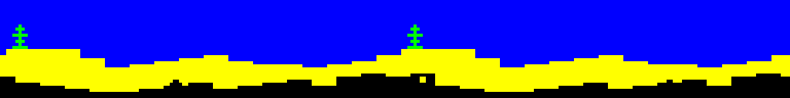
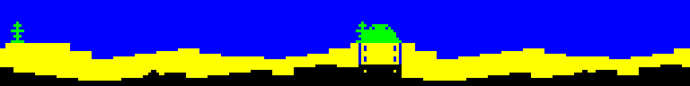
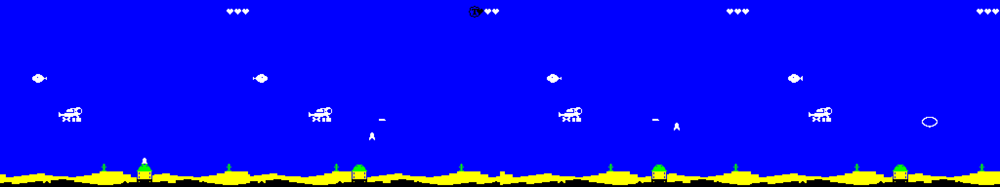

# Silos and missiles

Branch `claudelet/dev`, from main at `9c563b4`. This covers Quartus's
brief, item by item.

## 1. The silos are more obvious

**Before:** the silo was 8 pixels wide. Its bottom half was a black
block in the ground row and its top half was a yellow stub on the sand,
in the sand's colours. In play it was hard to see.

**After:** 16 wide and 24 tall, one character row in each band of the
seabed:

| Row | Part | Colours |
|---|---|---|
| 21 (weed) | a dome with a hatch | green on blue, the seaweed's own colours |
| 22 (sand) | a tower with ribs, cut out of the dunes by a blue edge | yellow on blue, the sand's colours |
| 23 (ground) | a black base | black on yellow, the ground's colours |

Close up, before and after: `build/silo-zoom.png`.

- **No clash.** Each part uses its own row's colours. Every cell the
  dome has ink in is painted green on blue, which is the seaweed's
  colour. A plant and a dome can share a cell as they scroll past each
  other, and both stay green. When the dome moves on, the cell gets
  back the colour the weed rule gives it.
- **The seaweed still sits on the sand.** The slow layer is unchanged.
- **The art is in `src/atlantis/silo.asm`** as binary rows, with an
  ASCII picture above them. It is not in `gfx/`, because the drawing
  code is built from it (below).
- **The diver** is held above the dome's top (`SILO_H` is now 24), and
  touching it costs a life, like the black ground.

### Drawing it every frame

The silo moves with the ground, one pixel a frame, so its tower and dome
are drawn on every frame. That made the stamp the costliest part of the
change:

- **Before:** the old 8×8 top was shifted a bit at a time, at run
  time, through a call per byte. With the stamp taken out, the seabed
  frame gained up to **49 spare scanlines**.
- **First try:** a masked loop over pre-shifted pictures. It drew four
  times the area for about the same cost, but still made 11 of 512
  seabed steps late at 50.
- **Final: each of the 8 shifts is its own straight run of code.** The
  assembler builds it from the art (`SILO_CODE` in silo.asm):
  - a byte the silo covers completely is one `LD (HL),n`;
  - a byte it doesn't touch is left out;
  - only the edge bytes are masked.

  That is about 5 scanlines a silo. A silo hanging off a screen edge
  still uses the masked loop, which skips the bytes off screen.
- **The dome on the weed row** is wiped on the frame that doesn't copy
  the weed. Its bytes are copied back from the slow buffer, which is
  still the picture on screen at that point, so nothing has to be
  saved. The frame that copies the weed wipes it anyway.
- **The dome's cell colours** are only worked out again when the ink
  moves into another byte, or when the ground wraps to a new column.

## 2. Missiles

`src/atlantis/missile.asm`, art in `gfx/missile.txt` (6×8, white on blue).

- **One at a time.** After a random wait (`CFG_MISSILE_GAP_MIN`,
  `_MAX`, in 1/50 s), a random silo on screen arms its missile.
- **The warning.** It sits in the hatch for `CFG_MISSILE_ARM`
  (half a second), scrolling with the ground. Its position comes from
  the silo's world column, so it stays on the silo at both speeds.
- **Then straight up**, `CFG_MISSILE_SPEED` pixels per 1/50 s
  (2 by default: about a second and a half to the top). It keeps its
  screen column. It is gone below the hearts (row 2), which is the top
  of the water as far as the sprites go: rows 0 and 1 are the stat line
  and the hearts.
- **Small and cheap.** It only leaves the hatch when the ground has put
  it at shift 0, 1 or 2. At those shifts its six pixels fit in one
  byte, so in flight it is one byte a row (8 bytes). In the hatch it
  can be two.
- **The same layer order as the other sprites**: save, draw, restore.
  - Up in the water, it is the first sprite drawn after the explosion
    (the bottom layer) and the last restored.
  - In the hatch, it is the first sprite drawn after the seabed copy
    and the last of those restored.
  - `msl_vn` records which, as `torp_vn` does for the torpedo.

  The soak runs with missiles flying and is green.
- **Touching the diver** is a hit through the same path as a bomb:
  the explosion where the missile was, a life, back to x = 8, and his
  crunch. A missile can't take a second life in the step that a bomb
  already took one.
- **A torpedo blows it up**, with its own sound: `snd_missile_def`,
  `CFG_MISSILE_SND_*`. That is 8 thin bursts, a crackle: high and
  sparse, so it sounds different from the bomb and the fish. Its pitch
  hasn't been heard yet.

The frames below are from a scratch build with short gaps: a missile in
the hatch, one in flight, then a torpedo reaching one, and the burst.

**Play tests** were done in scratch builds, with the gaps shortened and
the silo choice moved under the diver:

- A missile under the diver blows up on him. He loses a heart and
  restarts at the left.
- A torpedo fired along his row meets a missile and both go, with the
  burst.

## 3. Timing

`-DMEASURE`, 512 steps after the warmup. A new switch, `-DMEAS_MISSILE`,
keeps a missile armed or flying the whole time. The heaviest case is
`MEAS_DOWN MEAS_FIRE MEAS_BOOM MEAS_MISSILE`, with the bomb flying as
usual. Main's numbers are from main at `9c563b4`, which has no missiles.

Each cell is late steps / interrupts / minimum spare lines in the
picture frame.

| Case | main | now |
|---|---|---|
| 50: seabed | 0 / 512 / 0 | 0 / 512 / 8 |
| 50: seabed + fire | 22 / 512 / 0 | 0 / 512 / 2 |
| 50: seabed + fire + explosion | 62 / 512 / 0 | 5 / 512 / 0 |
| 50: seabed + missile | — | 0 / 512 / 5 |
| **50: seabed + fire + explosion + missile** | — | **9 / 512 / 0** |
| 50: the same, `NO_SOUND` | — | 7 / 512 / 0 |
| 25: the heaviest case | 0 / 1024 / 23 | **0 / 1024 / 35** |
| 25: the same, `NO_SOUND` | — | 0 / 1024 / 36 |

- **25 has no late frames.** Every step is exactly 2 interrupts, and the
  picture frame has 35 lines to spare, 12 more than main.
- **50 is better than main**, even with a missile always up:
  - every run is 1 interrupt a step, so no frame is dropped;
  - the heaviest case has 9 late steps, against 62 on main without a
    missile;
  - those 9 run a little past the interrupt and catch up, as before.

  The compiled silo is what paid for the missile. No cheaper missile
  was needed.
- **A note on measuring.** At first `MEAS_MISSILE` showed 11 late steps
  on the seabed. Those were explosions: the measuring diver sits still
  on the seabed, under the silos, so missiles kept hitting him. A
  measurement build now lets a missile pass through him, as it already
  ignores the black ground. `MEAS_BOOM` is what measures the explosion.

## 4. Checks

- `make`, `make timing`, `make soak`, `-DNO_SOUND` and the 25 fps soak
  build assemble with 0 errors.
- The soak ends on a green border with OK, at 50 and at 25.
- Engine Demo 1 is byte-identical
  (`git show fc5fe34^:build/diver.tap | cmp - build/diver.tap`).
- No tapes are committed.
- **Memory.** The tape build ends at `$B728`, with the data at `$E76C`.
  The soak build ends at `$BF11`, only 239 bytes short of `$C000`.
  The silo's picture tables were moved up into the data block to get
  it there. The next soak addition may need something else moved out
  of the code.

## Files

| File | Change |
|---|---|
| `src/atlantis/silo.asm` | new: the silo art, its tables, and the code generated from it |
| `src/atlantis/missile.asm` | new: arm, fly, hit, shot, draw and restore |
| `gfx/missile.txt`, `.asm` | new: the missile |
| `src/atlantis/scroll.asm` | silos are two columns; new stamp, `silo_unstamp`, dome cell colours; `paint_weed_attrs` ends with the domes |
| `src/atlantis/layout.asm` | `SILO_H` 24 |
| `src/atlantis/main.asm` | missile restore, draw, update and hit; `silo.asm`, `missile.asm` and `SILO_DATA` included |
| `src/atlantis/boom.asm` | `boom_at_missile` |
| `src/atlantis/torpedo.asm` | `torpedo_hit` checks a missile first |
| `src/atlantis/sound.asm` | `snd_missile_def`, `snd_missile_start` |
| `src/atlantis/config.asm` | `CFG_MISSILE_GAP_MIN/_MAX`, `_ARM`, `_SPEED`, `CFG_MISSILE_SND_*` |
| `src/atlantis/menu.asm` | `missile_reset` |
| `Makefile` | `gfx/missile.asm` in the game's graphics |
| `README.md`, `CLAUDE.md`, `docs/SCROLLING.md` | silos, missiles, `MEAS_MISSILE` |
| `build/silo-*.png`, `build/missile-flight.png` | the pictures |
