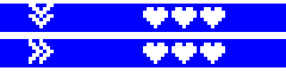
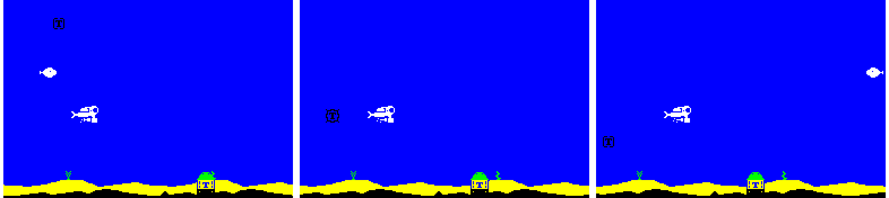
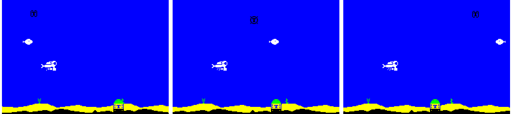
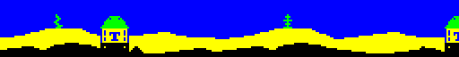

# Special bombs, and a rounder seabed

Branch `claudelet/dev`. Quartus's brief: special bombs that the diver
carries and sets off (suction and shove), a cleaner seabed, and a few
bytes moved to where they belong.

## In play

- **One held at a time.** A special bomb sinks like the heart and the
  bubble, in the missile's turn, but touching it does not set it off:
  the diver carries it, and its picture shows on row 1, left of the
  bubble's cell. Touching another replaces it.
- **B** sets it off (B for bomb; the menu lists it). The
  key is read only while he carries one.
- **Suction** (from level 5) pulls the bomb and the fish down to the
  seabed, 6 pixels a 1/50 second, to the lowest height whose swing
  still stays above the weed, and each blows up when it gets there. If
  he is low himself, he can pull them onto himself.
- **Shove** (from level 7) throws them to the right, 8 pixels a 1/50
  second, and each blows up at the right edge.
- **Half a second** at most: whatever has not got there by then blows
  up where it is.
- **Either one** blows up a silo missile at once, armed or flying, and
  a hunting bomb stops hunting. Each enemy scores what a torpedo would
  on that level (a piranha twice a fish). The border flashes and the
  missile's whoosh plays (a missile's bang replaces it).
- **How often:** each has its own share of the roll when a missile
  ends, 8 in 256 (about one turn in 32), and its own first level.

Suction, then 0.1 and 0.3 seconds later: the bomb is pulled down
(these pictures were taken before it blew up at the bottom).

Shove: the bomb and the fish are thrown to the right edge.

The knobs are in `config.asm`: `CFG_SUCTION_LEVEL` (5),
`CFG_SHOVE_LEVEL` (7), `CFG_SUCTION_ODDS` and `CFG_SHOVE_ODDS` (8 each),
`CFG_SPECIAL_TIME` (24 1/50 seconds), `CFG_SUCTION_SPEED` (6) and
`CFG_SHOVE_SPEED` (8).

## How it costs so little (`special.asm`)

- **Nothing held, nothing moving: nothing.** While he carries one,
  main_loop's `call chords_poll` is patched to `sp_poll`, which runs the
  chords and then reads B: about 60 T-states a step. When
  he sets it off, the call goes back.
- **While it moves things**, main_loop's two `missile_update` calls go
  through `sp_tick`, the way the double shot's clock goes through
  `double_tick`. One routine, `msl_calls_set`, now decides what those
  two calls are, for both. `sp_tick` moves the bomb's middle or its x,
  and asks for the whole bomb to be repainted (`wheel_odd`), as a
  wave's jump does. For the fish it moves the middle of its wave (the
  operand of `fish_wave`, put back for each new fish and each level) or
  its x. A straight fish's height and its three hit tests are written
  by one routine, `fish_set_y`, that `fish_wave` and `level_style` now
  share.
- **The pictures** are row 1's cells, in the UDG area. The sinking
  power-ups' masked pictures (the heart's and the bubble's too) are now
  built from them at start-up (`power_build`) into 80 bytes after the
  seabed's slope tables, so they are no longer stored twice.

**Timing.** Level 9 on the seabed, the heaviest case (spare scanlines,
late steps, interrupts, 512 steps), with the effect held on for the
whole measurement:

| | Spare | Late | Interrupts |
|---|---|---|---|
| no special | 3 | 0 | 512 |
| suction all the time | 0 | 3 | 512 |
| shove all the time | 1 | 0 | 512 |

No interrupt is missed; in play the effect lasts half a second.

## A cleaner seabed

- **Rounded tops.** The ground's and the sand's columns now run from
  one height to the next on an S-curve (smoothstep), not a straight
  line. It is flat at both ends, so where a rise meets a fall the top
  is rounded, and a step becomes a smooth bank. Only the start-up
  builder changed (`slope_build`, 11 bytes more and a 9-byte curve
  table, in the cold block): the frame copies the same tables as before.
  The curve stays between the two heights, as the line did, so the
  diver's terrain clamp is unchanged.
- **A fourth seaweed,** a forked sea grass, in the UDG area. The four
  plants are now equally likely, which made the picker 5 bytes shorter.

## Tidying

- `cheat_poll` (the menu's testers' switch) moved to the cold block: 48
  bytes out of the hot code.
- The UDG block now starts 16 bytes lower, at `$FF48`: the ROM's 168
  bytes were full. The 71 bytes from `$FF01` are still free.

## Bytes

| Feature | Hot code | Cold block | UDG | Built at start-up |
|---|---|---|---|---|
| carrying and setting off (key, tick, roll, row 1, the calls) | 56, and 2 a kind in the roll | 127 | | |
| suction | 53 | | 8 | |
| shove | 39 | | 8 | |
| the menu's key line | | 32 | | |
| the sinking pictures, built not stored | -36 | 17 | | 80 at `$FC80` |
| rounded seabed | | 20 | | |
| fourth seaweed | -5 | | 8 | |
| `cheat_poll` moved | -48 | 48 | | |

| | Before (main) | After |
|---|---|---|
| hot code | `code_end` `$B8AB`, 117 free | `$B8EB` (+64), 53 free below the round fish |
| data | `data_end` `$CD6B` | `$CD6B` |
| cold block | `cold_end` `$7153` | `$726A` (+279) |
| UDG area | `$FF58-$FFEF` (152) | `$FF48-$FFFF` (184) |
| tape block 1 | `$7200-$7E77` | `$7300-$7F91` (110 bytes below `$8000`) |
| packed game | `$CE00-$F9F2` | `$CE00-$FB0A` (1,086 below the UDG block) |
| tape | 14,579 bytes | 14,885 bytes |

## Checks

- **Levels 1 and 2 timing**, the same as main in all twelve cases (spare
  lines, late steps in brackets):

  | | Seabed | + fire | + missile | Burst | Open water | At 25 |
  |---|---|---|---|---|---|---|
  | level 1 | 8 | 1 | 5 | 0 (1) | 9 | 47 |
  | level 2 | 8 | 1 | 5 | 0 (2) | 9 | 47 |

- **The soak:** green at 50 and 25, with the new seaweed and the curved
  slopes.
- **The level codes:** byte-identical to main's.
- **Engine Demo 1:** byte-identical.
- **Every build assembles:** the tape, `STATS`, the soak, the measures,
  `TIMING_BARS`, `SHOT_FRAME`, `SLACK_LINES`, `NO_SOUND`.
- **Both tapes** load in Fuse to the menu, which shows the title from
  the UDG block and the new key line.
- **In Fuse,** on scratch copies with the diver made unhittable: a
  special bomb sank onto him and showed on row 1; B set it
  off and cleared row 1's cell; suction pulled the bomb down and
  shove threw the bomb and the fish to the right edge, with no cells
  left in the bomb's colour.

## They destroy what they move

Quartus's next brief: suction and shove blow up what they move, and it
scores.

- **Where.** Suction: the bomb when its middle reaches the lowest the
  pull takes it, the fish when its middle does. Shove: the bomb when its
  right edge reaches the screen's, the fish at its own right limit.
  Whatever is left when the half second runs out blows up then. A
  missile, armed in its hatch or flying, blows up as B is pressed. A
  power-up in the missile's place is left alone.
- **How.** As a torpedo kills them, with the game's one burst at a
  time: the bomb gets the burst, and the fish flashes yellow and red if
  a burst is up or the bomb is still there, else it gets the burst. A
  bomb that gets there while a missile's burst is up waits for it to
  end. No new bomb or fish can come and be blown up by the same special
  bomb: the bomb's pause (48 1/50 seconds, asserted) and a dead fish's
  flash and pause are longer than the effect.
- **Points.** The level's own, as a torpedo scores them, and they count
  towards the level's target.
- **Code.** The moving stays in `sp_tick` (hot, it runs every 1/50
  second of the effect); it now skips a bomb that has gone, and calls
  the cold routines once, when something gets there: `sp_bomb_down`
  (waits for a burst), `sp_fish_kill_on`, and `sp_end` on the last tick.
  The missile is blown up in `special_fire` (cold).

**Bytes.**

| | Before | After |
|---|---|---|
| hot code | `code_end` `$B8EB`, 53 free | `$B917` (+44), 9 free below the round fish |
| cold block | `cold_end` `$7255` | `$72AB` (+86), 85 left before the tape's first block would move past `$8000` |
| packed game | `$CE00-$FB04` | `$CE00-$FB5C` (1,004 below the UDG block) |
| tape | 14,885 bytes | 14,973 bytes |

**Timing.** Diver on the seabed, a missile always armed or flying, and
a scratch copy that sets off suction and shove in turn every 40 steps
(512 steps; the diver made unhittable). Spare scanlines, late steps,
interrupts. "Before" is main with the same script, where nothing blew
up:

| | Nothing set off | Before | After |
|---|---|---|---|
| level 1 | 4, 0, 512 | 0, 1, 512 | 0, 8, 512 |
| level 3 (spinning wheel) | 0, 1, 512 | 0, 1, 512 | 0, 6, 512 |
| level 4 (hunter) | 2, 0, 512 | 0, 2, 512 | 0, 12, 512 |
| level 9 | 2, 0, 512 | 0, 7, 512 | 0, 17, 512 |
| level 1 at 25 | 45, 0, 1,024 | 34, 0, 1,024 | 22, 0, 1,024 |
| level 9 at 25 | | 37, 0, 1,024 | 26, 0, 1,024 |

No interrupt is missed at either speed: the late steps overrun by a
little and catch up. Most of them are the bursts on the heavy seabed
frame (the same script with the bursts taken out: level 1 1 late,
level 4 6), with a fish's flash on top of the bomb's burst; a burst
alone (`MEAS_BOOM` on main) gives 1 to 4.

**Checks.**

- **Levels 1 and 2 timing:** the soak and the measurement builds
  (seabed, level 2) are byte-identical to main's, since power-ups are
  left out of them.
- **The soak:** green at 50 and 25.
- **In Fuse,** on a scratch copy firing every 40 steps: shove threw the
  fish and the bomb to the right edge, where they flashed and burst;
  suction pulled them down and they blew up near the seabed; a missile
  in its hatch burst as the bomb went off; the score went up 10, 1 and
  2 (level 1).
