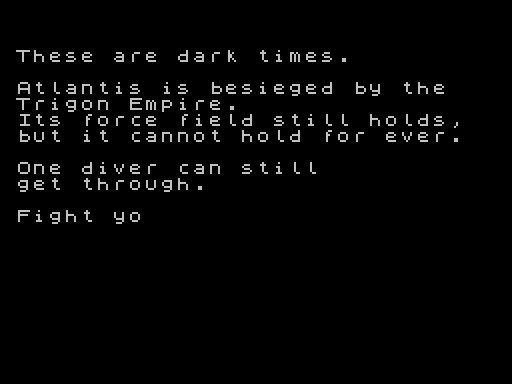

# The story, the lives top-up, and the special bombs' flash

Quartus's brief after the big squeeze (whose memory work is in
[MEMORY.md](MEMORY.md)): a story typed out as a game starts, the lives
topped up at each new level, and a flash and a sound of their own for
the special bombs.

## The story

- **When 1 starts a game,** between the menu and the game, on a black
  screen in the ROM's font, 30 columns with a column free each side.
  (The brief had it once as the game loads; Dalix moved it here, so it
  is told as each game begins.) A game started with a level code goes
  straight in.
- **Typed letter by letter,** a letter every 3/50 second with a short
  speaker click (spaces are silent), a pause of 0.8 seconds at each
  paragraph, then five seconds or a key, and the game.
- **Any key skips it,** straight into the game. The 1 that started it
  must be let go first, and the skipping key is let go before the game
  reads its keys.
- **The knobs** are in `config.asm`: `CFG_STORY_CHAR`, `CFG_STORY_PARA`,
  `CFG_STORY_END` (in 1/50 seconds) and `CFG_STORY_CLICK` (the click's
  length).
- **Where:** `story.asm`, code and words in the cold block (459
  bytes, with the menu's branch to it). It is built only where start-up
  goes to the menu (`TYPEWRITER`), so the soak and the measurements are
  as they were.

The words are Quartus's, broken by hand at sentences where they fit:

    These are dark times.

    Atlantis is besieged by the
    Trigon Empire.
    Its force field still holds,
    but it cannot hold for ever.

    One diver can still
    get through.

    Fight your way through the
    waters of Atlantis.
    Find the neutron bomb.
    Carry it to Trigon and destroy
    the Empire's power source.

    Atlantis is counting on you.

## Lives at a new level

Each new level brings the diver back up to three lives if he has fewer
(`CFG_LEVEL_LIVES`; 0 turns it off, and it may not be more than row 1
has hearts for). It is in `level_up`, which only a real level change
calls: a death takes its life in `death.asm`, and a start from a level
code climbs with `level_advance`, so neither tops up. The hearts on
row 1 are marked for drawing, so they show it on the next step, with
the "LEVEL n" banner. 15 bytes, in the cold block.

## The loading screen, a little longer

The web page plays the snapshot, not the tape (JSSpeccy can't load our
tape instantly, [WEB.md](WEB.md)), and the snapshot starts with the
loading screen in screen memory. Start-up used to clear it for the menu
after half a second. Now boot holds it for `CFG_SCREEN_PAUSE` (100, two
seconds) more before the menu, and any key ends it sooner
(`screen_pause`, story.asm, 16 cold bytes; 0 leaves it out). Quartus's
idea was a pause in the tape's unpacker, after it unpacks the screen,
but the web page never runs the unpacker; start-up is what both the
tape and the snapshot run. On a tape the screen has already been up for
the whole load, so there it is two seconds more. Only where start-up
goes to the menu (`TYPEWRITER`): the soak and the measurements are as
they were.

## The special bombs' flash and sound

Setting one off now flashes the border in the bomb's colour and black,
two steps each, for 24 steps (twice a chord's flash): cyan for suction,
yellow for shove (`CFG_SPECIAL_FLASH`, `CFG_SUCTION_INK`,
`CFG_SHOVE_INK`). Each plays its own slide instead of the whoosh:
suction falls from about 1,300 Hz to 260 Hz over the half second of the
pull, and shove rises the other way and holds its top note. A thrown
missile's bang still cuts the slide short.

The flash is the heartbeat's own: setting one off writes its colour into
the operand of the `ld a,WHITE` there (`step_skip.flash_ink`), and the
chords write white back when they flash, so nothing more runs each
step. The slides are tunes, played in the spare time like the level
jingle.

## Bytes and room

| | After the big squeeze | Story | Lives | Flash and sound | Left |
|---|---|---|---|---|---|
| hot code | 736 free | | | 51 | **685** |
| cold block | 1,018 free | 459 | 15 | 39 | **505** |
| packed game (below `$FF48`) | 2,134 | | | | **1,715** |
| tape | 14,943 bytes | | | | 15,362 bytes |

The story's text is most of its bytes (313; the code is 132); the slides are 46
of the hot bytes, and could go to the data block if the hot code ever
needs them.

## Checks

- **Timing:** six measurement cases (the seabed, fire, missile, level 4,
  the double shot, the seabed at 25) give the same figures as main.
- **The soak:** green at 50 and 25.
- **`make unpack-check`:** the sums match the files; the game unpacks in
  34 frames.
- **In Fuse:** the menu comes up straight after loading; 1 types the
  story out, with a pause at each paragraph, and the game starts after
  it; Space part way goes straight into the game, and the 1 that
  started it does not skip it. Recorded, the clicks come every 60 ms. A
  scratch copy that starts with one life and scores fast shows one
  heart, then three on the frame "LEVEL 2" comes up. A scratch copy
  setting off the bombs in turn shows the yellow flash, and its sound
  slides down for suction (1,260, 1,050, 938, 848, 774, 639 Hz measured)
  and up for shove.
- **Engine Demo 1** is byte-identical, and every build assembles.
