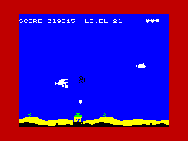
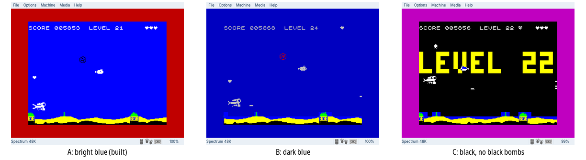

# Trigon, step 1

After the city interlude, the game goes on into Trigon. Until Trigon
has levels of its own, it carries on at the last level's settings, but
it already looks like somewhere else: Erin's enemies, and a darker set
of colours.

## Erin's sprites

Erin drew Trigon's enemies (`gfx/trigon/`): a piranha with a snapping
jaw, an armoured angler with a flashing lure in place of the round fish,
the pulsar as a Trigon T between a burst and a ring, a bladed spinning
wheel, and an angular missile with a flickering exhaust. Each is the
same size, frames and facings as the Atlantis one it replaces, so it
uses the same buffers, tables and drawing code.

- **Kept unshifted.** The four that `preshift` shifts at start-up are
  kept as raw art in the data block (576 bytes), beside the Atlantis
  set. The missile, which is shifted when the game is built, is kept
  whole (416 bytes).
- **Swapped at the city.** While the picture is up, the enemies' shifted
  copies are made again from Erin's art, into the same buffers
  (`preshift_list` with `trigon_jobs`), and the missile's pictures are
  exchanged with hers, byte for byte. Going back to the menu does both
  again with the Atlantis art, so a new game, the demo and the city on
  the menu are always Atlantis.
- **The city's colours** wait in the spinning wheel's shifted copies
  while the circle grows, since those are made again straight after.

## Trigon's colours

One flag, `trigon_on`, set at the city and cleared at the menu, gives
each new level Trigon's colours over the level's own (`src/trigon/theme.asm`,
`CFG_TRIGON_*` in `config.asm`):

- **The border** is a steady dark colour, blue, red, magenta and black in
  turn, so two levels in a row never share one.
- **The bombs** are black, red or magenta.
- **The death flash** is white and black, not red: red would hardly
  show against a red or black border. The new level's flash (white) and
  the special bombs' (cyan, yellow) show against them all.
- **The diver stays white.**
- **The fish and the missiles in colour.** On the Spectrum a sprite has
  no colour of its own: it takes its cells'. So in Trigon, each step,
  `trigon_paint` paints the fish's cells (three by two) cyan for the
  angler or red for the piranha, and a missile's black while it flies up
  through the water (not in its hatch, and not a power-up), and puts the
  water colour back on last step's cells. It runs in the fish's draw
  place, switched in at the city and out at the menu, so Atlantis does
  not pay for it. Anything else in a painted cell takes its colour for a
  moment: the Spectrum's colour clash. Nothing is painted while the
  "LEVEL n" banner is up. `CFG_TRIGON_ANGLER`, `_PIRANHA`, `_MISSILE`.

**The sea.** Black ink on a black sea would vanish, so three seas were
tried (`images/trigon-seas.png`):

- **A, the bright blue it has now** (built): every bomb colour shows.
- **B, a dark blue:** the white turns grey, and a blue border runs into
  the sea.
- **C, black:** the most dramatic, with red and magenta bombs only; the
  weed row's cells would need their paper changed to match.

B or C would mean making the water's colour, now a fixed value used in
26 places, something that can change while the game runs.

## Timing: two bombs and a fish

Measured on the heavy seabed frame (the diver on the seabed), with the
current graphics, in spare scanlines (the least in any of 512 steps):

| | 50 frames a second | 25 (the picture frame) |
|---|---|---|
| no bomb | 47 | 88 |
| one bomb, as now | 8 | 47 |
| one spinning wheel | 9 | 47 |
| two bombs (each costs what one does) | about -31 | about 6 |

A bomb costs about 39 to 41 scanlines in its worst frames, when it
repaints its colours. At 50 a second bomb would push those frames about
31 scanlines past the interrupt: those steps would be late and the game
would slow for a moment, and the seabed copy, which must finish ahead
of the beam, would be pushed into it, so the seabed could tear. At 25
two bombs fit, with about 6 scanlines to spare. Nothing was changed in
the game for this.

The fish's and the missile's colours, measured the same way (one bomb,
the heavy seabed frame): without them 9 spare scanlines at 50 and 44
at 25; with them 1 and 40, and no late step. They fit, but they use
nearly all of the room left at 50, so a second bomb would have to come
with a move to 25 frames a second.
