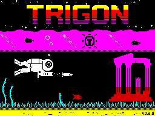
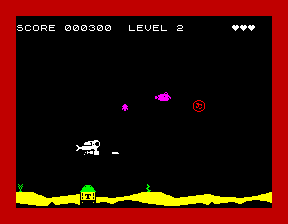
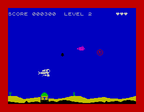

# Trigon

Trigon is the second game. Atlantis ends at the city: its last screen
gives the player a code and tells them to load Trigon, and Trigon's menu
asks for that code before level 1. It has its own tape and snapshot
(`build/trigon.tap`, `build/trigon.sna`) and its own web page, at
[play/trigon/](play/trigon/).

## One game, built twice

Trigon is the Atlantis game assembled with `TRIGON` defined
(`src/trigon/main.asm`), not a copy of it. The frame loop, the sprites,
the scroll, the sound, the pre-shifting and the 2-pixel diver all come
from the same files. What Trigon changes sits under `IFDEF TRIGON`, with
Atlantis's own code in the other half, so Atlantis assembles to the same
bytes as before:

- **Its numbers:** `src/trigon/config.asm`, in place of Atlantis's: the
  levels, the colours, and the sea.
- **Its art:** Erin's sprites (`gfx/trigon/`): a piranha with a snapping
  jaw, an armoured angler with a flashing lure, the pulsar as a Trigon T
  between a burst and a ring, a bladed spinning wheel, and an angular
  missile. Each is the same size, frames and facings as the Atlantis one
  it stands in for, and `tools/gfx2raw.py` writes it under the same
  names, so the same draws, buffers and tables take it. The diver and
  the torpedo are Atlantis's.
- **Its menu:** TRIGON in the tall letters (R, G and O drawn to match
  the Atlantis ones), and the code first (below).
- **Its words:** the story typed before level 1, and the keys its level
  codes are made with, so no Atlantis code opens a Trigon level.
- **Its loading screen:** `tools/mkloadscreen.py --trigon` draws the
  Atlantis scene again in Trigon's dark colours, with Erin's sprites,
  TRIGON for the title, and its own version (`src/trigon/VERSION`).
- **No city:** Trigon has no interlude.

`make trigon` builds it, `make run-trigon` loads its tape in Fuse, and
`make` builds both games. Its packed tape is `src/atlantis/tape.asm`
assembled with `-DTRIGON`; `make unpack-check-trigon` proves it as
`make unpack-check` does Atlantis's.

## The code

Trigon's menu has no "Start game". Option 1 asks for six letters:

- **The Trigon code**, from the Atlantis ending, starts level 1, with
  the story first.
- **A Trigon level code** (shown on the banners, as in Atlantis) starts
  that level.
- **Anything else** buzzes, says BAD CODE, and asks again. Space gives
  up.

The attract demo still plays level 1 by itself. The testers' switch on
the menu works as it does in Atlantis.

## Colours

Trigon's sea is **black**, which sets it apart from Atlantis at once.
Its borders keep the dark colours Atlantis left for it, and everything
on the water is bright:

- **Borders:** blue, red and magenta for its three levels; black is
  kept for the next.
- **Bombs:** the dark set, from the level table: a magenta pulsar
  (black ink would vanish on the black sea), then a red and a magenta
  spinning wheel.
- **Fish and missiles:** a splash of colour against them: a cyan
  angler, a yellow piranha, and bright blue missiles. A sprite has no
  colour of its own on the Spectrum, so `trigon_paint`
  (`src/trigon/theme.asm`) paints the fish's cells and a flying
  missile's, and gives the cells they leave back to the water. The
  bomb's cells are left alone, so where they meet the bomb keeps its
  colour. Another sprite in a painted cell takes its colour for a
  moment: the Spectrum's colour clash.
- **The seabed:** Erin's ominous plants in red, with the silo domes in
  their row (`CFG_WEED_INK`; Atlantis keeps its own, green), the yellow
  sand, and the ground under it black on yellow (`CFG_GROUND_ATTR`). A red
  ground was tried and dropped: the yellow has more impact with the red
  weed.
- **The diver stays white.**
- **The flashes still show:** a death flashes white and black
  (`CFG_HIT_INK`; red would vanish against a red border), a new level
  white and black, and a special bomb cyan or yellow.

## The sea is one setting

`CFG_SEA` in `src/trigon/config.asm`: every colour on the water is an
ink on its paper (`SEA`, `layout.asm`). Black is the game's; the dark
blue that was tried beside it is still there to compare, with the
first plan's colours (black, red and magenta fish and missiles, and
everything dimmer, as the bright bit belongs to the whole cell).
`make trigon-seas` builds both:

| Black (`CFG_SEA equ BLACK`), the game's | Dark blue (`CFG_SEA equ BLUE`) |
|---|---|
|  |  |
| `build/trigon-sea-black.sna` | `build/trigon-sea-dark.sna` |

## The first three levels

Each is a step on from the end of Atlantis, from the movements it
already has:

| Level | Bomb | Moves | Fish | Border |
|---|---|---|---|---|
| 1 | the pulsar | on a wave | the angler, on a wave | blue |
| 2 | the spinning wheel | hunting the diver | from here, one in four a piranha | red |
| 3 | the spinning wheel | hunting harder, the missiles home in | on a wave, faster | magenta |

They score as Atlantis does. Hearts come from level 1, the double shot
and suction from level 2, shove from level 3. After level 3, level 3
repeats.

## Two bombs (0.2.0)

A wave is a bomb and a fish, or **two bombs of the same type**: each
time a new fish is due, the level's share decides whether a second bomb
comes instead, and the fish waits until it has gone. The second bomb has
its own colour and movement, so the two cross differently
(`TB_TABLE`, `src/trigon/config.asm`):

| Level | Two-bomb waves | First bomb (the level's) | Second bomb |
|---|---|---|---|
| 1 | 1 in 4 | magenta pulsar, on a wave | red pulsar, bobbing straight |
| 2 | about 3 in 8 | red spinning wheel, hunting | magenta wheel, on a wave |
| 3 | 1 in 2 | magenta wheel, hunting harder | red wheel, on a wave |

The fish swims back and forth until it is shot, so a two-bomb wave comes
after the player shoots the fish.

**How:** the second bomb is the first one's code assembled a second
time (`src/trigon/twobomb.asm`): `wheel.asm` and the bomb's movers in
`level.asm`, inside `MODULE b2`, with its own state, background record
and colour, placed in the data block. Shots, the diver's touch, the
special bombs (suction pulls it down, shove throws it and blows it up)
and the fish's and missile's colours all treat it as
they treat the first. A second bomb of another type, and enemy divers in
place of bombs, come later.

**At 25 or at 50: menu option 3.** Two bombs do not fit in a 50 frames
a second step (below). Option 3 on Trigon's menu picks:

- **"Two bombs at 25 a second"** (the default): while a second bomb is
  out the game drops to 25 frames a second, and goes back to 50 when it
  has gone. The change is made at the start of a step, as Symbol Shift +
  F makes it. Real speeds stay the same; the motion is coarser.
- **"Two bombs at 50 a second"**: the speed stays. No frame is lost, but
  many steps run late (the table below), so sprites near the top can
  flicker.

**One set of bomb copies.** The pulsar and the spinning wheel share one
room for their shifted copies (`SHARED_BOMB`): the spinning wheel's, at
$78E0. The first bomb of the other kind has them made again from its
art (`bomb_art`), about 4.5 television frames for the spinning wheel,
once when a level brings the new kind; a second bomb out at that moment
takes the new pictures too. That frees the pulsar's own 912 bytes, below
the scroll buffers: the fish's and the diver's copies move up into
them, and the data block gains them. Less the rebuild's code (52 bytes),
Trigon gains 866 bytes (860 data, 6 cold).

## Timing

Measured on the heavy seabed frame (the diver on the seabed), the least
spare scanlines in 512 steps at 50 frames a second, and the steps that
started late and caught up:

| Build | Spare | Late steps | Interrupts |
|---|---|---|---|
| Atlantis, level 1 | 8 | 0 | 512 |
| Atlantis, level 3 | 1 | 0 | 512 |
| Atlantis, level 3, a missile always up | 1 | 1 | 512 |
| Trigon, level 1 | 0 | 1 (was 3) | 512 |
| Trigon, level 2 | 2 | 0 (was 6) | 512 |
| Trigon, level 3 | 0 | 6 (was 20) | 512 |
| Trigon, level 3, a missile always up | 0 | 11 (was 24) | 512 |

512 interrupts for 512 steps: no frame is lost. The fish's and the
missile's colours cost about 8 scanlines when they were painted every
step, all the room the heavy frame had. Now the paint saves itself
the work:

- **Nothing changed, nothing painted.** It works out the cells first
  (the fish's and its colour, the missile's, and the bomb's box), about
  3 scanlines, and if they are last step's, the cells are already right.
  The fish crosses a cell in 8 steps and a missile in 4, so most steps
  stop there.
- **Otherwise,** last step's cells are given back to the water and this
  step's painted, as before. (Repainting only the fish or only the
  missile, when only one moved, was tried: it measured the same and cost
  285 bytes more.)
- **Never on the heaviest step.** At 50, every other step also rotates
  the slow sand-and-weed buffer; the paint skips that step altogether,
  and a change waits for the next one. So a cell can show the water's
  colour for a 1/50 second. At 25 there is time on every picture frame.
- **A safety net:** after the banner, and twice in every 32 1/50
  seconds, it paints both whatever.

**Two bombs**, measured the same way with the second bomb always out
and no fish (`-DMEAS_TWO`), against one bomb and the fish:

| | One bomb and the fish, 50 | Two bombs, 50 | Two bombs, 25 (picture frame) |
|---|---|---|---|
| Level 1 | 0 spare, 1 late | 0 spare, 66 late | 17 spare, 0 late |
| Level 2 | 0 spare, 3 late | 0 spare, 125 late | 17 spare, 0 late |
| Level 3 | 0 spare, 20 late | 0 spare, 157 late | |
| Level 3, a missile always up | | 0 spare, 217 late | 13 spare, 0 late |

No frame is lost in any of them (512 interrupts at 50, 1,024 at 25), but
the fish's time does not cover a second bomb at 50: a bomb's draw, its
colours and its movement cost more than the fish's. Where its pictures
live makes little difference (two pulsars from fast RAM measured 131
late steps against two spinning wheels' 142 from contended RAM). At 25
two bombs fit with 13 to 17 scanlines to spare. One bomb and the fish
on level 3 went from 6 late steps to 20 with the second bomb's checks in
the paint and the hit tests.

## Room

Trigon has the whole 48K to itself, laid out as Atlantis is
(`docs/MEMORY.md`). Without the city it has more of it free:

| Free bytes | Atlantis | Trigon |
|---|---|---|
| Hot code (to `RFISH_BUF`) | 628 | 754 |
| Cold block (to the unpacker) | 43 | 155 |
| Data (to `PRESHIFT_START`) | 1,153 | 1,713 |
| Tape room (below the packed game) | 985 | 1,666 |
| The tape | 18,560 bytes | 17,917 bytes |

Trigon 0.2.0's second bomb takes about 2,040 bytes of the data block
(the bomb code again), 164 of hot code (the main loop's calls, the
paint's and the hits' checks) and 19 of the cold block; the shared bomb
copies give back 866.

## An enemy diver (an experiment)

A Trigon diver who swims at the player, sketched to see what one costs
before anything is built round him: `src/trigon/ediver.asm`, only with
`-DENEMY_DIVER` (`make trigon-ediver` writes `build/trigon-ediver.sna`;
the tape and the web page do not have him).

- **Cheap on purpose.** One frame and one facing (ours has three frames
  and two facings), drawn at even x only like ours, so four shifted
  copies. The art is a placeholder, our diver's first frame turned to
  face left (`gfx/trigon/ediver.txt`), until Erin draws him.
- **What he does.** He comes in from the right edge, swims left a pixel
  each 1/50 second, and drifts towards the player's depth every other
  one, above the weed. Off the left edge, he comes again after a pause.
  He is drawn and restored as the fish is, with the same fast walker,
  clipped at the edges as the bomb is. He hits nothing, and torpedoes
  pass through him: that is the next step, if these numbers allow it.

**Memory:** 833 bytes in all: 171 of hot code (his move, draw and
restore, and the main loop's three calls), 99 in the cold block (his art
and its pre-shift job), 18 of data (pointer tables), a 65-byte
background record, and 480 bytes of shifted copies, below our diver's.
Trigon has the room for all of it.

**Frame time,** measured as above (the heavy seabed frame, 512 steps):

| | Spare | Late steps | Interrupts |
|---|---|---|---|
| Trigon, no bomb | 37 | 0 | 512 |
| the enemy diver **in place of** the bomb, at 50 | 0 | 20 | 512 |
| the enemy diver **and** the bomb, at 50 | 0 | 459 | 531 |
| Trigon, one bomb, at 25 (picture frame) | 38 | 0 | 1,024 |
| the enemy diver and the bomb, at 25 | 0 | 8 | 1,032 |

He costs about what a bomb does (a bomb is 39 to 41 scanlines at worst):
he is 24 pixels wide, so 4 bytes a row over 15 rows, to save, restore
and draw. So:

- **In place of the bomb, at 50, he fits,** like Trigon's level 3 now:
  no frame lost, a few steps late that catch up. A section of a level
  where the bombs stop and a diver comes for the player is the shape
  that fits.
- **With the bomb, at 50, he does not:** 19 frames lost in 512 steps.
- **With the bomb, at 25, he nearly does:** 8 frames lost in 1,024.
  A narrower diver (16 pixels: 3 bytes a row), fewer rows, or leaving
  out the fish's colours while he is up could make the room.

## Checks

- **Atlantis is unchanged** apart from its ending: its tape, snapshot
  and every test build assemble to the same bytes with Trigon's
  switches in, and Engine Demo 1 is byte-identical.
- **The soak** (`make trigon-soak`) passes at 50 and at 25 with Erin's
  art and Trigon's colours. It plays Atlantis's level 1, which its frame
  numbers need, in Trigon's colours (`config.asm` puts that row first
  for the soak), and allows the fish's colour on row 0, where its script
  takes the fish.
- **`make unpack-check-trigon`:** the sums of the unpacked screen, cold
  block, code, data and UDG block match the files.
