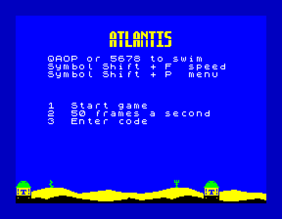
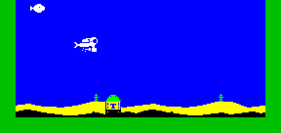

# The UDG area, the title, the seabed, and staged features

Branch `claudelet/dev`. Quartus's brief: use the ROM's UDG area, a tall
title, seaweed variety, staged power-ups and piranhas, and smoother land.

## 1. The UDG area ($FF58-$FFFF)

**Nothing used it.** The game calls no ROM routine and prints no UDG.
Above the stack (which grows down from `STACK_TOP`, `$FDFC`) the only
thing is the IM2 vector table, `$FE00-$FF00`. So `$FF01-$FFFF` was free,
and the 168 bytes of the ROM's UDGs are the top of it. `main.asm` now
asserts that the block starts at `$FF58`, ends by `$FFFF`, clears the
IM2 table, and that the stack's top is below both.

**What went up there** (`src/atlantis/udg.asm`, 152 of the 168 bytes):

| | Bytes | From |
|---|---|---|
| the title's letters (A T L N I S, 8 by 16) | 96 | new |
| the seaweed: fir, kelp, fan coral | 24 | the fir from the code block (8), two new |
| the rock on the ground | 8 | the code block |
| the hearts on row 1, and an empty cell | 16 | the data block |
| the double shot's bubble beside the hearts | 8 | the code block |

All are copied a cell at a time on a character boundary. The power-ups'
heart and bubble stay where they are: they are drawn at any pixel
height. Anything shifted stays too.

**Freed below:** 40 bytes of graphics (24 in the code block, 16 in the
data block), plus the old title string (9 bytes of data).

**How it gets there.** The tapes fill it: the packed tape's unpacker
unpacks it last, and the plain tape loads it as a fourth CODE block (the
BASIC has one more `LOAD ""CODE`). The snapshot has it anyway. The packed
game must still end below `$FF58`, so the unpacker never writes over
packed bytes it has still to read.

**The packed tape.** The new code pushed the packed game (the second
tape block) past `$FF58`. The first tape block (the unpacker and the
loading screen) had 1.7 KB to spare below `$8000`, so the packed data
block and the packed UDG block now ride there: the cold block unpacks
below the first block and everything else above `$8000`, so nothing is
written over them before they are read. The packed game now ends at
`$F9EF`, 1,385 bytes below `$FF58` (it was 185).

## 2. The title

ATLANTIS in tall letters, rows 2 and 3, centred (columns 12 to 19), in
the title's yellow. Each letter is 7 pixels wide and 16 tall, square and
chunky with three-pixel strokes, and a one-pixel stencil cut runs
across every letter at the same height, for an 80s computer look. The
drawing code (`title_draw`, `menu.asm`) is in the cold block.

## 3. Seaweed

Three plants: the old fir, a wavy kelp and a fan coral. Each time a plant
goes in, `next_back_tile` picks one from its own shift register (the fir
is twice as likely as the others). That happens once per plant as the
sand scrolls in, never on the frame. Every plant's pixels stay in
columns 2 to 6 of its cell, as the fir's did, so the code that paints
the weed cells green is unchanged.

## 4. Staged features (`config.asm`)

| Setting | Value | What |
|---|---|---|
| `CFG_POWER_LEVEL` | 2 | hearts from this level |
| `CFG_DOUBLE_LEVEL` | 4 | the double shot's bubble from this level |
| `CFG_PIRANHA_LEVEL` | 4 | before this level every fish is the round one; from it, one in four is the piranha |

Each is on its own line. When a missile ends, the next turn is still
rolled once: a heart in the hearts' share (32 in 256) once hearts are
on, a bubble in the bubble's share (12 in 256) once it is on, else a
missile.

## 5. Smoother land

The ground and the sand were blocks: each 8-pixel column was its
profile height, flat on top, so a hill was a staircase. Now each
column's top slopes from its own height to the next column's, in a
straight line across its 8 pixels, to the nearest half pixel. Steps
become slopes, and peaks and dips are bevelled.

It is the tiles, not the drawing: the columns are built as they scroll
in, from two tables of 16 columns by 8 rows (ground and sand, 256 bytes)
that `slope_build` makes at start-up at `$FB80-$FC7F`, between the row
table and the stack's room. A new column copies its 8 bytes from there
instead of filling them, which costs about the same. A flat column is
byte for byte the old block. Rocks still sit on top, and silos still
replace their columns. The diver's terrain clamp still uses each
column's height; on a slope that can leave him a pixel or two above the
ground, never in it.

## Memory

| | Before (main) | After |
|---|---|---|
| hot code | `code_end` `$B804` | `$B8E2` (+222), 62 free below the round fish |
| data | `data_end` `$CDC3` | `$CDB3` (-16) |
| cold block | `cold_end` `$7169` | `$7189` (+32), 55 free |
| UDG area | unused | `$FF58-$FFEF`, 152 used, 16 free; `$FF01-$FF57` (87) still free |
| run-time | | the slope tables, `$FB80-$FC7F` (256, built at start-up) |
| packed game (tape block 2) | `$CE00-$FE9F` | `$CE00-$F9EF` |
| tape block 1 | to `$78E0` | `$7200-$7EAA` (+ the packed data and UDG block) |
| tape | 14,345 bytes | 14,627 bytes |

The hot code grew most for start-up work that the cold block had no
room for: `slope_build` (90 bytes) and `torpedo_reset`.

## Checks

- **Levels 1 and 2 timing** against main, spare lines (late steps in
  brackets):

  | | main | Now |
  |---|---|---|
  | level 1 seabed | 9 | 8 |
  | level 1 + fire | 2 | 2 |
  | level 1 + missile | 4 | 5 |
  | level 1 boom | 0 (1) | 0 (1) |
  | level 1 open water | 9 | 8 |
  | level 2 seabed | 9 | 9 |
  | level 2 + fire | 1 | 1 |
  | level 2 + missile | 5 | 5 |
  | level 2 open water | 10 | 9 |
  | at 25, levels 1 and 2 | 47 | 47 |

  The interrupts are the same in every build, with no new late steps.
  Nothing that runs every frame changed; a new column is now built
  faster than before (eight `LDI`s instead of a filling loop). The
  one-line moves, two down and one up, are the schedule-alignment drift
  CLAUDE.md describes when code moves.
- **The soak:** green at 50 and 25. (Its first run caught a fault: a
  seaweed shape that did not reach column 6 left a green cell with no
  plant in it. Every plant now reaches both edges.)
- **The level codes:** byte-identical to main's.
- **Engine Demo 1:** byte-identical.
- **Every build assembles:** the tape, `STATS`, the soak, the measures,
  `TIMING_BARS`, `SHOT_FRAME`, `SLACK_LINES`.
- **Both tapes** (`build/atlantis.tap`, `build/atlantis-plain.tap`)
  loaded in Fuse to the menu with the new title, which comes from the
  UDG block, so both fill it.
- **The staged levels and the testers' switch** were checked in Fuse.
