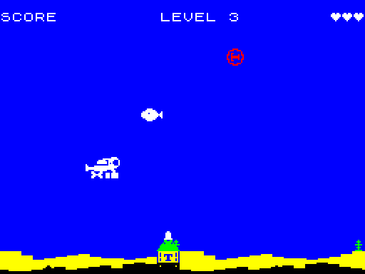

# The spinning wheel, a second kind of bomb

Branch `claudelet/dev`. Quartus's brief, item 3. Items 1, 2 and 4 are in
[LEVEL-CODES.md](LEVEL-CODES.md).

> Since the memory reorganisation ([MEMORY.md](MEMORY.md)) the pictures
> are at `$71C0-$7FFF`, and `preshift.asm` (was `wspin.asm`) builds them
> along with the fish's and the pulsar's.

## What it is

- **The art** is `gfx/wheel-full.txt`, Dalix's full wheel: a ring with a
  cross that turns all the way round. It's cut from 16 frames to 8
  (every other one) and is the same 12×12 box as the pulsar.
- **Bright red** on the blue (`CFG_SPIN_INK`), where the pulsar is black.
- **The same bomb in every other way.** It drifts, bobs and speeds up
  with the level's haste exactly as the pulsar does, and the draw,
  restore, colour, hit and torpedo code serve both. There's still only
  one bomb on screen at a time.
- **Chosen per level.** `CFG_LEVELS` has a new last column, `bomb`:
  `BOMB_P` (the pulsar) or `BOMB_W` (the wheel). Levels 1 and 2 are the
  pulsar and levels 3 to 9 the wheel, as a placeholder that's easy to
  change. An `ASSERT` keeps level 1 on the pulsar. A bomb already in
  flight when the level changes keeps its kind, and the next one is the
  new level's. A game started from a level 3 code starts with a wheel.

## How it switches

`wheel_type` (wheel.asm) runs when a bomb appears (`wheel_spawn_type`,
`wheel_reset`), never while one is on screen. It copies the bomb's five
settings from `enemy_wheel` or `enemy_spin` (data.asm), as before. It
also **patches two operands**: the draw's `ld hl,wheel_images` and the
animation's `ld hl,wheel_seq`. So the draw runs the same instructions
for both kinds, and the pulsar's frame costs exactly what it did.

## Memory

The pulsar fits in 912 bytes only because it has two different
pictures. The wheel has 8, and 8 pre-shifted copies of each come to
3,648 bytes, or 3,792 with the pointer tables. That's the brief's
"around 3.8 KB", and it fits nowhere fast:

| Area | Free before item 3 |
|---|---|
| code, `$8000-$BFFF` | 553 |
| data, `$C000-$EFFF` | 1,669 |
| `$F300-$F9FF` (soak photographs only) | 1,792 |

So:

1. **The tape carries each row once.** `tools/gfx2raw.py` writes
   `gfx/wheel_spin.asm`: 8 pictures × 12 rows × (2 mask + 2 ink bytes)
   = **384 bytes**.
2. **`wspin_build` makes the shifted copies at start-up** (wspin.asm,
   130 bytes of code and its row buffer, a sixth of a second before the menu) into
   **`$7000-$7E3F`**. Its output is byte-for-byte what gfx2asm.py would
   have written: a scratch build checksummed the buffer against
   gfx2asm's bytes for the same frames, and they matched.
3. **The pointer tables** (which picture, which shift) are worked out at
   assembly time by `WSPIN_DATA`, in the data block. They're in the
   same shape as gfx2asm's, which is why one draw serves both kinds.

I didn't go for fewer shifts, because the bomb moves a pixel at a time
and a 2-pixel step would judder. I didn't use a compiled sprite either,
since that would be several times bigger than the data.

**Why `$7000` is safe.** Nothing else uses `$6000-$7FFF`. The BASIC
loader ends far below it, its machine stack is abandoned when `entry`
sets SP, and the soak build's own code (`$6000-$67C6`) ends below
`$7000`. `ASSERT`s check both edges.

**The memory map, before and after**

| | Before the brief | After items 1, 2, 4 | After item 3 |
|---|---|---|---|
| code `$8000` to `code_end` | `$BB2D` (1,235 free) | `$BDD7` (553 free) | `$BE87` (**377 free**) |
| data `$C000` to `data_end` | `$E808` (2,040 free) | `$E97B` (1,669 free) | `$EBA1` (**1,119 free**) |
| `$6000-$6FFF` | soak build only | same | same |
| `$7000-$7E3F` | free | free | **wheel pictures**, built at start-up |
| `$7E40-$7FFF` | free | free | free (448) |

(The brief said 2,196 data bytes free. The build's own figures give
`$F000 - $E808` = 2,040.)

Item 3 costs 176 bytes of code: the builder, `wheel_type`, the two
patched operands, and `level_enter` reading the new column. It costs
550 bytes of data: the 384-byte art, 144 bytes of pointer tables, 8 of
animation order, 5 for the enemy row, and a byte per level row.

## Timing

The wheel's pictures are in **contended** RAM. While the beam draws the
picture area, the ULA can hold up each read of it by up to 6 T-states.
The draw reads 48 to 72 image bytes, so in theory it's a couple of
hundred T-states at most, and nothing when the bomb is drawn while the
beam is in the border. The code itself stays in fast RAM.

Measured with MEASURE, 512 steps. `-DMEAS_SPIN` (new) makes every bomb
the wheel, to compare against the same build without it:

| Build | Rate | Min spare lines | Late steps | Interrupts |
|---|---|---|---|---|
| last commit, pulsar, MEAS_DOWN | 50 | 9 | 0 | 512 |
| pulsar, MEAS_DOWN | 50 | 9 | 0 | 512 |
| **wheel**, MEAS_DOWN | 50 | **9** | **0** | 512 |
| pulsar, MEAS_DOWN + MEAS_FIRE | 50 | 8 | 0 | 512 |
| **wheel**, MEAS_DOWN + MEAS_FIRE | 50 | **8** | **0** | 512 |
| pulsar, MEAS_DOWN | 25 | 48 (0x30) | 0 | 1024 |
| **wheel**, MEAS_DOWN | 25 | **47** (0x2F) | **0** | 1024 |

- **At 50 the wheel costs nothing measurable.** It shows the same
  minimum, no late steps, and one interrupt per step, so it's no worse
  than the pulsar.
- **At 25 the picture frame loses one line** out of 48 spare, with no
  late frames. The idle frame is unchanged (0x63 minimum, both kinds).

**Soak:** green and OK at 50 and at 25. Level 1 is still the pulsar,
and the soak's frame numbers are unchanged.

**Engine Demo 1:** a fresh `make demo` is byte-identical to the
committed tape.

## Files

| File | What |
|---|---|
| `gfx/wheel-full.txt` | the art (unchanged, apart from its header) |
| `tools/gfx2raw.py` | new: every Nth frame, unshifted |
| `gfx/wheel_spin.asm` | generated from it, committed like the other `gfx/*.asm` |
| `src/atlantis/wspin.asm` | new: `wspin_build`, `WSPIN_DATA` |
| `src/atlantis/wheel.asm` | `wheel_type`, and the two patched operands |
| `src/atlantis/config.asm` | the `bomb` column, `CFG_SPIN_INK` |
| `src/atlantis/score.asm` | `LEVEL_ROW` takes the column; `level_bomb` |
| `src/atlantis/data.asm` | `enemy_spin` |
